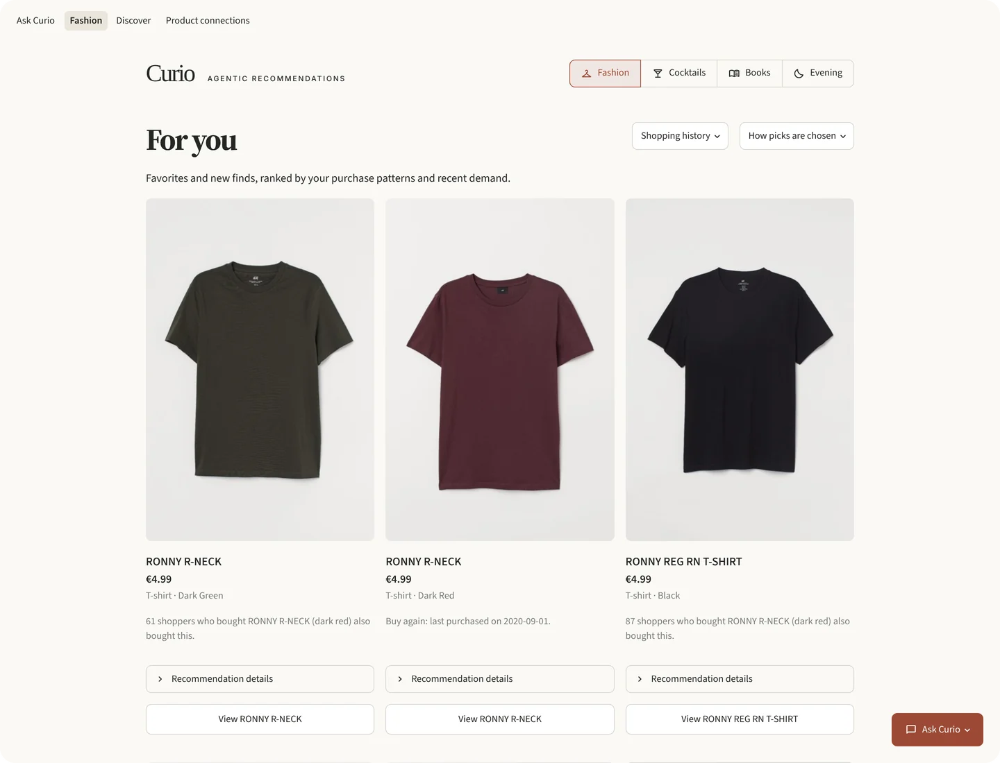
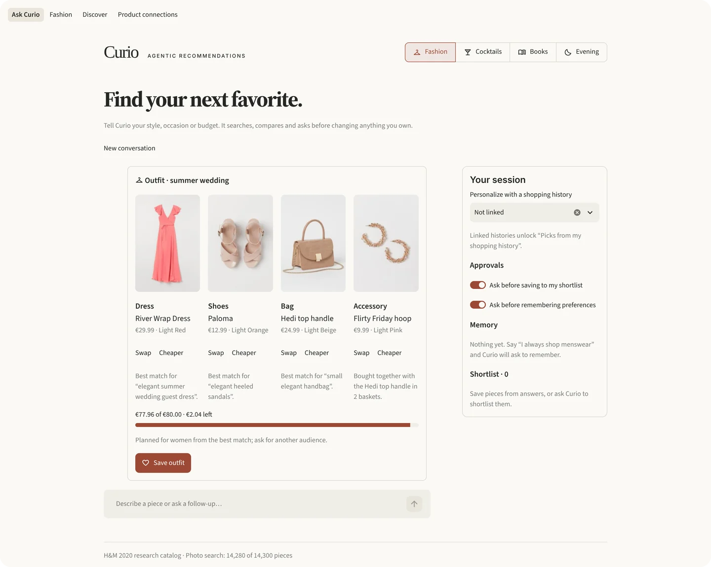
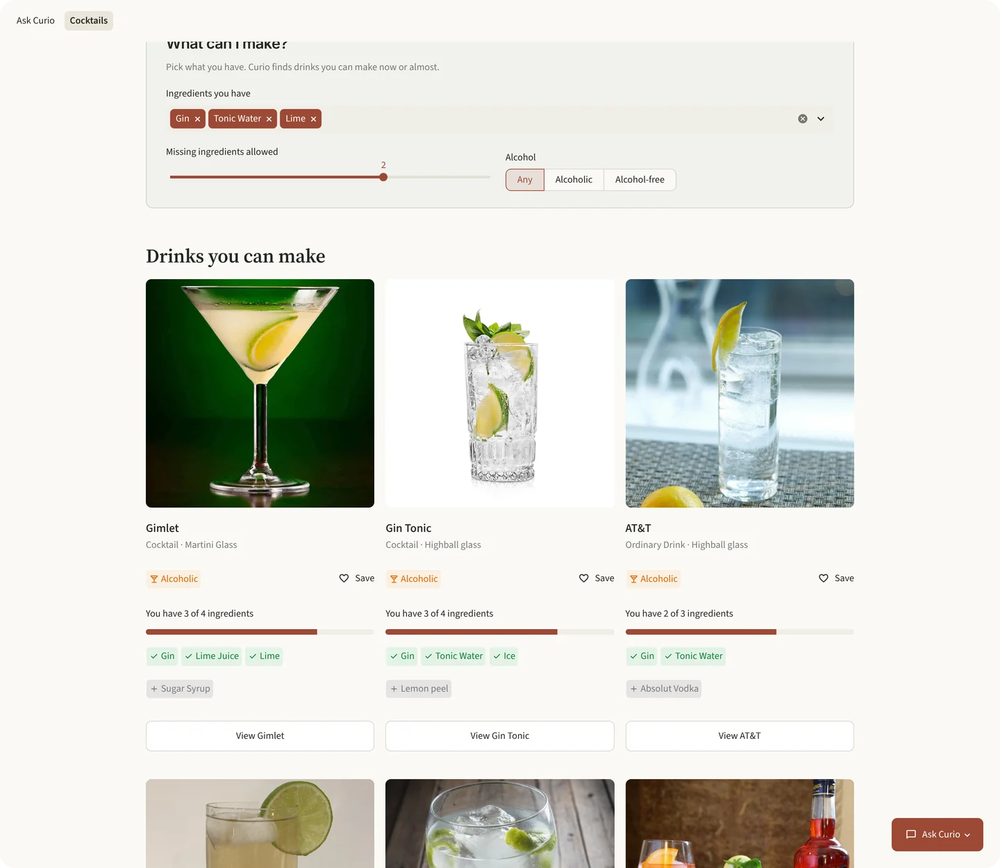
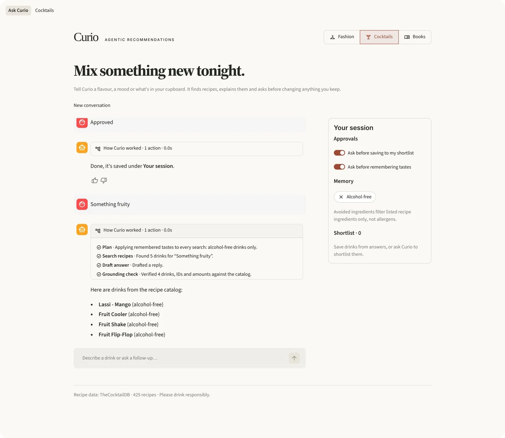
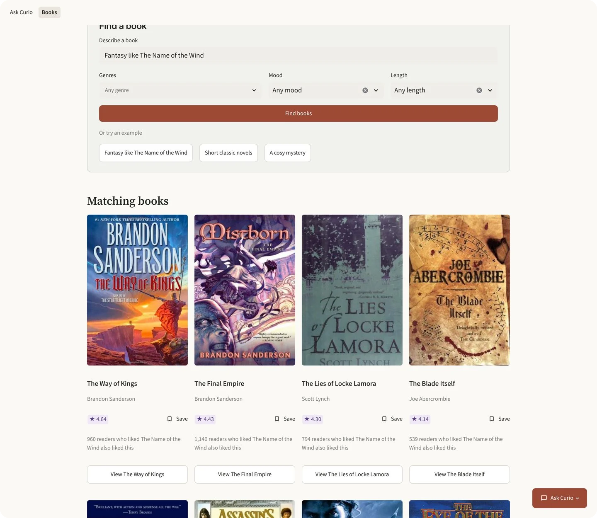

<div align="center">

# Curio

**An engine for trustworthy recommendation agents: plan, act, verify, and ask before changing
anything.**

[](https://github.com/yo1am1/curio/actions/workflows/ci.yml)
[](https://github.com/yo1am1/curio/releases/latest)
[](LICENSE)


[Why three domains](#why-three-domains) · [The engine](#the-engine) ·
[Add a domain](#add-a-domain-in-150-lines) · [Plan my evening](#plan-my-evening) ·
[Domains](#fashion) · [Quick start](#quick-start) · [Under the hood](#under-the-hood) ·
[Changelog](CHANGELOG.md)

</div>

Curio is one agent engine and three recommendation domains built on it: fashion, cocktails
and books. Each domain stresses a different recommendation problem. The engine stays the
same for all three, and the domains compose: "Plan my evening" builds an outfit, a book and a
drink paired with that book from one sentence.


Try it in one command, with no large download: `docker compose --profile demo up --build`
([quick start](#quick-start)).

## Why three domains

The domains were picked to be different from each other. The engine runs all three, and
holds no code from any of them.

| Domain | The recommendation problem | Data |
|---|---|---|
| **Fashion** | Visual retrieval with CLIP and Qdrant, purchase history, co-purchases and a learned ranker | 14,300 H&M products, 5,000 real shoppers, a photo index of 14,280 images |
| **Cocktails** | Hard constraints: what your pantry covers, missing ingredients, alcohol-free | 425 TheCocktailDB recipes, offline |
| **Books** | Item-item collaborative filtering on about 6 million ratings, with author and series caps | 10,000 goodbooks-10k titles |
| **Composed** | Book → drink pairing (books + cocktails), and Plan my evening (all three) | The catalogs above |

## The engine


- **Plan → act → verify.** `AgentEngine` runs every turn. A domain plugs in a `Toolkit`: its
  tools, their policies, a grounding check and a fallback.
- **Policy-gated tools.** A tool is READ (runs), ASK (pauses with a question) or APPROVE
  (only proposes). Proposals are HMAC-signed and bound to the tool, arguments, domain and
  time. You can approve or narrow one, never widen or replay it.
- **Grounding.** Every price, ID, rating, title and drink name in an answer is checked
  against what the tools returned. A failed check gets one self-correction, then a
  deterministic fallback built from catalog facts.
- **Budgets and streaming.** A turn allows five tool calls and 90 seconds. Every step
  streams to the UI as NDJSON, so you see what the agent did.
- **Stateless server.** The client holds the shortlist, memory and outfit. Client-held text
  is display-only and never counts as evidence.
- **Enforced layering.** `curio.engine` imports no domain. Each `curio.domains.<name>`
  imports the engine and itself. `curio.app` wires them together. A test parses every import
  to keep it that way.


Saving or remembering anything is only proposed. You approve it, untick what you don't want,
or decline.


In the chat screenshots the replies come from the scripted test model in
`tests/e2e/llm_stub.py`, because no LLM was configured. The catalog, tool results, step
trace, checks and approvals are the real system.
[How the agent works](docs/agent-architecture.md).

## Add a domain in ~150 lines

[`examples/hello_domain/teas.py`](examples/hello_domain/teas.py) is a complete domain in one
171-line file: twelve teas, a search tool, a save tool behind approval and a grounding check.
The engine does the rest. Trimmed:

```python
class SearchTeas(BaseModel):
    """Find teas by name, kind or flavour words, e.g. 'smoky black'."""

    query: str = Field(min_length=1, max_length=100, pattern=r"\S")


class SaveTeas(BaseModel):
    """Propose saving teas to the shopper's list. The shopper approves it first."""

    tea_ids: list[PositiveInt] = Field(min_length=1, max_length=5)


class TeaToolkit:
    tools: ClassVar = {schema.__name__: schema for schema in (SearchTeas, AskShopper, SaveTeas)}
    policies: ClassVar = dict(
        SearchTeas=Policy.READ, AskShopper=Policy.ASK, SaveTeas=Policy.APPROVE
    )

    def read(self, turn: Turn[Tea], action: SearchTeas) -> tuple[str, AgentStep]:
        words = action.query.lower().split()
        text = {t.tea_id: f"{t.name} {t.kind} {t.notes}".lower() for t in self._teas.values()}
        turn.show([t for t in self._teas.values() if any(w in text[t.tea_id] for w in words)][:5])
        step = AgentStep(kind="tool", name="SearchTeas", summary=f"Found {len(turn.items)} teas.")
        return _lines(turn.items) or "(none)", step

    def apply(self, action: SaveTeas, *, dry_run: bool = False) -> tuple[TeaEffect, list[Tea], str]:
        teas = self.proposed({"tea_ids": list(dict.fromkeys(action.tea_ids))})
        if not teas:
            raise ToolError("None of those tea IDs exist.")
        verb = "Would save" if dry_run else "Saved"
        names = ", ".join(t.name for t in teas)
        return TeaEffect(tea_ids=[t.tea_id for t in teas]), teas, f"{verb} {names}."

    def check(self, turn: Turn[Tea], text: str) -> GroundingReport:
        """Every tea ID, and every catalog tea name, must be one a tool returned."""
        returned = list(turn.evidence.values())
        checked, issues = check_ids(text, _TEA_ID, (t.tea_id for t in returned), "tea")
        for name in dict.fromkeys(m.group(0) for m in self._names.finditer(text)):
            checked += 1
            if name not in {t.name for t in returned}:
                issues.append(f"{name} was not returned by any tool")
        return grounding_report(checked, issues)

    # ... plus prompt, history, fallback, reply fields and suggestions


def tea_agent(chat_model: BaseChatModel, *, signer: ActionSigner | None = None):
    schemas = Schemas(context=TeaContext, reply=TeaReply)
    return AgentEngine(chat_model, TeaToolkit(), signer=signer, schemas=schemas)
```

Its tests drive the real engine with a scripted model: a grounded answer, an invented tea
caught by the check, and a signed proposal that is narrowed and approved, while widened or
forged ones are refused.

```bash
uv run pytest tests/test_hello_domain.py tests/test_architecture.py
```

[`tests/test_architecture.py`](tests/test_architecture.py) is the second half: it fails if
the engine imports a domain, or if a domain imports another one outside the two composed
domains.

## Plan my evening

The Evening tab composes all three domains. Tell Curio the occasion ("rainy Sunday in",
"date night under €100", "book club, alcohol-free"). It picks one theme, then plans an outfit
from the fashion catalog, a book from the book recommender and a drink the pairer pairs with
that book. Each part has a reason, and one line says why they go together. Swap any part,
then save the whole evening through one approval. Without fashion data, as in the
quick-start demo, it plans the book and the drink and says the outfit needs the fashion
catalog.


### Pair a book with a drink

In the book dialog, "Pair a drink" maps the book's genres, reader shelves and setting words
(Paris, the Jazz Age) to a flavour profile and scores the 425 recipes. Each drink comes with
the evidence from both catalogs. The Great Gatsby gets the gin rickeys Tom Buchanan mixes.
Children's and young-adult books, and anyone who asked for alcohol-free, only get
alcohol-free drinks. The pairing is deterministic and offline. The book agent answers "what
should I drink with Dune?" with the same pairer, and its drink names are checked like its
titles.


## Fashion

The feed ranks picks from a shopper's purchase history with a learned ranker, and each pick
says why it is there ("61 shoppers who bought this also bought…", "Buy again").



Search by description or by photo. Photo search embeds the image with CLIP and finds the
nearest products in Qdrant.


Ask for an outfit ("a summer outfit for a wedding under €80"). Curio plans the slots for the
occasion, fills each from the photo index within the budget, prefers pieces real shoppers
bought together, and checks the total like any other price.



## Cocktails

"What can I make?" ranks drinks by the ingredients you have, shows what is missing and lets
you allow up to three missing ingredients. Recipe search takes names, flavour words or
ingredients.



A remembered preference becomes a hard filter on every search. Here, alcohol-free:



Alcohol-free means TheCocktailDB's "Non alcoholic" label; "Alcohol optional" recipes count
as alcoholic. Ingredient filters cover the recipe's listed ingredients only. They are not an
allergen or dietary guarantee. Please drink responsibly.

## Books

Search by title, author, genre or mood. "Fantasy like The Name of the Wind" starts from what
that book's readers also loved, and each result says how many did. "Because you liked…"
combines several books, and the book agent remembers genres and authors you avoid.



Ratings are Goodreads averages. Genres and moods come from readers' Goodreads shelves, so
they are crowd labels.

## Quick start

One command gives you Curio with cocktails, books and Plan my evening (without the outfit),
and no 3.5 GB H&M download. With Docker:

```bash
DEMO_BOOKS=1 docker compose --profile demo up --build
```

Or with [uv](https://docs.astral.sh/uv/) and no Docker:

```bash
CURIO_BOOKS=1 scripts/quickstart.sh
```

Both prepare the cocktail recipes on the first run (a checksum-verified ~400 KB download)
and, with the books flag, goodbooks-10k (~150 MB, under a minute). Leave the flag out for
cocktails only. Open http://localhost:8501. The quick start serves this computer only;
`UI_HOST=0.0.0.0` opens the UI to your network. Search and recommendations work without an
LLM. Chat needs one: copy `.env.example` to `.env` and set `LLM_MODEL` (plus `LLM_API_KEY` /
`LLM_BASE_URL`). The Docker demo can also run a local model with Ollama
([details](docs/technical-guide.md#quick-start)).

Every release is also a container image:

```bash
docker pull ghcr.io/yo1am1/curio:latest
```

Fashion is opt-in because its data is large: [prepare the H&M data and image
index](docs/technical-guide.md#fashion-data), then run the full stack:

```bash
uv sync --all-extras
cp .env.example .env
uv run uvicorn curio.app.api:create_app --factory
uv run streamlit run src/curio/app/ui.py     # in a second terminal
```

With Docker, `docker compose --profile fashion up --build` starts it. Every domain is
optional: the API serves whichever domains are prepared.

## Under the hood

Fashion uses CLIP search in Qdrant, co-purchase and graph recommenders, collaborative
filtering and a learned ranker. Cocktails use an in-memory TF-IDF and ingredient-overlap
recommender. Books use TF-IDF search plus item-item collaborative filtering precomputed from
goodbooks-10k ratings (numpy and scipy only). Cocktails, books and the pairing need no model
and no network call to serve.

The fashion screenshots use 5,000 historical customers and a photo index covering 14,280 of
the 14,300 catalog products (the mirror lacks 20 photos), prepared from the public Hugging
Face mirror of the H&M data. A product without a photo shows a placeholder. Prices are
approximate historical values; there is no live stock or checkout.

On the 819-customer holdout, MAP@12 was 0.0302 versus 0.0248 for buy-again;
customer hit rate was 13.9% versus 11.1%. The uncertainty interval crosses zero,
so this result alone does not establish superiority. [Evaluation and limitations](docs/recommendation-audit.md).
Model quality remains available at `/quality`, outside shopping navigation.

Tests: about 1,285 offline tests, and a browser suite of 75 end-to-end tests that runs the
real uvicorn and Streamlit in Chromium on the real data, with a scripted OpenAI-compatible
LLM. Every dataset is downloaded from a pinned commit and checked by SHA-256.

[Technical guide](docs/technical-guide.md) · [Agent architecture](docs/agent-architecture.md) ·
[LLM setup](docs/technical-guide.md#llm-configuration) ·
[Tests and development](docs/technical-guide.md#development) ·
[All documentation and research notes](docs/README.md)

## How it's built and released

CI runs lint, format, the offline tests and a quick-start boot on every pull request and
every push to `main`. When CI passes on `main` with a new version, a tag, a GitHub release
with the changelog notes and the container image are published automatically.
[Security policy](SECURITY.md).

## Data and licences

The code is under the [Apache License 2.0](LICENSE). If you redistribute Curio or a work
based on it, keep the [NOTICE](NOTICE) file's credit ("Based on Curio by Yehor Trepalin",
with a link to this repository) in your documentation or credits, as section 4(d) of the
licence requires. To cite the project, use [CITATION.cff](CITATION.cff). Versions up to
1.0.0 were released under MIT. The data is not part of this repository and is not covered
by that licence:

- **H&M data**: the [H&M Personalized Fashion Recommendations](https://www.kaggle.com/competitions/h-and-m-personalized-fashion-recommendations)
  dataset, licensed by H&M for non-commercial research use. You download it yourself.
- **Book data**: [goodbooks-10k](https://github.com/zygmuntz/goodbooks-10k) by Zygmunt
  Zając, published under the [CC BY-SA 4.0](https://creativecommons.org/licenses/by-sa/4.0/)
  licence. `prepare_books` downloads it from a pinned commit and checks each file's
  SHA-256. Its metadata, shelves and ratings were collected from Goodreads, so Goodreads'
  terms may also apply to them. Covers and book descriptions belong to their publishers and
  Goodreads and are not covered by CC BY-SA: when you run Curio, covers are loaded directly
  from Goodreads by your browser, and descriptions stay in your local prepared file. The
  exception is the README images that show book covers or a description excerpt
  (`docs/screenshots/curio-books.webp`, `curio-pairing.webp`, `curio-evening.webp` and the
  overview animation `curio-overview.webp`), for illustration only; that material remains
  its owners' and is not licensed by this repository. The prepared files are not part of
  this repository; if you share them, credit goodbooks-10k and share them under CC BY-SA
  4.0. The book pages credit "Book data: goodbooks-10k from Goodreads (CC BY-SA 4.0)" and
  link each book to Goodreads.
- **Book covers missing from Goodreads** come from the [Open Library Covers
  API](https://openlibrary.org/dev/docs/api/covers) by ISBN, loaded by your browser; the
  book pages credit "Some covers: Open Library" and the book dialog links each such cover
  to its Open Library page. The covers remain their publishers' material.
- **Cocktail data**: recipes and photos come from [TheCocktailDB](https://www.thecocktaildb.com/).
  `prepare_cocktails` reads them from a CSV in
  [yo1am1/cocktail_advisor](https://github.com/yo1am1/cocktail_advisor), whose code is
  Apache-2.0. The recipe data and images remain subject to TheCocktailDB's own terms;
  Curio does not relicense them, and neither Curio's licence nor cocktail_advisor's covers
  them. Check TheCocktailDB's terms before any commercial use. Drink photos are loaded
  directly from thecocktaildb.com, and the cocktail pages credit "Recipe data: TheCocktailDB".

Created and maintained by [Yehor Trepalin](https://github.com/yo1am1).
AI development assistance: Claude Code, Codex and Antigravity.
