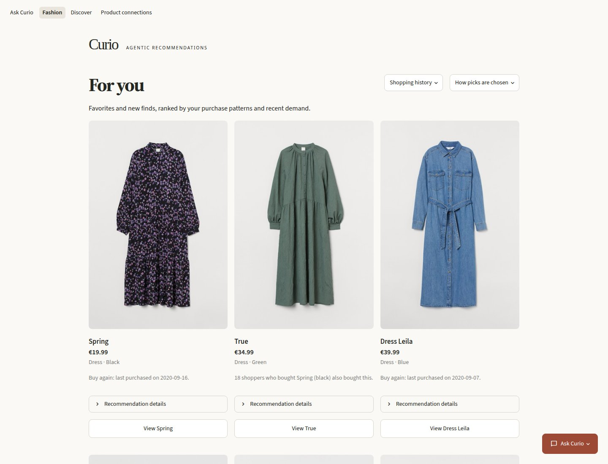
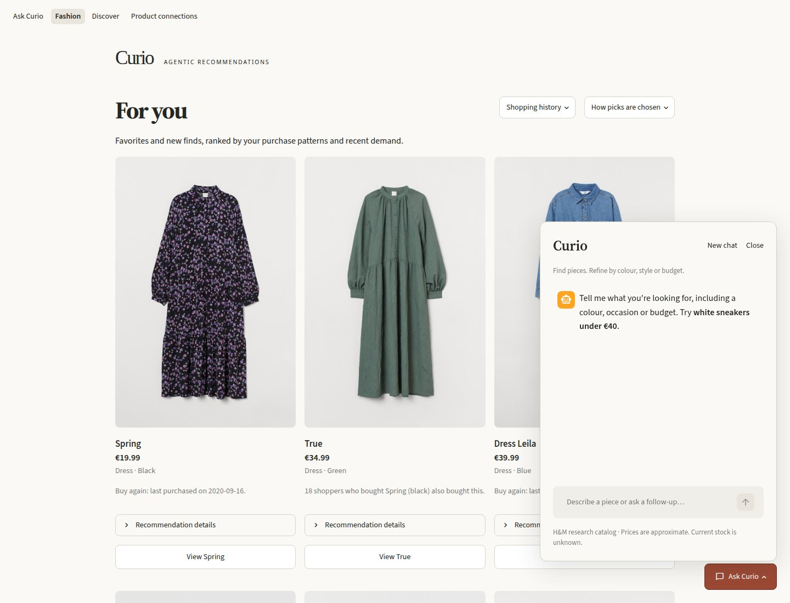
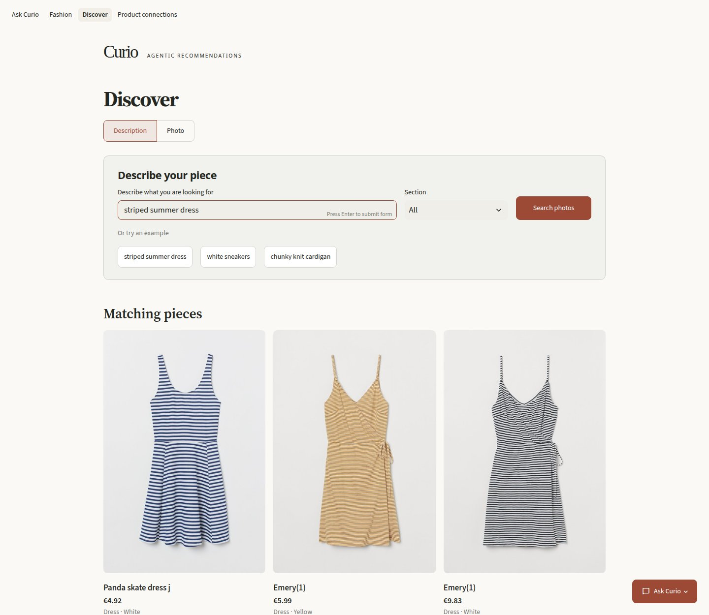
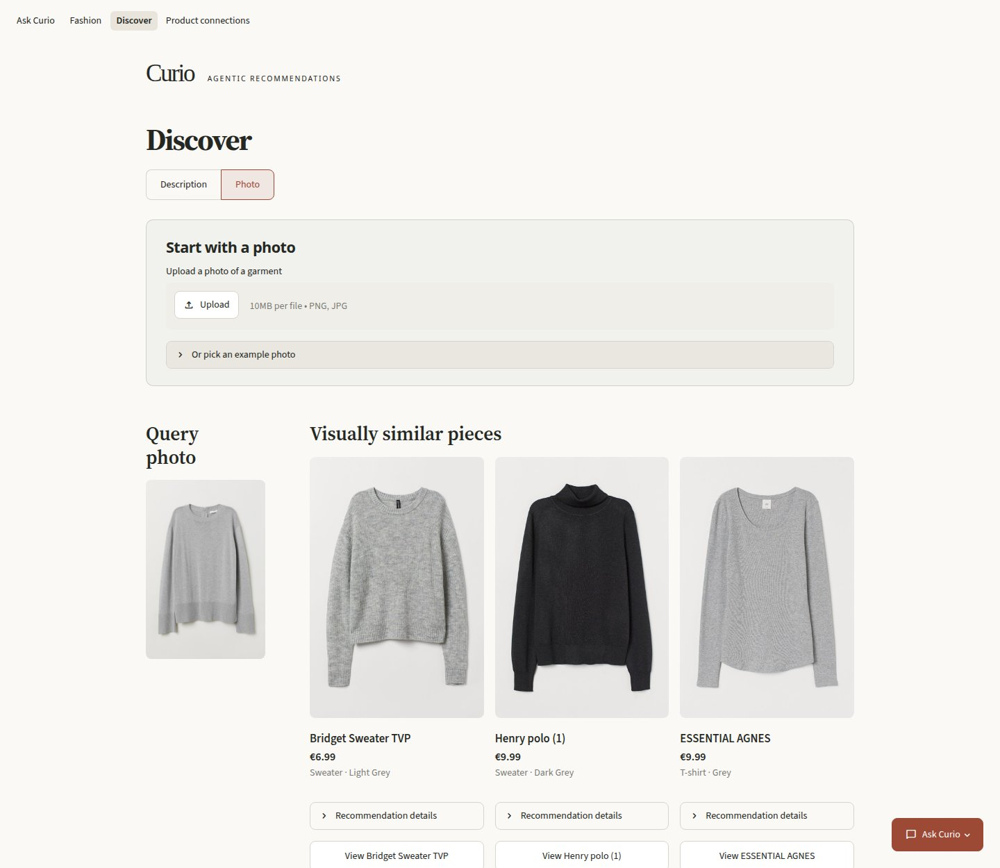
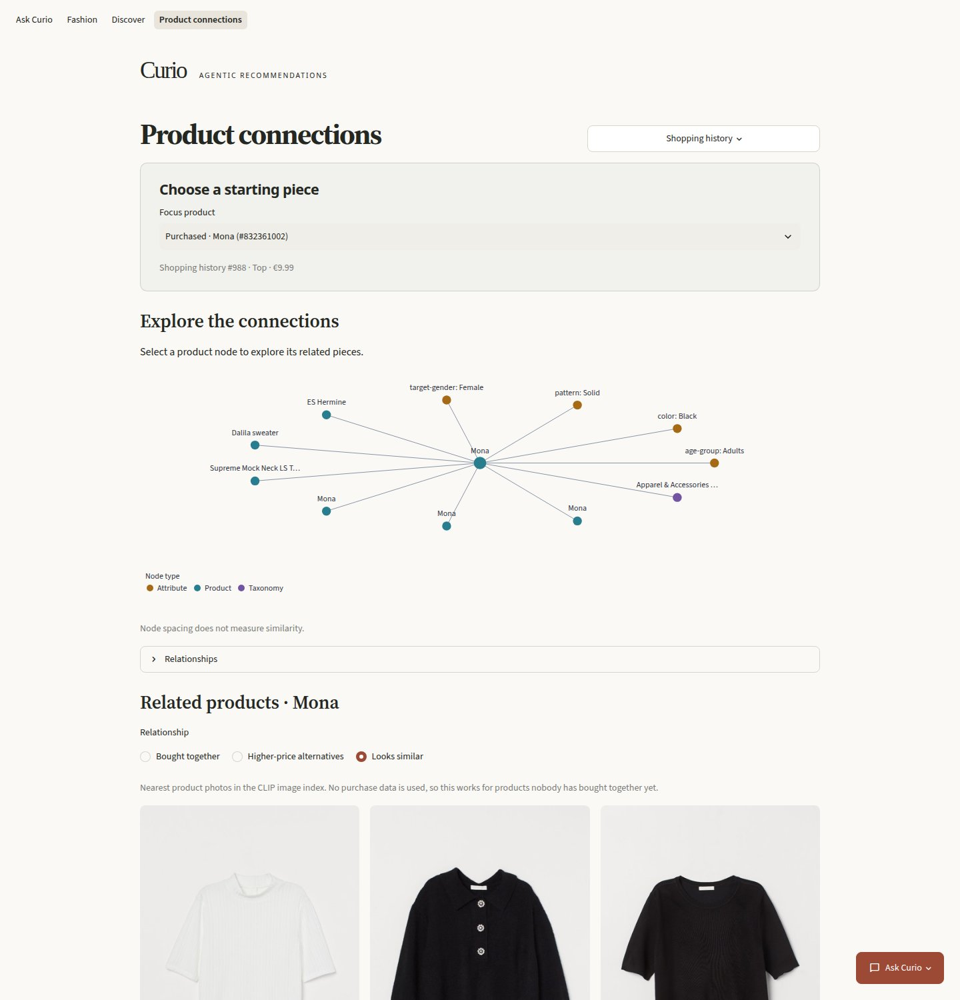
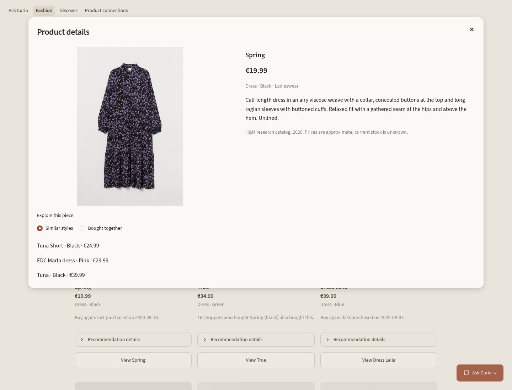
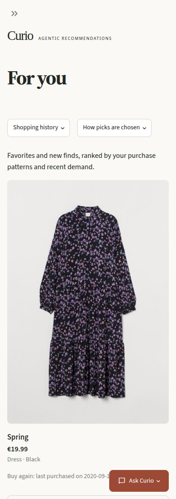

# Curio: agentic recommendations, fashion edition

[](https://github.com/yo1am1/curio/actions/workflows/ci.yml)

Find fashion through personalized recommendations, photo search or a conversation.
Curio uses historical H&M purchases and real product photos, with a tool-using
assistant that searches the catalog and compares items.



## Ask Curio

Describe what you want, set a budget, then refine your search or compare products.
The agent uses validated, read-only catalog tools and keeps context across follow-ups.
It is available from the conversation home and a floating panel on browsing pages.



## Search by description or photo

Search in everyday language, upload a photo, or try an example garment.





## Explore product connections

Browse co-purchased pieces, visually similar products and higher-priced alternatives.
Open a product to inspect its details and the evidence behind its recommendations.





## On your phone



[Conversation home](docs/screenshots/curio-home.jpg) ·
[Mobile conversation home](docs/screenshots/curio-home-mobile.jpg)

## Under the hood

Streamlit UI → FastAPI → CLIP search, Qdrant, purchase-based recommenders and an LLM agent.
The learned ranker combines repeat purchases, collaborative candidates and catalog signals.

The screenshots use 5,000 historical customers and a partial photo index covering
3,537 of 14,300 catalog products. Prices are approximate; there is no live stock or checkout.

On the 819-customer holdout, MAP@12 was 0.0302 versus 0.0248 for buy-again;
customer hit rate was 13.9% versus 11.1%. The uncertainty interval crosses zero,
so this result alone does not establish superiority. [Evaluation and limitations](docs/recommendation-audit.md).
Model quality remains available at `/quality`, outside shopping navigation.

## Run locally

Requires Python 3.13 and [uv](https://docs.astral.sh/uv/).

```bash
uv sync --all-extras
cp .env.example .env
```

[Prepare the H&M data and image index](docs/technical-guide.md#quick-start), then run
these commands in separate terminals:

```bash
uv run uvicorn clothes_recommender.api:create_app --factory
uv run streamlit run src/clothes_recommender/ui.py
```

Open http://localhost:8501. Configure an LLM provider in `.env` to enable chat.
The research dataset is downloaded separately and is not included in this repository.

[Data, architecture, Docker and API reference](docs/technical-guide.md) ·
[LLM setup](docs/technical-guide.md#llm-configuration) ·
[Tests and development](docs/technical-guide.md#development) ·
[Documentation and research](docs/README.md)

This release covers fashion. Work on other domains is saved separately on
`next/curio-multidomain`.

## Contributors

Created and maintained by [Yehor Trepalin](https://github.com/yo1am1).
AI development assistance: Claude Code, Codex and Antigravity.
