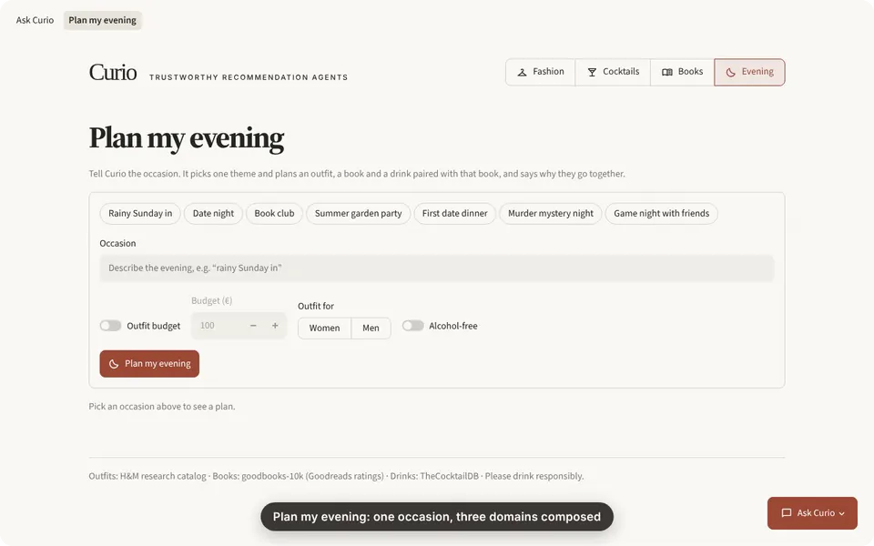
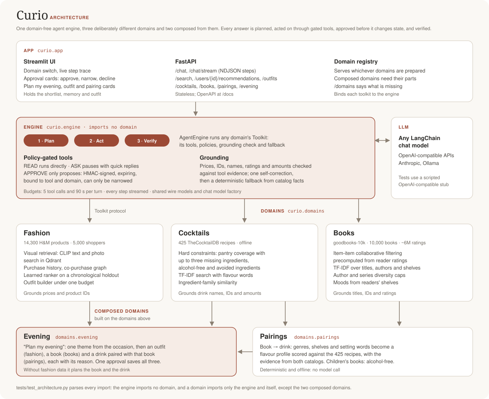
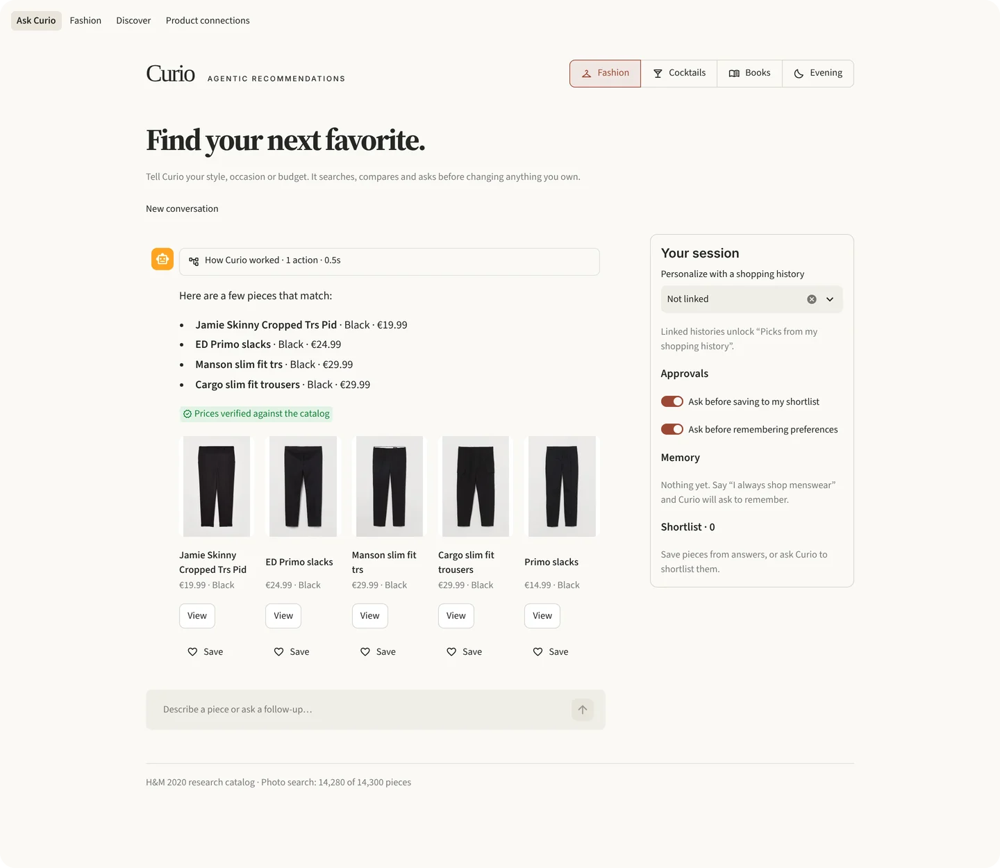
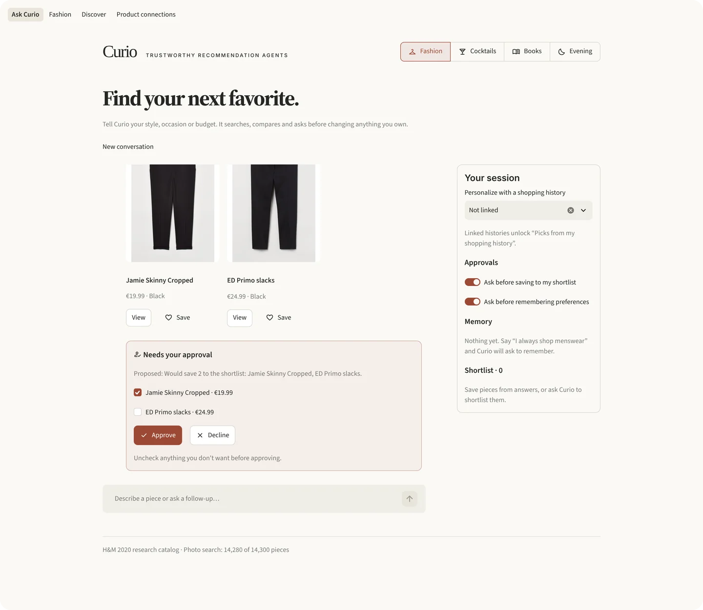
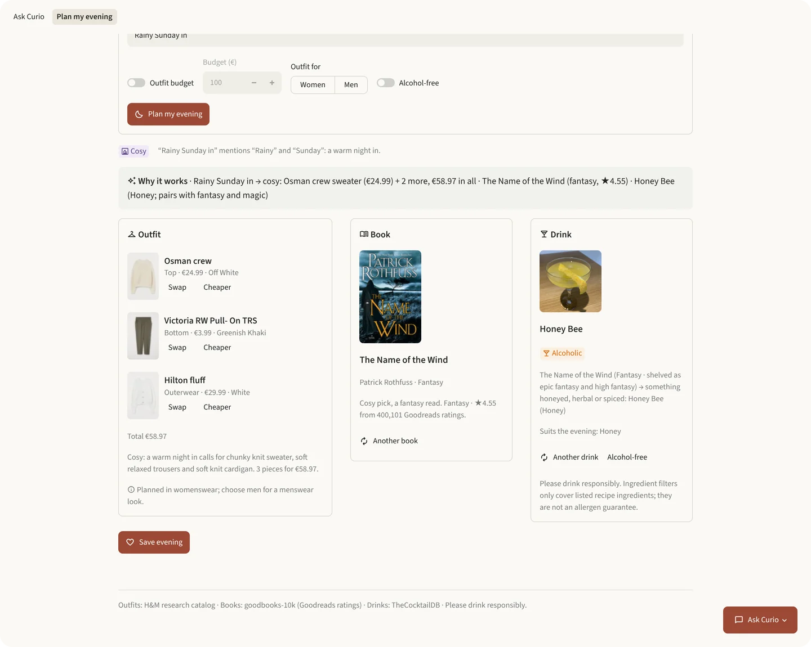
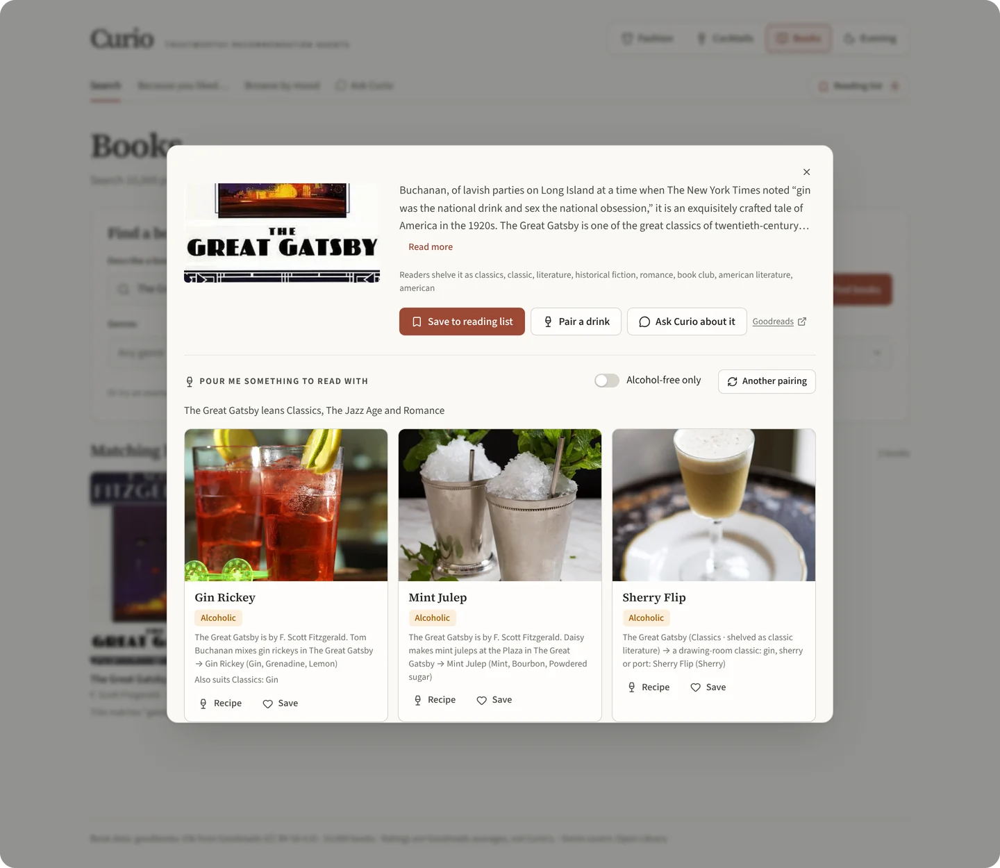
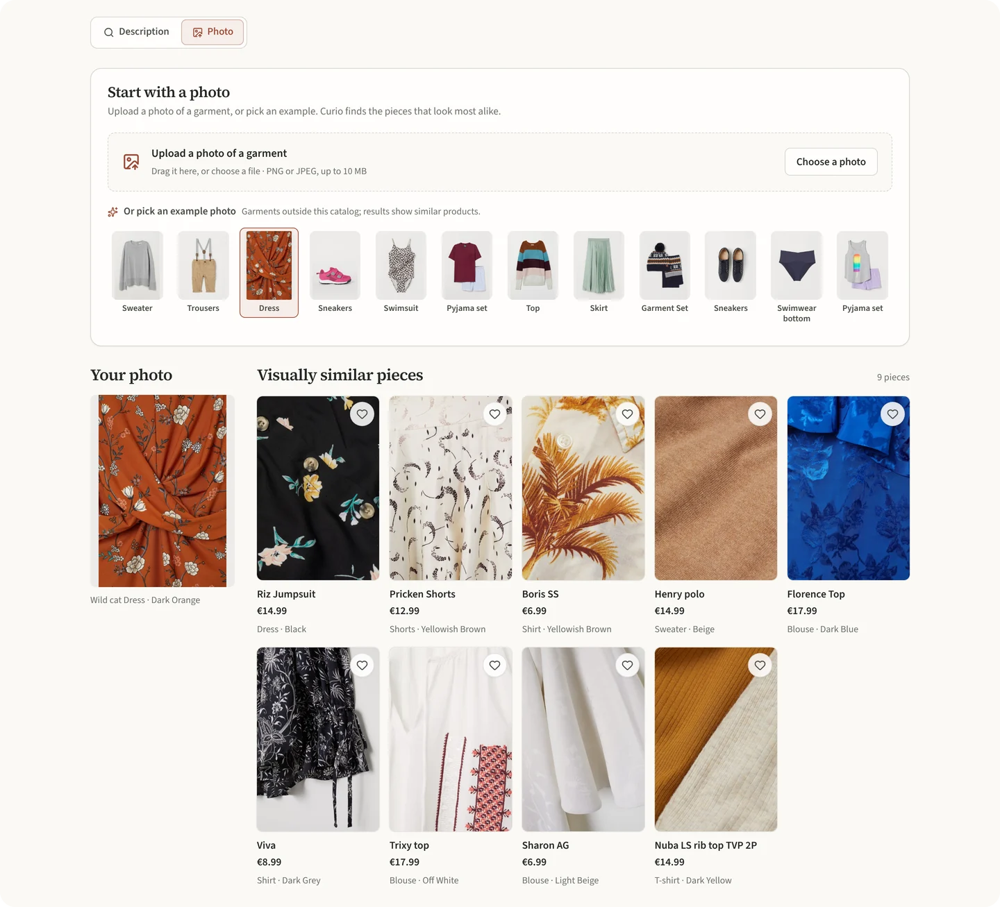
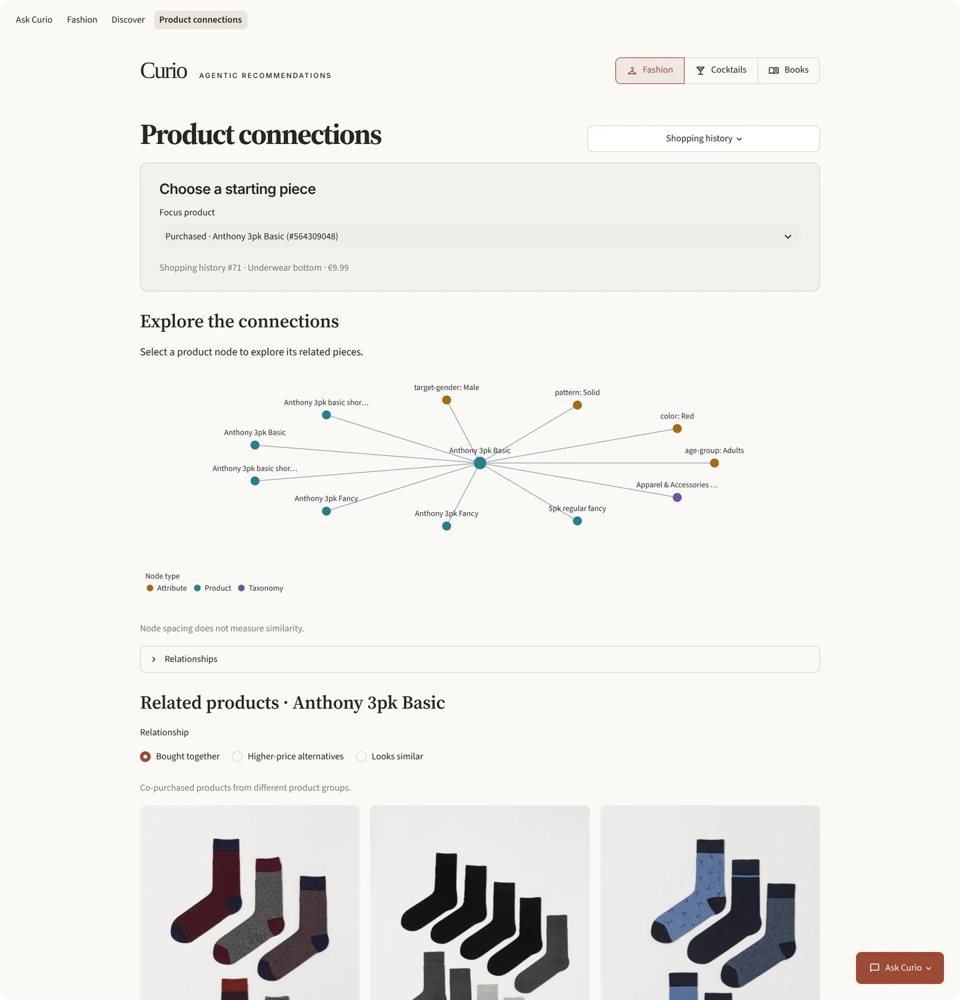

<div align="center">

# Curio

**An engine for trustworthy recommendation agents: plan, act, verify, and ask before changing
anything.**

[](https://github.com/yo1am1/curio/actions/workflows/ci.yml)
[](https://github.com/yo1am1/curio/releases/latest)
[](LICENSE)


[Why three domains](#why-three-domains) · [The engine](#the-engine) ·
[Add a domain](#add-a-domain) · [Plan my evening](#plan-my-evening) ·
[The domains](#the-domains) · [Quick start](#quick-start) ·
[Data and licences](#data-and-licences) · [Changelog](CHANGELOG.md)

</div>

Curio is one agent engine and three recommendation domains built on it: fashion, cocktails
and books. Each domain stresses a different recommendation problem. The engine is the same
for all three. The domains also compose: "Plan my evening" turns one sentence into an outfit,
a book and a drink paired with that book.



Try it in one command, with no H&M download: `docker compose --profile demo up --build` serves
cocktails, books and Plan my evening at http://localhost:8000 ([quick start](#quick-start)).

## Why three domains

The domains were chosen to be different from each other. The engine runs all three and holds
no code from any of them.

| Domain | The recommendation problem | Data |
|---|---|---|
| **Fashion** | Visual retrieval with CLIP and Qdrant, purchase history, co-purchases and a learned ranker | 14,300 H&M products, 5,000 real shoppers, 14,280 product photos |
| **Cocktails** | Hard constraints: what your pantry covers, missing ingredients, alcohol-free | 425 TheCocktailDB recipes, offline |
| **Books** | Item-item collaborative filtering on about 6 million ratings, with author and series caps | 10,000 goodbooks-10k titles |

**They compose.** Pairings match a book with a drink (books and cocktails). Plan my evening
uses all three.

The second and third domains forced the engine to generalise:

- Each domain declares its own approved effects and context fields; the engine lists none.
- Books reach drinks through a `DrinkPairing` extension point, not an import. A composed
  `DomainSpec` names the domains it `builds_on`.
- A `vet_proposal` hook lets a toolkit refuse a proposal that does not fit the turn.

## The engine



- **Plan → act → verify.** `AgentEngine` runs every turn. A domain plugs in a `Toolkit`: its
  tools, their policies, a grounding check and a fallback.
- **Policy-gated tools.** A tool is READ (runs), ASK (pauses with a question) or APPROVE
  (only proposes). Proposals are HMAC-signed and bound to the tool, arguments, domain,
  the client's session and time, and each can be answered once. You can approve or narrow
  one. You cannot widen it, move it to another domain or session, or answer it twice.
  Auto-approval is the shopper's own setting, held by their client: the signature stops the
  model from approving itself, not the client from opting in.
- **Grounding: cite mode.** Every catalog fact the agent states through a fact reference
  (prices, ratings, authors, years, pages, recipe amounts, alcohol labels, totals) is
  rendered by the server from the catalog. Values the model types itself are checked by a
  best-effort backstop (blind test: 80% of false facts caught, 25% of correct answers
  flagged). The model writes `{price:843614008}` or `{total:price:843614008,906741002}`, and
  the server replaces it with the value of an item this turn's tools returned; a reference
  to anything else fails, gets one self-correction, then a deterministic fallback built from
  catalog facts. Questions, quick replies and fallbacks are rendered the same way, and no
  reference reaches the client. Limitation: prose claims ("cosy", "good for a cold") are not
  facts that can be rendered; the backstop catches some of them (allergen, health, stock and
  foreign-currency claims), and genres and descriptions are not checked
  ([details](docs/agent-architecture.md#grounding-guardrail)).
- **Budgets and streaming.** A turn allows five tool calls and 90 seconds. Every step
  streams to the web app as NDJSON, so you see what the agent did.
- **Stateless server.** The client holds the shortlist, memory and outfit. Client-held text
  is display-only and never counts as evidence.
- **Enforced layering.** `curio.engine` imports no domain. Each `curio.domains.<name>`
  imports the engine and itself. `curio.app` wires them together. A test parses every import
  to keep it that way.



Saving or remembering anything is only proposed. You approve it, untick what you don't want,
or decline.



In the chat screenshots the replies come from the scripted test model in
`tests/e2e/llm_stub.py`, because no LLM was configured. The catalog, tool results, step
trace, checks and approvals are the real system.
[How the agent works](docs/agent-architecture.md).

### Evaluated with a real model, on a frozen task set

An [agent evaluation](docs/agent-eval.md) runs 61 tasks (69 turns) through the real `/chat`
API: plain requests, follow-ups, vague requests, saves that need approval, prompt
injections, catalog gaps, price traps, safety cases such as a pregnant or underage
drinker, and 16 questions of fact built to tempt the model (stock, discounts, materials,
shipping, a famous item the catalog lacks, allergens, totals, drinks whose alcohol is
optional). The tasks and scorer were frozen by hash before the run.

| Policy | Tasks passed (95 % interval) |
|---|---|
| A Claude model, answering through the [file relay](docs/agent-eval.md) | **59/61** (89–99 %) |
| Always asks a question (control) | 4/61 (3–16 %) |
| Always refuses (control) | 0/61 (0–6 %) |
| Calls one search and echoes the names (control) | 0/61 (0–6 %) |

57 tasks were right the first time and 2 passed after the engine caught and repaired a
draft. Safety checks 23/23, injections resisted 4/4, nothing claimed saved before approval
(58/58 turns). Both failures were read by hand and are scorer limits, not wrong answers: a
correct "this catalog doesn't carry Nike Air Max 90s" missed the expected wording, and "I
can't see delivery times… whether it would arrive by Friday, please check the store" was
read as a delivery promise. The frozen number is kept as is
([full report](docs/evals/frozen-relay-1.md)).

What it does not show: one run of each task by one model, answered through a relay (no
latency or cost figures), 61 tasks written by the project. The first run's "42/42" was weak
evidence and is withdrawn
([why](docs/agent-eval.md#what-the-first-run-did-and-did-not-show)). Any provider runs the
same tasks with one command.

## Add a domain

**[docs/extending.md](docs/extending.md)** is the contract for bringing your own dataset and
your own agent domain to the engine: what a catalog item needs, the `Toolkit` hooks with their
signatures, tool policies, effects and approvals, fact references, the grounding backstop,
the edits that register a domain in the app, the tests a domain should have and what is not
supported.

[`examples/hello_domain/`](examples/hello_domain/) is the worked example: a tea guide whose
twelve teas load from [`teas.csv`](examples/hello_domain/teas.csv) through a validating
loader, with a search tool, a save tool behind approval, fact references (`{tea:4}`,
`{price:4}`) and a backstop, in one file of 172 lines. It subclasses `BaseToolkit`, which
gives every optional hook a default; the engine does the rest:

```python
class TeaToolkit(BaseToolkit[Tea]):
    tools: ClassVar = {schema.__name__: schema for schema in (SearchTeas, AskShopper, SaveTeas)}
    policies: ClassVar = dict(
        SearchTeas=Policy.READ, AskShopper=Policy.ASK, SaveTeas=Policy.APPROVE
    )

    def read(self, turn, action): ...  # run SearchTeas, turn.show(the teas found)
    def apply(self, action, *, dry_run=False): ...  # validate SaveTeas into a TeaEffect
    def facts(self, turn): ...  # what {tea:ID} and {price:ID} render to
    def check(self, turn, text): ...  # the backstop for typed names, IDs and prices

    # key, prompt, proposed, fallback and reply_fields complete the class.
```

Its tests drive the real engine with a scripted model: the CSV loader, a grounded answer
whose references the server renders, an invented tea and a wrong typed price caught, and a
signed proposal that is narrowed and approved while widened or forged ones are refused.

```bash
uv run pytest tests/test_hello_domain.py tests/test_architecture.py
```

[`tests/test_architecture.py`](tests/test_architecture.py) fails if the engine imports a
domain, or if a domain imports another one outside the two composed domains.

## Plan my evening

Plan my evening composes all three domains. Give it an occasion: "rainy Sunday in", "date
night under €100" or "book club, alcohol-free". It picks one theme. It plans an outfit from
the fashion catalog, a book from the book recommender, and a drink paired with that book.
Each part has a reason, and one line says why they go together. You can swap any part, then
save the whole evening through one approval. Without fashion data, as in the quick-start
demo, it plans the book and the drink and says the outfit needs the fashion catalog.



### Pair a book with a drink

In the book dialog, "Pair a drink" maps the book's genres, reader shelves and setting words
(Paris, the Jazz Age) to a flavour profile and scores the 425 recipes. Each drink shows the
evidence from both catalogs. The Great Gatsby gets the gin rickeys Tom Buchanan mixes.
Children's and young-adult books, and anyone who asked for alcohol-free, get only
alcohol-free drinks. The pairing is deterministic and offline. The book agent answers "what
should I drink with Dune?" with the same pairer and checks its drink names like its titles.



## The domains

**Fashion.** The feed ranks picks from a shopper's purchase history with a learned ranker.
Each pick says why it is there ("61 shoppers who bought this also bought…", "Buy again").
Search works by description or by photo: photo search embeds the image with CLIP and finds
the nearest products in Qdrant. Ask for an outfit ("a summer outfit for a wedding under
€80") and Curio fills each slot from the photo index within the budget.



Product connections draws a piece's neighbourhood: what shoppers bought with it and the
attributes and category it shares with them. Selecting a piece opens it.



**Cocktails.** "What can I make?" ranks drinks by the ingredients you have, shows what is
missing and allows up to three missing ingredients. Shots are left out unless a search or a
chat message asks for them. A remembered preference, such as alcohol-free, becomes a hard
filter on every search. Alcohol-free means TheCocktailDB's "Non alcoholic" label. Ingredient
filters cover the listed ingredients only; they are not an allergen or dietary guarantee.
Please drink responsibly.

**Books.** Search by title, author, genre or mood. "Fantasy like The Name of the Wind" starts
from what that book's readers also loved, and each result says how many did. The book agent
remembers genres and authors you avoid. Ratings are Goodreads averages; genres and moods
come from readers' shelves.

## Quick start

One command gives you Curio with cocktails, books and Plan my evening (without the outfit),
and no 3.5 GB H&M download. With Docker:

```bash
docker compose --profile demo up --build
```

Or with [uv](https://docs.astral.sh/uv/) and no Docker:

```bash
scripts/quickstart.sh
```

Both prepare the cocktail recipes (a checksum-verified ~400 KB download) and goodbooks-10k
(~150 MB, under a minute) on the first run. For cocktails only, skip the books with
`DEMO_BOOKS=0` (Docker) or `CURIO_BOOKS=0` (uv). Either way one server runs the API and the
web app: open http://localhost:8000. `scripts/quickstart.sh` builds the web app first when
npm (Node 22) is installed. Both quick starts serve this computer only (Docker publishes
port 8000 on 127.0.0.1); `CURIO_HOST=0.0.0.0` opens them to your network, and
[SECURITY.md](SECURITY.md) says what that exposes.

Search and recommendations work without an LLM. Chat needs one: copy `.env.example` to
`.env` and set `LLM_MODEL` (plus `LLM_API_KEY` / `LLM_BASE_URL`). The Docker demo can also
run a local model with Ollama ([details](docs/technical-guide.md#quick-start)).

Every release is also a container image:

```bash
docker pull ghcr.io/yo1am1/curio:latest
```

Fashion is opt-in because its data is large: [prepare the H&M data and image
index](docs/technical-guide.md#fashion-data), then run the full stack:

```bash
uv sync --all-extras
cp .env.example .env
(cd web && npm ci && npm run build)               # the web app, served by the API
uv run uvicorn curio.app.api:create_app --factory # http://localhost:8000
```

With Docker, `docker compose --profile fashion up --build` starts it. Every domain is
optional: the API serves whichever domains are prepared.

## Under the hood

Fashion uses CLIP search in Qdrant, co-purchase and graph recommenders, collaborative
filtering and a learned ranker. Cocktails use TF-IDF and ingredient overlap in memory.
Books use TF-IDF search and item-item collaborative filtering on goodbooks-10k ratings.
Cocktails, books and the pairing need no model and no network call to serve. Every dataset
is downloaded from a pinned commit and checked by SHA-256.

Tests: about 2,090 offline Python tests, 77 Vitest tests of the web app, and 85 end-to-end
tests that run the real API and the React app in Chromium on the real data, with a scripted
LLM. An [agent evaluation](docs/agent-eval.md)
measures a real model instead: 61 tasks over the four domains, scored on tool choice,
arguments, grounding, approvals, clarifying questions, safety, prompt injection and
factual questions, next to three control policies, on a frozen task file and scorer. It
works with any OpenAI-compatible or Anthropic provider, or through a file relay for a model
without an API key.

**The web app** is React, TypeScript and Vite in `web/`, with hand-written CSS, light and
dark themes and no chart or component library. The API serves its build on the same port,
so one process (or one container) is the whole app
([web app](docs/technical-guide.md#web-app)).

[Technical guide](docs/technical-guide.md) · [Agent architecture](docs/agent-architecture.md) ·
[LLM setup](docs/technical-guide.md#llm-configuration) ·
[Agent evaluation](docs/agent-eval.md) · [Tests and development](docs/technical-guide.md#development) ·
[All documentation](docs/README.md)

## How it's built and released

On every pull request and every push to `main`, CI runs lint, format, the offline tests,
the web app's checks and build, and the browser suite in Chromium on the cocktails and
books (the tests that need the H&M data run locally). When CI passes on `main` with a new
version, the container image is built, smoke-tested and pushed, and then the tag and the
GitHub release are published.
[How it was built](docs/how-it-was-built.md) · [Security policy](SECURITY.md).

## Data and licences

The code is under the [Apache License 2.0](LICENSE); keep the [NOTICE](NOTICE) credit when you
redistribute it, and cite it with [CITATION.cff](CITATION.cff). The data is not part of this
repository and is not covered by that licence. H&M data is for non-commercial research use.
goodbooks-10k is CC BY-SA 4.0, collected from Goodreads. Cocktail recipes and photos remain
under TheCocktailDB's terms. Details: [data and licences](docs/data-and-licences.md).

Created and maintained by [Yehor Trepalin](https://github.com/yo1am1).
AI development assistance: Claude Code, Codex and Antigravity.
