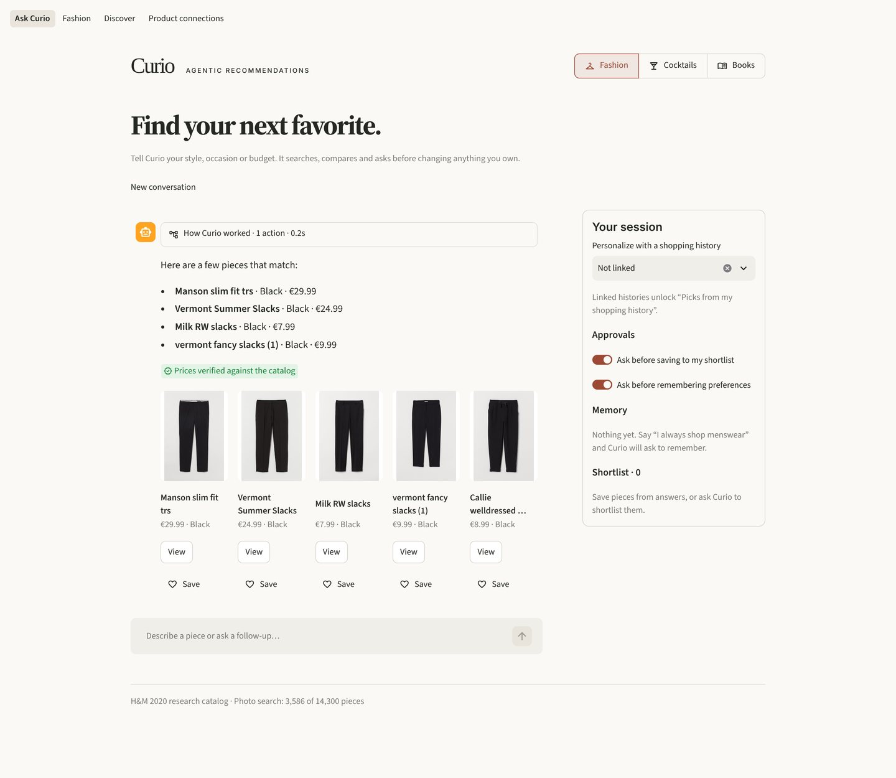
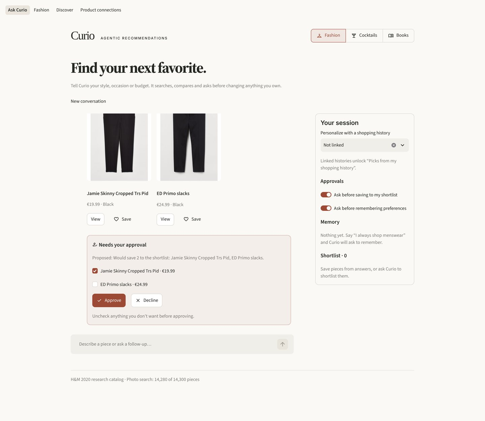
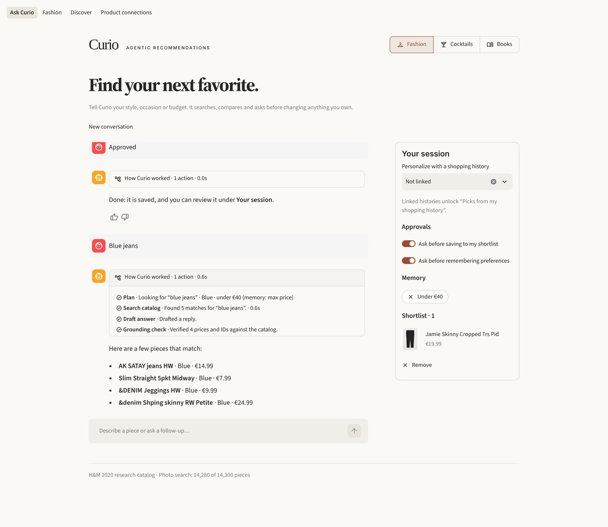
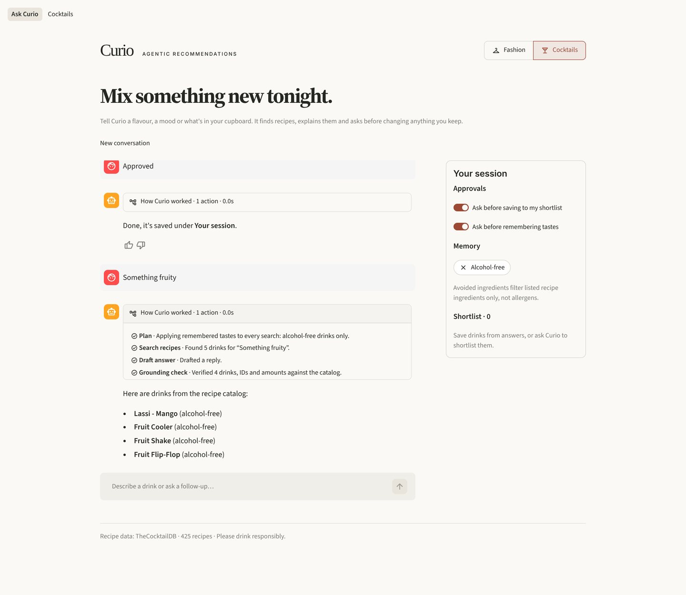
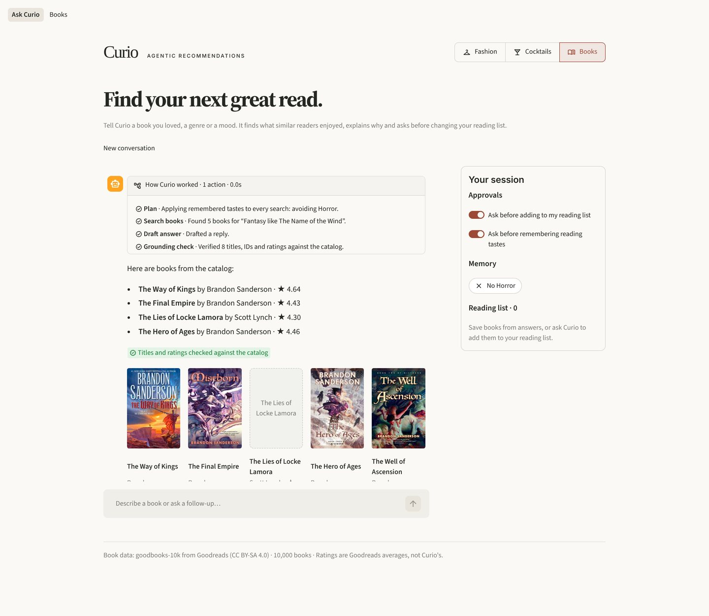
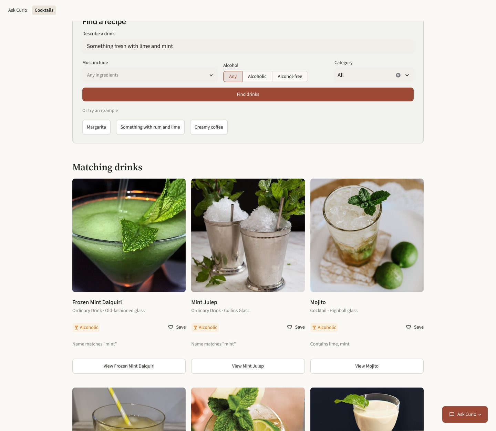
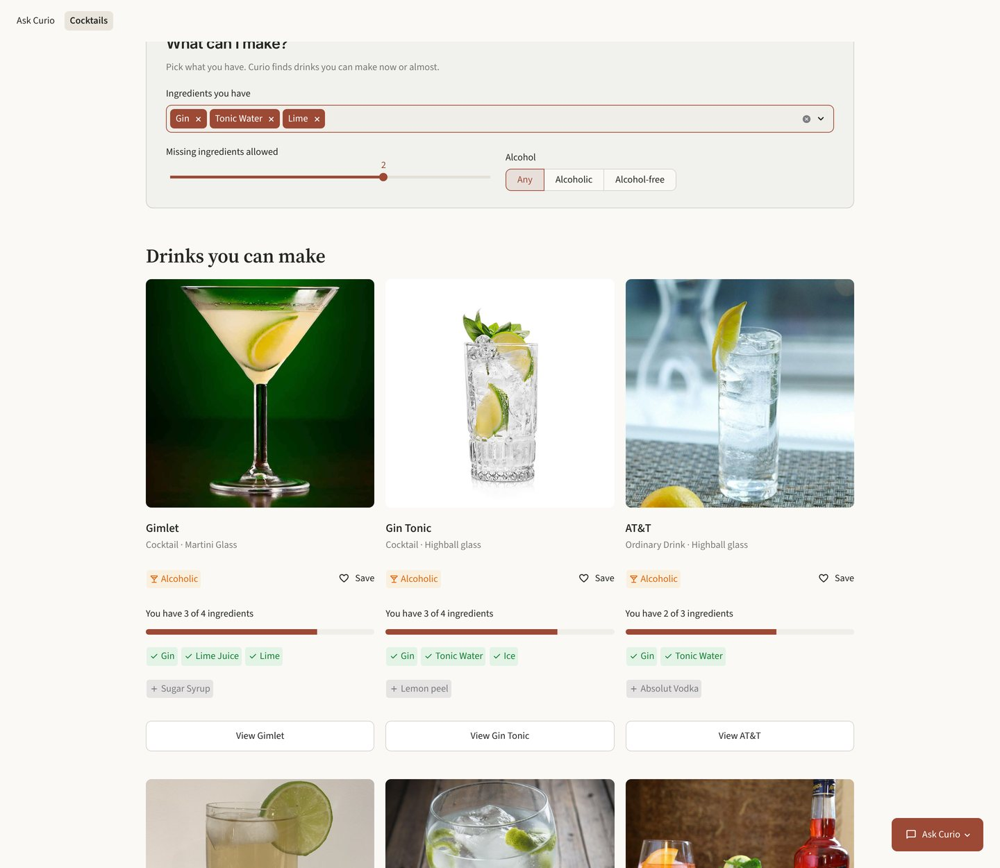
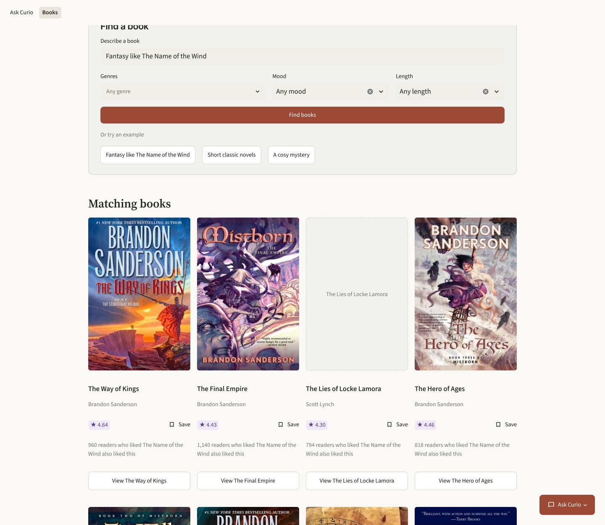
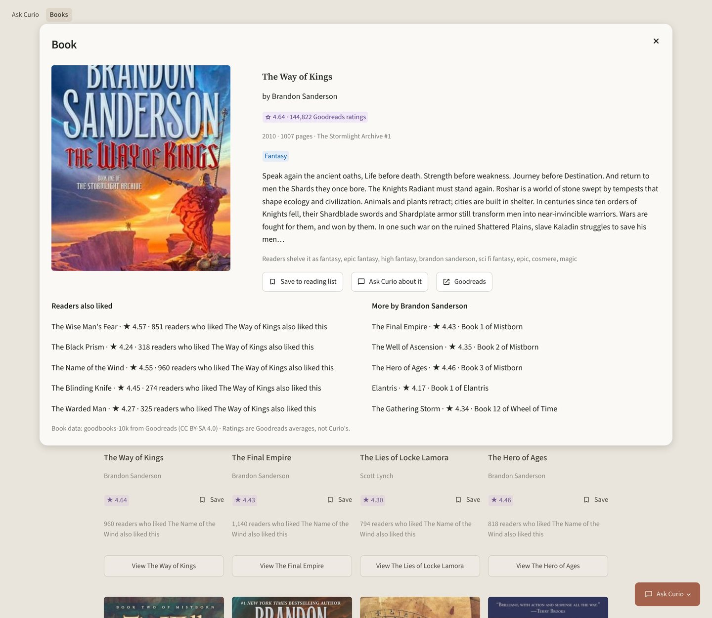

# Curio: agentic recommendations for fashion, cocktails and books

[](https://github.com/yo1am1/curio/actions/workflows/ci.yml)

Curio recommends things through browsing pages and a tool-using assistant. It has three
domains, switched in the header:

- **Fashion**: personalized recommendations, photo search and product connections built
  from historical H&M purchases and product photos.
- **Cocktails**: search, similar drinks and "What can I make?" over 425 recipes from
  TheCocktailDB, served offline from a prepared file.
- **Books** (new, unreleased): search, "readers who liked this also liked", "Because you
  liked…" and mood browsing over the 10,000 most-rated Goodreads books of goodbooks-10k,
  learned from about 6 million real ratings.

All three domains share one agent: it plans, calls policy-gated catalog tools, asks before
changing your shortlist or memory, and checks its answer against what the tools returned.


## Ask Curio

Describe what you want, set a budget, then refine your search or compare items. In
fashion the agent searches the catalog, finds pieces bought together or alike, and ranks
picks from a linked shopping history. In cocktails it searches recipes, finds similar
drinks and matches what you have at home. In books it finds what readers of a book you
loved also loved, lists an author's books and remembers genres or authors you avoid. Each
answer shows the steps it took. Prices, product, drink and book IDs, drink names, recipe
amounts, book titles and ratings are checked against the tool results before you see them. It asks a quick question when a request is vague, and asks
before saving to your shortlist or remembering preferences. It is available from the
conversation home and a floating panel on browsing pages.
[How the agent works](docs/agent-architecture.md).



Saving to the shortlist or remembering a preference is only proposed. You approve it,
untick what you don't want, or decline. Approved memory, such as a budget, applies to
later searches, and the step trace shows where it came from.





The same agent works for cocktails. Here a remembered alcohol-free preference filters
every search.



And for books: a remembered "no horror" applies to every search, and the titles and
ratings in the answer are checked against the catalog.



In these chat screenshots the replies come from the scripted test model in
`tests/e2e/llm_stub.py`, used because no LLM was configured. The catalog, tool results,
step trace, price checks and approvals are the real system.

## Fashion

### Search by description or photo

Search in everyday language, upload a photo, or try an example garment.


### Explore product connections

Browse co-purchased pieces, visually similar products and higher-priced alternatives.
Open a product to inspect its details and the evidence behind its recommendations.


### On your phone


[Conversation home](docs/screenshots/curio-home.jpg) ·
[Mobile conversation home](docs/screenshots/curio-home-mobile.jpg)

## Cocktails

Search recipes by name, flavour words ("fresh", "creamy") or ingredients, filter by
alcohol and category, and open a recipe to see its method and similar drinks. Each
result says why it matched. Alcohol-free means TheCocktailDB's "Non alcoholic" label;
"Alcohol optional" recipes count as alcoholic.



"What can I make?" ranks drinks by the ingredients you have, shows what is missing and
lets you allow up to three missing ingredients.



Ingredient filters and avoided ingredients only cover the recipe's listed ingredients.
They are not an allergen or dietary guarantee. Please drink responsibly.

## Books

Search by title, author, topic, genre or mood. "Fantasy like The Name of the Wind" starts
from what that book's readers also loved; "short classic novels" keeps classics of at most
250 pages; "cosy mystery" browses by mood. Every result says why it is there, for example
"960 readers who liked The Name of the Wind also liked this".



Open a book to see its cover, Goodreads rating, genres, description, what its readers also
liked and more by the author, then save it to your reading list or ask Curio about it.
"Because you liked…" combines several books you loved, and "Browse by mood" lists the
best-loved Cosy, Dark, Funny or Epic reads.



Ratings are Goodreads averages. Genres and moods come from readers' Goodreads shelves, so
they are crowd labels rather than editorial ones.

## Under the hood

Streamlit UI → FastAPI → a shared agent engine with one toolkit per domain.
Fashion uses CLIP search, Qdrant, purchase-based recommenders and a learned ranker.
Cocktails use an in-memory TF-IDF and ingredient-overlap recommender, and books an
in-memory TF-IDF search plus item-item collaborative filtering precomputed from goodbooks-10k
ratings (numpy and scipy only); neither needs a model or a network call to serve.

The fashion screenshots use 5,000 historical customers and a partial photo index
covering 3,586 of 14,300 catalog products, prepared from the public Hugging Face mirror
of the H&M data. Recommendations for unphotographed products show a placeholder. Prices are approximate historical values;
there is no live stock or checkout.

On the 819-customer holdout, MAP@12 was 0.0302 versus 0.0248 for buy-again;
customer hit rate was 13.9% versus 11.1%. The uncertainty interval crosses zero,
so this result alone does not establish superiority. [Evaluation and limitations](docs/recommendation-audit.md).
Model quality remains available at `/quality`, outside shopping navigation.

## Run locally

### Quick start

One command gives you a working Curio with the cocktail domain, without the 3.5 GB H&M
download. With Docker:

```bash
docker compose --profile demo up --build
```

Or with [uv](https://docs.astral.sh/uv/) and no Docker:

```bash
scripts/quickstart.sh
```

Both prepare the cocktail recipes on the first run (a checksum-verified ~400 KB download)
and start the API and the UI. Open http://localhost:8501. Recipe search, similar drinks and
"What can I make?" work straight away. For books too, run
`DEMO_BOOKS=1 docker compose --profile demo up --build` or `CURIO_BOOKS=1 scripts/quickstart.sh`:
the first run also prepares goodbooks-10k (a checksum-verified ~150 MB download, under a
minute). Chat needs an LLM: copy `.env.example` to `.env` and
set `LLM_MODEL` (plus `LLM_API_KEY` / `LLM_BASE_URL`); until then the app says how to
enable it. The Docker demo can also run a local model with Ollama
([details](docs/technical-guide.md#quick-start)).

### Fashion

Fashion is opt-in, because its data is large: [prepare the H&M data and image
index](docs/technical-guide.md#fashion-data), then run the full stack:

```bash
uv sync --all-extras
cp .env.example .env
uv run uvicorn clothes_recommender.api:create_app --factory
uv run streamlit run src/clothes_recommender/ui.py     # in a second terminal
```

With Docker, `docker compose --profile fashion up --build` starts it. Every domain is
optional: the API serves whichever domains are prepared, and the UI opens on the first one
available. Search, recommendations and the cocktail pages work without an LLM.

[Data, architecture, Docker and API reference](docs/technical-guide.md) ·
[LLM setup](docs/technical-guide.md#llm-configuration) ·
[Tests and development](docs/technical-guide.md#development) ·
[Changelog](CHANGELOG.md) ·
[Documentation and research](docs/README.md)

## Data and licences

The code is under the [MIT licence](LICENSE). The data is not part of this repository
and is not covered by that licence:

- **H&M data**: the [H&M Personalized Fashion Recommendations](https://www.kaggle.com/competitions/h-and-m-personalized-fashion-recommendations)
  dataset, licensed by H&M for non-commercial research use. You download it yourself.
- **Book data**: [goodbooks-10k](https://github.com/zygmuntz/goodbooks-10k) by Zygmunt
  Zając, published under the [CC BY-SA 4.0](https://creativecommons.org/licenses/by-sa/4.0/)
  licence. `prepare_books` downloads it from a pinned commit and checks each file's
  SHA-256. Its metadata, shelves and ratings were collected from Goodreads, so Goodreads'
  terms may also apply to them. Covers and book descriptions belong to their publishers and
  Goodreads and are not covered by CC BY-SA: covers are loaded directly from Goodreads by
  your browser, and descriptions stay in your local prepared file. The prepared files are
  not part of this repository; if you share them, credit goodbooks-10k and share them under
  CC BY-SA 4.0. The book pages credit "Book data: goodbooks-10k from Goodreads (CC BY-SA
  4.0)" and link each book to Goodreads.
- **Cocktail data**: recipes and photos come from [TheCocktailDB](https://www.thecocktaildb.com/).
  `prepare_cocktails` reads them from a CSV in
  [yo1am1/cocktail_advisor](https://github.com/yo1am1/cocktail_advisor), whose code is
  Apache-2.0. The recipe data and images remain subject to TheCocktailDB's own terms;
  Curio does not relicense them, and neither the MIT nor the Apache-2.0 licence covers
  them. Check TheCocktailDB's terms before any commercial use. Drink photos are loaded
  directly from thecocktaildb.com, and the cocktail pages credit "Recipe data: TheCocktailDB".

## Contributors

Created and maintained by [Yehor Trepalin](https://github.com/yo1am1).
AI development assistance: Claude Code, Codex and Antigravity.
