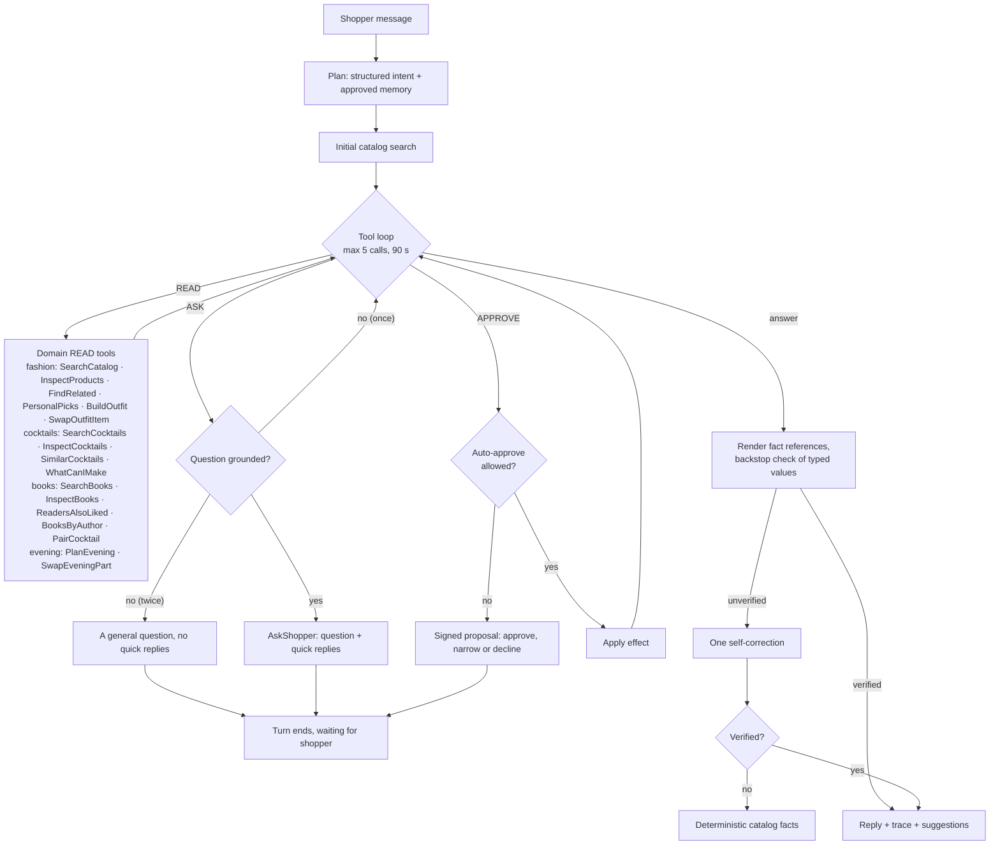

# Curio agent: architecture and review

This page describes how Curio's agent plans, acts, verifies and hands control back to
the shopper, in the fashion, cocktail and book domains, and in "Plan my evening", which
composes them. It also records the review of
the recommendation system and the earlier assistant that led to this design.

## One engine, four toolkits

The loop lives once, in `curio.engine` (`engine/agent.py`, `AgentEngine`). Each domain
plugs in a `Toolkit` (`engine/toolkit.py`): its tool schemas and policies, planning, how
READ tools run, how APPROVE effects are validated, the grounding check, the deterministic
fallback and the reply fields. `BaseToolkit` gives every optional hook (context cleaning,
history, planning, refresh, proposal display, `vet_proposal`, suggestions) a no-op default, so
a toolkit subclass writes only what its domain needs; every domain toolkit and the tea example
subclass it.

The code has three layers, and `tests/test_architecture.py` enforces their boundaries:

- `curio.engine`: the loop, the `Toolkit` protocol and `BaseToolkit`, policies and the shared `AskShopper`,
  signed proposals (`ActionSigner`, `narrow_args`), cite mode (`engine/facts.py`: fact
  references, their rendering and the report), the generic grounding machinery of the
  backstop (price and ID checks, name matching, `merge_reports`), the chat model factory and
  the wire models every turn shares. It imports no domain and not the app.
- `curio.domains.<name>`: a domain's catalog and recommenders beside its `agent/` package
  (toolkit, tools, prompts, fact sheet (`facts.py`: the references it renders), grounding
  check and session schemas: its context fields, card IDs and approved effects). A domain imports the engine and itself; only the composed domains
  build on others: `pairings` on `books` and `cocktails`, and `evening` on `fashion`,
  `books`, `cocktails` and `pairings`.
- `curio.app`: settings, the domain registry and the API, which also serves the React web
  app (`web/`). `app/schemas.py` combines
  every domain's payloads into the one `/chat` wire format, and `app/assistants.py` binds
  each toolkit to the engine with it (`Schemas`).

[`examples/hello_domain`](../examples/hello_domain) is a complete small domain on the same
engine, without the app.

| | Fashion (`ShoppingAssistant`) | Cocktails (`CocktailAssistant`) | Books (`BookAssistant`) | Evening (`EveningAssistant`) |
|---|---|---|---|---|
| Toolkit | `domains/fashion/agent/` | `domains/cocktails/agent/` | `domains/books/agent/`; PairCocktail from `domains/pairings/agent/` | `domains/evening/agent/` |
| Planning | Structured `SearchIntent` from the LLM, then an initial catalog search | The message is the query; no extra model call before the tool loop | As cocktails | As cocktails; the plan step lists the remembered tastes of every domain |
| Fact references | `{product:ID}`, `{price:ID}`, `{colour:ID}`, `{total:price:…}`, `{diff:price:…}` | `{drink:ID}`, `{alcohol:drink:ID}`, `{recipe:drink:ID}`, `{amount:drink:ID:Gin}` | `{book:ID}`, `{author:book:ID}`, `{rating:book:ID}`, `{year:book:ID}`, `{pages:book:ID}`, `{total:pages:…}`, `{diff:rating:…}`; a pairing's drinks as in cocktails | All of these, for the plan's parts |
| Backstop grounding | Prices and colours bound to their product, totals, differences and budgets, product IDs and names, other currencies, percentages, stock, delivery and safety claims | Drink IDs and names, recipe amounts and ingredients bound to their drink, alcohol labels, allergen and health claims | Book IDs and titles, authors, ratings, page counts (and their totals) and years bound to their book; prices, store and age-safety claims; paired drinks as in cocktails | All of these, against the plan's parts |
| Reply items | `products` | `cocktails` | `books`; a pairing's drinks in `cocktails` and `pairing` | The plan in `evening`; its pieces, book and drink in `products`, `books`, `cocktails` |

The engine owns everything shared: the tool-call and time budgets, policy enforcement,
signed proposals and resume, clarifying questions, merging approved effects into the
turn, the self-correction step, the streamed trace and the error mapping. `POST /chat`
picks the assistant by `ChatRequest.domain` (default `fashion`) from the loaded domains in
the domain registry (`app.services.DOMAINS`, see the
[technical guide](technical-guide.md#domain-registry)). Every domain is optional: a request
for a domain the server does not serve gets 503 with how to prepare it, and a served domain
without an LLM gets 503 saying how to enable chat. Every assistant is built once at startup
from one shared `AgentKit` (the chat model and the approval signer), so a proposal is bound
to its tool's domain but verifies on any. A new domain's assistant is a `Toolkit` for the
same engine, built by its loader from that kit.

Books were the test of that claim. The book toolkit needed no change to the loop, budgets,
signing, resume, grounding flow, streaming or UI chat code. The book domain declares its own
session fields (`book_preferences`, `book_shortlist` on `BookContext`), card IDs and approved
effects (`BookEffect`, which names the context field each effect field updates); the app adds
them to its wire models and the book approval tools to `ApprovalTool`.

The book → drink pairing is the one cross-domain feature. The book toolkit registers
PairCocktail and exposes a `DrinkPairing` extension point; the pairings domain implements it
(`CocktailPairing`) with the pairer and `PairedDrinkCheck`, and the app plugs it in when both
books and cocktails are served. So `books` never imports `cocktails` or `pairings`.

"Plan my evening" is the composition showcase: a domain whose toolkit uses three others'
recommenders through one deterministic planner, with no change to the engine. Its toolkit's
items are products, books and drinks together (`Turn[Product | Book | Cocktail]`, keyed in
separate ID ranges), its effect `EveningEffect` names three context fields in `adds`, so the
engine's existing effect merging saves one approval to three lists, and its grounding is the
three domains' checks merged, plus three of its own: catalog drink names in any case and
unmarked ("pour a mojito"; names that are also ordinary words, such as "Manhattan" or
"Thriller", only in a drink context; names inside the plan's products, books, authors or own
text are allowed), "<title> by <author>" against that book's authors, and prices in another
currency ($, £), which never match the euro catalog. A save (SaveEvening) may name only the current
plan's parts: the toolkit's `vet_proposal` hook, which the engine calls before it applies or
signs any APPROVE action, refuses other IDs with a tool message. The hook is generic and
optional, so the engine stays domain-free.

## One turn

Every phase emits an `AgentStep` (kind, tool, summary, status, duration). The UI
streams them from `POST /chat/stream` as NDJSON, shows live progress, then keeps a
collapsed "How Curio worked" trace on each answer. A READ tool that works in stages returns
a generator instead of a `(result, step)` pair: the engine streams each step it yields as it
happens and records the returned step last. A `ToolError` raised midway keeps the steps
already streamed and ends with an error step. `BuildOutfit` uses this for one step per slot.

## Tools and policies

Each tool is a strict pydantic schema (`extra="forbid"`, bounded lists and lengths).
Invalid calls return a tool error to the model; nothing runs. The policy, not the
model, decides what a valid call may do.

### Fashion

| Tool | Policy | Backed by |
|---|---|---|
| SearchCatalog | read | CLIP text search; keeps budget, audience, type and colour filters |
| InspectProducts | read | Exact catalog rows for up to five IDs |
| FindRelated | read | Graph recommender (complement, alternative) or CLIP item-to-item (similar), kept in the product's audience unless the shopper asks for another (`audience`) |
| PersonalPicks | read | Learned ranker when deployed, collaborative filtering otherwise, with their reasons |
| BuildOutfit | read | `OutfitPlanner`: plans 3-4 slots for the occasion and fills each under one total budget; streams a step per slot |
| SwapOutfitItem | read | Replaces one slot of the current outfit ("other" or "cheaper", optional refining words) within the budget |
| AskShopper | ask | Ends the turn with a question and 2–4 quick replies |
| SaveToShortlist | approve | Validated product IDs; the shopper approves, narrows or declines |
| RememberPreferences | approve | Values mapped to catalog vocabulary; unknown values are a tool error |

`FindRelated` and `PersonalPicks` reach the recommendation system through
`RecommenderNavigator`. The agent sees ranked IDs plus the same evidence the browsing
pages show ("3 shoppers who bought … also bought this"), so explanations stay grounded.

`FindRelated` keeps every relation in the source product's audience
(`toolkit.related_sections`, from the outfit builder's `SECTION_AUDIENCE` and
`AUDIENCE_SECTIONS`): a Menswear piece gets Menswear, a Ladieswear or Divided piece gets
Ladieswear and Divided (both womenswear), a Baby/Children piece gets Baby/Children. Sport has
no audience in the catalog (it is not split by gender), so a Sport piece is not restricted.
The model passes `audience` only when the shopper asks for another one ("women's pieces like
this men's sweater"). The look-alike search filters the photo index by section; the graph
relations read up to 200 neighbours and keep those in the sections, with the same reasons.
The browsing endpoint `GET /products/{id}/similar` keeps its unfiltered photo neighbours:
it has no shopper or conversation, and the product page shows it as the photo index's view
of the piece, so a cross-section look-alike is information there, not a wrong answer.

Prices are euros and Curio has no exchange rates. When the shopper writes an amount in
dollars or pounds ("under $30", "£80", "150 USD", "50 quid"), a budget is used as a euro
budget of the same number, never converted (`domains/fashion/currency.py`): it becomes the
price limit when the intent extractor left it out, and a "Currency" trace step, the session
prompt and every tool result of the turn carry the note "Prices are in euros; I used 30 as a
€ budget. You gave it in US dollars, and Curio does not convert currencies.", so the answer
says it too. An amount that was not used as the budget gets a reminder instead.

#### Outfits: multi-step planning with human approval

"Build me a summer outfit for a wedding under €80" is one `BuildOutfit` call. The planner
(`domains/fashion/outfits.py`, described in the [technical guide](technical-guide.md#outfit-builder)) plans
slots from the occasion (a women's wedding: dress, shoes, bag, accessory), searches each
slot's candidates with CLIP restricted to its product types and the audience's sections,
checks that the cheapest pieces fit the budget, then fills the slots in order. Each slot may
spend what the later slots do not need at minimum, and prefers pieces bought together with,
or looking like, the ones already chosen. The trace shows the plan ("Planned 4 slots for
“summer wedding”: dress, shoes, bag, accessory · for women · budget €80.00"), each slot
("Filled shoes: Paloma · €12.99. Best match for “elegant heeled sandals”.") and the result
("Outfit ready: 4 pieces for €77.96 of a €80.00 budget."). A slot the budget cannot cover
is shown as "Could not fill …" with its cheapest price, never dropped silently.

The tool's audience is the one the shopper gave, else a wearer named in the occasion
("wedding outfit for my husband"), else the one their section filters or remembered
sections point to, else the section of the best match (the answer says so). A
remembered budget (`max_price`) caps every piece. The server keeps no outfit: the reply
carries `outfit` with its `state`, the UI sends that back as `TurnContext.outfit`, and the
toolkit re-reads every piece and price from the catalog. The session prompt lists the
current outfit, so "cheaper shoes" or "another top" become `SwapOutfitItem` calls, and
"Save outfit" becomes a `SaveToShortlist` proposal with every piece, which the shopper can
narrow in the approval card. The model is told to quote the tool's total and never add
prices up itself.

### Cocktails

| Tool | Policy | Backed by |
|---|---|---|
| SearchCocktails | read | `CocktailRecommender.search`: query, required ingredients, alcohol, category |
| InspectCocktails | read | Full recipes (ingredients with amounts, glass, method) for up to five drink IDs |
| SimilarCocktails | read | Ingredient-family overlap with one drink |
| WhatCanIMake | read | Pantry matching for 1–15 ingredients, up to three missing |
| AskShopper | ask | Shared with fashion |
| SaveCocktails | approve | 1–5 validated drink IDs for the cocktail shortlist |
| RememberTastes | approve | Alcohol-free, liked and avoided ingredients, mapped to catalog spelling |

Remembered tastes fill missing filters on every search: an alcohol-free taste sets
`non_alcoholic`, and avoided ingredients become exclusions. WhatCanIMake maps each pantry
word to catalog spelling first ("tonic" becomes "Tonic Water"); ambiguous or unknown words
pass through unchanged.

Safety rules are in the cocktail system prompt and in the toolkit: the agent labels alcohol
status, offers alcohol-free drinks to anyone underage, pregnant or driving, does not
encourage excessive drinking, and never claims allergen safety or health effects.
Ingredient filters only cover listed recipe ingredients. The deterministic fallback adds
"Please drink responsibly." when a listed drink contains alcohol, and the cocktail pages
show the same line.

### Books

| Tool | Policy | Backed by |
|---|---|---|
| SearchBooks | read | `BookRecommender.search`: query (including "like <title>"), genres, mood, minimum rating, maximum pages |
| InspectBooks | read | Full details (description, genres, shelves, rating, pages, year, series) for up to five book IDs |
| ReadersAlsoLiked | read | Item-item collaborative filtering from goodbooks-10k ratings; other authors only by default |
| BooksByAuthor | read | The author's books in the catalog, most rated first |
| PairCocktail | read | `BookCocktailPairer`: drinks for one book (ID or title) or the reading list and remembered tastes, with reasons; `alcohol_free`, `exclude_drink_ids` for another pairing |
| AskShopper | ask | Shared with fashion |
| SaveBooks | approve | 1–5 validated book IDs for the reading list |
| RememberReadingTastes | approve | Liked genres, avoided genres and avoided authors, mapped to catalog names |

Remembered tastes apply to every tool: avoided genres and authors are left out, and liked
genres rank higher (a 10 % boost, with the reason "A genre you like"). A genre the reader
asks for in the same call wins over a remembered avoidance of it. Genres and moods must
be catalog names; an unknown one is a tool error that lists the valid ones, so the model
can retry. The book that a "like <title>" search started from counts as evidence, so the
answer may name it. The prompt tells the model to quote ratings exactly, to say ratings are
Goodreads averages and not to reveal endings.

#### Cross-domain: pairing a drink with a book

PairCocktail is the agent's one cross-domain tool. "What should I drink with The Name of the
Wind?" is one call with the title; "pair a cocktail with my reading list" uses the reading
list, liked genres and avoided genres from the turn context. It reads the same deterministic
pairer as `POST /pairings/book-cocktail` ([technical guide](technical-guide.md#book--cocktail-pairing)),
so the agent cites the pairer's reasons rather than inventing its own. The tool is
registered with every book agent; when the server does not serve cocktails it returns a tool
error saying pairing is unavailable, and the session prompt says so.

Safety follows the cocktail rules: a children's or young-adult book is always alcohol-free,
whatever the model asks; the cocktail domain's remembered tastes (`TurnContext.cocktail_preferences`,
which the UI sends with book requests) apply, so an alcohol-free taste keeps every pairing
alcohol-free and avoided ingredients stay out; the prompt adds the cocktail safety rules
(alcohol status for each drink, no encouragement of excessive drinking, no health or allergen
claims), and the fallback ends with the pairer's note ("Please drink responsibly."). The
reply carries the drinks in `cocktails` and the explained `pairing`; its suggestions are
"Another pairing", "Make it alcohol-free" and readers-also-liked. For another pairing the
model sees the drinks earlier answers showed ("Drinks shown (an earlier pairing): drink #269
Old Fashioned") and passes them as `exclude_drink_ids`.

### Evening

| Tool | Policy | Backed by |
|---|---|---|
| PlanEvening | read | `EveningPlanner.plan`: occasion (plus budget, audience, mood, alcohol-free); streams a step for the theme, the outfit, the book and the drink, and one per missing part |
| SwapEveningPart | read | `EveningPlanner.swap` on the plan the client holds: another or a cheaper outfit piece (part outfit with its slot), another book (its drink is re-paired), another or an alcohol-free drink |
| AskShopper | ask | Shared; used when the request names no occasion ("plan my evening") |
| SaveEvening | approve | Validated product, book and drink IDs; one `EveningEffect` adds them to the fashion shortlist, the reading list and the saved cocktails. The shopper can untick any of them |

Remembered tastes from every domain apply to every call: avoided and liked genres and avoided
authors to the book, the alcohol-free taste and avoided ingredients to the drink, the
per-piece price limit to the outfit, and a remembered menswear or womenswear section chooses
the audience. The server keeps no plan: the reply carries `evening` with its `state`, the UI
sends it back as `TurnContext.evening`, and the toolkit restores it from the catalogs (and
re-pairs the drink) for the session prompt, so "another book", "cheaper shoes" or "make the
drink alcohol-free" become SwapEveningPart calls and "save the evening" a SaveEvening
proposal with every part. Children's and young-adult books always get alcohol-free drinks,
as in pairings; the prompt adds the cocktail safety rules, and the fallback ends with the
pairer's note.

## Human in the loop

The API is stateless. The shortlist, remembered preferences, linked shopping history
and approval policy live on the client and are sent with each request (`TurnContext`).

1. When the agent calls an approval tool, the server validates the arguments against
   the catalog and returns `status="needs_approval"` with a `pending_action`.
2. The proposal is HMAC-SHA256 signed over its ID, tool, arguments, originating
   request, the proposing turn's search filters (`intent`), issue time and the client's
   `session_id` (a random id the web app keeps per tab and sends in every request). It
   expires after 30 minutes. On resume the engine rebuilds the turn from those filters.
3. The client answers with `decision: {action, approved, edited_args}` and the same
   `session_id`. Edits may only remove values (a subset of product IDs, dropped
   preferences). A forged, modified, widened or expired proposal, or one sent from another
   session, is rejected with HTTP 409.
4. Each proposal is answered once. The signer's `NonceStore` records an answered proposal
   until it expires, so approving or declining it again gets HTTP 409 ("already
   answered"). A refused edit does not count as an answer, and when the turn fails before
   its reply reaches the client (a provider error, a dropped connection), the proposal is
   released so the shopper can answer it again.
5. On approval the server returns an `applied` effect for the client to store, merges it
   into the turn's context the way the UI does, and the agent continues the turn to
   confirm. Later searches in that turn use the approved change. An effect that touches
   no items (remembering preferences) leaves the shown cards in place. A resumed turn
   cannot pause for another proposal or question.

Shoppers can opt into auto-approval per tool in the session panel. Auto-approved
actions still run through the same validation and appear in the trace. `auto_approve` is a
user preference held by the client, like the shortlist: the server takes it as sent. The
signature therefore protects against the model approving its own proposals and against
forged, widened, replayed or moved proposals; it does not, and cannot, protect the server
from its own client, which may opt into auto-approval. Effects are only returned to the
client, so this is fine for Curio; a server-side effect (an order, an email) would need a
server-held policy per user instead.

`AGENT_SIGNING_KEY` sets the signing key (at least 32 bytes). Without it, a random
per-process key is used, so pending proposals expire on restart. With several API workers
(`WEB_CONCURRENCY` above 1) the API refuses to start without it. The default nonce store
(`InMemoryNonceStore`) lives in one process, so with several workers a proposal could be
answered once per worker; pass `ActionSigner(..., nonces=<a shared store>)` that implements
the two-method `NonceStore` protocol (`claim`, `release`) over Redis or a database, or run
one worker.

## Grounding guardrail

Grounding has two parts. **Cite mode** is the main one: the model does not type catalog
facts, it refers to them, and the server renders the catalog's values, so a fact stated this
way is correct by construction. **The backstop** is the free-text check below, which still
reads every value the model types itself. Every catalog fact the agent states through a fact
reference (prices, ratings, authors, years, pages, recipe amounts, alcohol labels, totals) is
rendered by the server from the catalog. Values the model types itself are checked by a
best-effort backstop (blind test: 80% of false facts caught, 25% of correct answers flagged).

### Cite mode: fact references

Every answer prompt asks the model to state catalog facts only through references, to
compute totals and differences with the computed references, and never to type a price,
colour, rating, author, year, page count, recipe amount or alcohol label itself
(`cite_rules` in `engine/facts.py` words the rule; each domain's `facts.py` lists its
references). The grammar is one brace-delimited form:

| Reference | Renders | Example |
|---|---|---|
| `{KIND:ID}` | The item's name, in bold (not bolded twice inside `**…**`) | `{product:843614008}` → **Basquiat blazer**; `{book:3}`, `{drink:12}` |
| `{ATTRIBUTE:ID}` or `{ATTRIBUTE:KIND:ID}` | One catalog value; the kind is optional, since every attribute belongs to one | `{price:843614008}` → €39.99; `{colour:…}`; `{rating:book:3}` → 4.25; `{author:book:3}` (the first listed author); `{year:book:3}`; `{pages:book:3}` → 366; `{alcohol:drink:12}` → the catalog's label; `{recipe:drink:12}` → every ingredient with its measure |
| `{ATTRIBUTE:KIND:ID:ARGUMENT}` | A value that takes an argument | `{amount:drink:12:Gin}` → the recipe's measure for gin |
| `{total:ATTRIBUTE:ID,ID,…}` | The sum of two or more items' values, computed by the server | `{total:price:843614008,906741002}` → €79.98; `{total:pages:3,5}` |
| `{diff:ATTRIBUTE:ID,ID}` | The difference of two (larger minus smaller) | `{diff:price:…}`, `{diff:rating:3,5}` → 0.17, `{diff:pages:…}`, `{diff:year:…}` |

Names are case-insensitive, spaces around ":" and "," are ignored and an ID may carry a
"#". A word followed by a colon between braces is always read as a reference, so a mistyped
one is caught rather than shown. Parsing is one regular expression and a split on ":".

**Resolution uses only this turn's evidence.** A toolkit's `facts(turn)` returns a
`FactSheet`: its item kinds (with the items it may cite, by ID) and its attributes. The
items are exactly the evidence its backstop check accepts: what this turn's tools returned
plus the cards the client carried that the existing code already treats as evidence (the
history's cards, the shortlist or reading list, the current outfit or evening plan); a
book turn adds the drinks its pairings returned, an evening the drinks of its plans. An
unknown kind or attribute, an item no tool returned, a value the item lacks (a book without
a year, an ingredient not in the recipe or listed without a measure) or a malformed
reference is a verification failure, listed in the report's issues: one rewrite, then the
fallback, as for any unverified claim.

**Rendering happens on the server, before anything leaves it.** The engine renders every
text it sends: the answer and its rewrite, the catalog-facts fallback (which now states its
facts through references too), every AskShopper question and quick reply and the trace step
that shows them. `/chat` and the final `reply` event of `/chat/stream` carry the same
rendered text; the stream has no partial text events (steps carry server-written summaries,
never the model's draft), so no reference reaches the client. A reference that fails is
dropped from the text as well as reported.

**Rendered spans are trusted.** `render` returns the client's text and a copy for the
backstop in which every rendered value is masked (a character no check reads) while item
names stay, so a value the model typed next to a cited item still binds to it.
`checked_report` runs the domain check on that copy and subtracts what the rendered names
alone account for, so the backstop never counts or flags a rendered span; it reads only
what the model typed. This removes the main source of false alarms by construction: binding
a number to the wrong item in a sentence that names several ("Next to the **Run Shoe**, the
**Summer Dress** costs €24.99 and the jeans €29.99" is a false alarm when typed, and
verified when the three facts are references).

### Why the design changed

The free-text check was measured on three blind held-out sets (below): recall 0.846 and
false alarms 0.171 on v1, 0.902 / 0.184 on v2, and 0.800 / 0.250 on v3, written fresh and
scored once. Each version scored 1.0 / 0.0 on the sets it had been tuned on and then
dropped on the next blind one: rule tuning overfits to the wordings it has seen. Many of the
false alarms were correct answers whose number was bound to the wrong item of a sentence
that names several. More rules would move the numbers on the next set, not fix the cause, so
the owner chose a deterministic design: the facts the model states come from the catalog by
construction, and the free-text check stays as a best-effort backstop for anything the model
still types as a raw value. Its rules were left as they were, and v3 was not used to tune
it.

### The backstop: what is checked

The backstop checks the facts an answer types against what this turn's tools returned. It is
a deterministic check, not a model: regular expressions find the facts, and each fact is
tied to the item it is about before it is compared. The engine's part (`curio.engine.grounding`)
knows no domain: items, references, binding, number framing, names, labels and the report.
Each domain supplies its vocabulary: how answers cite its items, which numbers its items
carry, which labels matter and which claims no data can support.

**Facts are bound to items.** An item is referenced by its citation (`[id 3]`, `product #12`,
`book #31`, `drink #107`) or its name (a product's display or raw name, a book's title or
series, a drink's name). A word of four or more letters that occurs in only one item's
name also counts ("the jeans" for Slim Jeans) when its sentence names no item in full. A
fact binds to the nearest reference before it in its sentence or bullet, else the nearest
after it, else the last item named in an earlier sentence of the same line, else the last
item named anywhere before, else the only item the answer names (or the only item in the
evidence). The fact must then match *that* item:

| Fact | Domains | Rule |
|---|---|---|
| Price | fashion, evening | That product's price, to the cent; a whole euro may round it ("about €35" for €34.99). "Under €30", "over €20" and "about €25" compare instead of matching. |
| Rating | books, evening | That book's Goodreads average at the precision written (4.6 may round 4.55). "★ 4.55", "rated", "scores", "a Goodreads average of", "4.5/5", "on Goodreads", and in book answers any bare 1.0–5.99 decimal. |
| Page count, year | books, evening | That book's pages (within 5%, "a 300-page novel") and publication year ("published in", "from", "(1985)"). |
| Recipe amount | cocktails, pairings, evening | An amount in that drink's recipe ("1 1/2 oz"). |
| Percentage | fashion, evening | Must appear in that product's description ("100% cotton"). |
| Colour | fashion, evening | A colour word within a few words of a product in its sentence ("**Tambov** – navy", "the **Paris Trench** (beige)", "the navy **Tambov**", or a "Colour:" line under it) must fit its catalog colour. A plain word covers the catalog's shades ("beige" for Light Beige, "white" for Off White), but a shade must be the catalog's ("light grey" is not Grey); "navy" is Dark Blue, "gray" grey, "golden" gold. Colours in a hedged or negated clause ("if you'd like black", "not navy"), about the shopper ("your white sneakers"), across a turn ("black, but the **Waverly hoodie**"), of a part or another thing ("a gold buckle", "a white shirt") or of food ("orange juice") are not read. |
| Ingredient | cocktails, pairings, evening | An ingredient said to be in a drink must be in its recipe: the sentence names the drink and a recipe word ties them ("uses", "made with", "is", a colon, dash or table cell before the list), or it is "<ingredient>-based", or its sentence or bullet lists amounts or only ingredients ("- 8 oz ginger beer" under the drink). A name may be more or less precise than the recipe's ("rum" for Light rum, "lime juice" for Lime), singular or plural ("cherries" for Maraschino cherry), the end of a compound ("berries" for Blackberries), a word of the recipe's measure ("orange" for a carbonated soft drink measured as ", orange") or a word describing the next ingredient ("an orange carbonated soft drink"), and a few synonyms count (white/light rum, Cointreau/triple sec). An ingredient said to be missing ("the Long Island has no tequila") must not be in the recipe. The shopper's own ("your ginger beer"), hedged or negated mentions ("if you want ginger beer", "not ginger beer"), substitutes ("swap in"), ingredients in drink or glass names and tool text the answer repeats are not read; nor are ice and water. |
| Author | books, evening | "<title> by <name>" must name one of that book's authors, and so must every co-author ("by A and B", "by A together with B", "co-written with B"). The byline may follow a verb ("**Scarlet** was written by", "is by") or open the next sentence ("It was written by"). |
| Alcohol label | cocktails, pairings, evening | "Alcohol-free", "non-alcoholic", "mocktail" only for a drink marked non-alcoholic; "contains alcohol" for one with alcohol or alcohol optional; "alcoholic" (always) only for one with alcohol, not an optional one; "alcohol optional" and "with or without alcohol" only for an optional one. Negated labels flip ("not alcohol-free"). A plural label with no drink in its sentence ("All of these are alcohol-free:") covers the list after it; a plural subject ("Both are non-alcoholic versions here") covers the drinks just named. |

A number bound to no item is allowed only if it equals a value the tools stated without an
item: an outfit's or evening's total, its budget, what is left, the cheapest option of a
gap, a price filter or a remembered limit. Otherwise it is reported as *unattributed*. An
unbound "under €30" must hold for every item the answer names.

**Totals, differences and multiples are verified, not whitelisted.** A price or page count
that matches no item may be a sum or a difference of the items' values. It is accepted when
its words frame it so and it adds up: a total anywhere in its sentence ("together that's
€74.98", "Buying both would be €46.98", "| **Total** | €23.97 |", "2,786 pages in total"),
a difference in its own clause ("so the Waverly is €5.00 cheaper", "but €5 less", "saves
you €5", "466 pages longer", "€6.98 over your budget" against the shopper's budget), or a
multiple ("4 pairs for €23.96", "two of them come to €11.98"). The operands are the items
the sentence names, or, when it names fewer than two, the items the answer names (any two
or more of them for a total); an answer that names none may give the total of everything
the tools returned. It must match to the cent, or to the precision written ("€76" for
€75.96, "about 1,200 pages" for 1,157, but not "about 1,203"). A wrong total or difference
is reported. A difference never makes a discount: "€5 off", "on sale" or "discounted"
anywhere in the sentence is a discount claim, so the audit's "€5 off" probe is still caught.
A price stated for one item stays that item's price even in a sentence that says "cheaper"
("the cheaper option at €19.99" is checked against that product). When a sentence names n
items and then lists n facts of one kind joined only by "and", commas or "respectively"
("rated 4.53 and 4.46 respectively"), the k-th fact binds to the k-th item. A value right
before "for the <item>" binds to that item ("€24.99 against €39.99 for the **Eva
trousers**"), and "the former", "the latter", "the first" and "the second" stand for the
last two items named.

**Derived numbers: the permissive rule (v2.2).** Held-out v2 showed that correct
arithmetic comes in more wordings than any list of framing words covers ("=", "+", "bring
you to", "you're at", "fewer", "by 68 pages", "between them"). So a price or page count is
also accepted, whatever its wording, when it equals the sum of the values of any two or
three items the answer names (or of all of them), the difference of two, or a figure the
shopper or the tools gave minus one value or such a sum ("€20 left", "35 pages over your
~600"). It must match to the cent (a whole number to its rounding). It is not accepted when
its sentence frames a discount or sale, or when it is stated as one item's own value: right
after the item's name with only punctuation, a figure-free parenthesis, table cells, a short
descriptor or a copula between ("the **Seth sweater** is €49.76", "| **Hanky skirt** |
Purple | €17.99 |", "– Grey, €14.99"), after a singular pronoun ("it's €54.98"), or before
"for the <item>". "Under €20" is never a sum. **The trade-off, chosen on purpose:** a wrong
total or difference is caught only when it matches no plausible combination of the named
items' values, so an invented figure that happens to equal one passes. A false alarm costs
a correct answer (it is rewritten, then replaced by catalog facts); a missed arithmetic
slip of this kind costs less.

**What the shopper typed is not evidence.** A number the shopper typed may appear only as
their own figure: in a budget or limit ("under €30", "your €100 budget", "within €40", "a
€50 limit"), attributed to them ("the €4.99 your friend saw", "you mentioned €4.99"),
contradicted ("€8.99, not €4.99", "isn't rated 4.5"), or compared against in a clause that
names no item and is not about a single one ("the last two are over €50"), or framed as
their money ("with €15 for two", "a budget of around €20", "you have €40"). "Yes, it's
€4.99" or "Yes, the dress is under €20" for an €8.99 dress binds the figure to the dress
and is reported. A question
or quick reply may suggest a budget ("Something under €20?"). Names the shopper typed may
be repeated ("*The Seven Moons of Maali Almeida* isn't in the catalog").

**Names.** Each check keeps its closed-vocabulary pass (catalog titles and drink names that
this turn did not return are reported). Besides that, every bold, italic or quoted span that
reads as a name, and every unmarked "<Title> by <Author>", must name an item this turn's
tools returned, a person of one, a name the tools wrote, or something the shopper typed. A
span reads as a name when it starts with a capital, has at most ten words and no amounts,
and most of its words, leaving out heading words ("Why it works", "Top pick", "Women's")
and the domain's vocabulary (genres, moods, ingredients, glasses, colours, product types,
occasions), are capitalised. A label prefix ("**Dress: River Wrap Dress**") is dropped, and
spans that are labels themselves ("**Ingredients:**") or category headings ("**Picture
books**") are skipped. In fashion, a sentence-case span counts when it is a catalog product
name. So a book, drink or brand outside the catalog ("**Paper Plane**", "**Nike Air Max
90**") is caught.

**Claims no data supports.** Allergen, skin-health and age-suitability promises
("nut-free", "hypoallergenic", "gentle on sensitive skin", "safe for kids", "suitable for
children", "fine for 8-year-olds", "ages 8 and up") are reported in every domain; drinks
add dietary and health promises ("vegan", "caffeine-free", "healthy", "safe during
pregnancy"). Health benefits are reported in every domain: a remedy, cure or help for an
ailment ("a good remedy for a sore throat", "good for a cold", "settles an upset stomach",
"boosts immunity", "medicinal"). Stock, size, delivery and discount promises ("in stock", "ships tomorrow",
"20% off") are reported in fashion, book and evening answers, and a book answer's prices
and formats too ("€9.99 in paperback", "available in hardcover"): books carry none. Each is
reported unless the clause before negates or hedges it ("I can't guarantee it's nut-free",
"check whether it's gluten-free"), or, for safety, the rest of the sentence hedges it ("...
but check the label"), or the product's own description says it. Reasoning from the data
is allowed when the answer names the data as its source and the data bears it out: "dairy-free
going by the ingredient list", "contains no egg according to the recipe" pass for drinks
whose recipes list no dairy (milk, cream, yoghurt, butter, sherbet, Irish cream...) or no
egg, and "nut-free" likewise for nuts (amaretto, orgeat, Frangelico...). Only dairy, egg and
nuts can be read off a recipe; "gluten-free going by the recipe" is still reported, and so
is any unhedged guarantee. A reader's own figure may
be repeated as theirs in a book answer ("I can't filter by your €15 budget"). Amounts in
dollars, pounds or yen are reported in fashion, book and evening answers, even the
shopper's own figure: the answer should say how the budget was read in euros.
A sentence that repeats tool text word for word (an evening swap's "An alcohol-free drink:
Figgy Thyme → Masala Chai") is the tool's own.

### Questions, repair and fallback

The final answer, every `AskShopper` question and its quick replies are rendered and checked
the same way (each quick reply reads as a question of its own). An unverified answer gets one
rewrite request listing the issues; if the rewrite still fails, or tries to call tools, the
reply falls back to a deterministic list of catalog facts. An unverified question goes back
to the model as a tool error (it may ask again or answer); a second unverified question is
replaced by "Could you tell me a little more about what you're looking for?" without quick
replies. The catalog-facts fallback after a tool or time budget, or an empty answer (traced
as "Empty answer"), is checked too, so its report says what it states.

### The report and the badge

`GroundingReport.status` is `verified` when at least one fact was rendered or checked and
nothing failed; `not_applicable` when the answer stated nothing; `repaired` when the
rewrite passed; `fallback` when catalog facts replaced the answer. `rendered` (new, and
absent from older servers) counts the facts the server rendered in the text the client
shows, by kind (`name`, `price`, `colour`, `rating`, `author`, `year`, `pages`, `alcohol`,
`recipe`, `amount`, `total`, `diff`). `checked` counts the typed values of the first draft
that the backstop covered and `counts` splits them by kind (`price`, `id`, `rating`,
`title`, `name`, `author`, `amount`, `alcohol`, `pages`, `year`, `percent`, `colour`,
`ingredient`, `claim`; `fact` for toolkits that do not split them). The trace's "Grounding
check" step says both ("Rendered 2 names, 2 prices and 1 total from the catalog; checked 1
price against the catalog"). The UI badge says "5 facts from the catalog · 1 checked", with
the kinds of each in its tooltip; a report without rendered facts keeps "Checked 3 prices
and 2 names against the catalog" (three kinds at most, then "N other facts"). Nothing is
shown for `not_applicable`. "Self-corrected to match the catalog" and "Unverified answer
replaced with catalog facts" keep their labels; their tooltip says how many claims did not
match and what the shown text renders.

### Measured

The figures in this section measure the backstop on typed text; rendered facts need no
estimate. `tests/agents/test_fact_references.py` checks the rendering itself: rendered
values equal the catalog's for random items of the prepared catalogs (property tests),
unknown references and references to items outside the turn's evidence fail, and computed
totals and differences add up.

`tests/agents/grounding_corpus/corpus.json` is a labelled corpus; `test_grounding_corpus.py`
gates it (recall at least 0.95 on false answers, false alarms at most 0.05 on correct ones)
and `python -m tests.agents.test_grounding_corpus` prints every miss and false alarm. Each
case carries the evidence the engine had: for run texts it is rebuilt from the requests the
model saw (the item IDs of the tool results, session and history cards, loaded from the
prepared catalogs, and the euro figures the tools stated without an item), by
`tests/agents/grounding_corpus/build.py`.

| Source | False answers | Caught | Correct answers | Flagged |
|---|---|---|---|---|
| The audit's 13 probes (F1), on the test fixtures | 13 | 13 | | |
| Real-model texts of the first evaluation run (39 answers, 4 questions) | | | 43 | 0 |
| Scripted end-to-end model, eval dry run plus its e2e scenarios | 4 (its deliberate inventions) | 4 | 68 | 1 |
| Written for this corpus, on the evidence of real turns | 49 | 47 | 35 | 0 |
| New phrasings after held-out v2 (the overfitting check below), on catalog rows | 50 | 50 | 47 | 0 |
| **Total** | **116** | **114 (recall 0.983)** | **193** | **1 (false-alarm rate 0.005)** |

The two misses are kept on purpose and are misses by design: a wrong glass and a wrong
genre ("Gone Girl is a gentle cosy mystery"). Glasses, genres, descriptions, plot and
shelves are not checked. (Before v2.1 the wrong colour, "The **Primo slacks** come in navy",
was a third; colours are checked now.) The false alarm is the scripted model's
evening answer for "budget $150", whose "why it works" line repeats the shopper's "$150":
nothing in it is false, but every non-euro amount is reported, so it is rewritten (the
evaluation's dollar-budget task wants no "$" in the answer either). On the corpus as it stood before the new
phrasings, the previous check (v1) caught 17 of the 66 false answers (0.258), none of the 13
probes, and flagged 3 of the 146 correct texts (two of them questions, which v1 did not
check in production).

Read these numbers with their limits. The written cases were written by the same person who
wrote the check, after it existed, and the heading and binding rules were calibrated on the
relay and stub texts, so the corpus is not a held-out test: it shows the check catches the
listed failure classes and flags only one of these 193 texts, not how it does on a new model's
answers. The real-model sample is one run of 39 answers.

### Held-out sets

A held-out set is written blind: by someone who has not seen the check, after it was
frozen, on the evidence of real catalog items, and laid out like the corpus by
`grounding_heldout/build.py`. Each is measured blind once; after that it is development
data and only a regression floor (`test_grounding_heldout.py`).

| Held-out set | False answers caught | Correct answers flagged |
|---|---|---|
| v1 (80 answers), blind, grounding v2 | 33 of 39 (recall 0.846) | 7 of 41 (false-alarm rate 0.171) |
| v1, grounding v2.1, after development use, no longer blind | 39 of 39 (1.000) | 0 of 41 (0.000) |
| **v2 (100 answers), blind, grounding v2.1** | **46 of 51 (recall 0.902)** | **9 of 49 (false-alarm rate 0.184)** |
| v2, grounding v2.2, after development use, no longer blind | 51 of 51 (1.000) | 0 of 49 (0.000) |
| v1, grounding v2.2 (no longer blind) | 39 of 39 (1.000) | 0 of 41 (0.000) |
| **v3 (120 answers), blind, grounding v2.2, scored once** | **48 of 60 (recall 0.800)** | **15 of 60 (false-alarm rate 0.250)** |

Summary of the blind results (each set measured once, before any fix on it):

| Set | Check version | Recall (false answers caught) | False-alarm rate (correct answers flagged) |
|---|---|---|---|
| v1 | v2 | 0.846 | 0.171 |
| v2 | v2.1 | 0.902 | 0.184 |
| v3 | v2.2 | **0.800** | **0.250** |
| v1, v2 after development (not estimates) | v2.2 | 1.000 | 0.000 |

**v3** (`grounding_heldout/v3.json`, 40 answers per domain) is the number to quote for the
backstop. Its twelve misses were unhedged safety and health claims ("perfectly safe for a
3-month-old", "helps prevent back pain"), a confirmed wrong total ("about €50" for €54.98),
ingredients swapped for near-synonyms (Cointreau for triple sec, light for dark rum), a
wrong author and a wrong co-author, two wrong years, a page count that belongs to another
book, a wrong rating difference and a book said to lift depression. Thirteen of its
fifteen false alarms were correct numbers (prices, ratings, recipe amounts, a year, a page
count) bound to the wrong item of a sentence that names several, or to none; the other two
were a label read as a name ("Option B") and an ingredient misread. It was not used for development: its regression floor
(`test_grounding_heldout.py`) is its blind result, and the check's rules are unchanged.
Cite mode answers it by construction rather than by more rules (see "Why the design
changed").

**v1.** The seven false alarms were all arithmetic (a total, a difference or the shopper's
"over €50" reported as an item's wrong price); the six misses were a colour, a
hypoallergenic claim, an ingredient, a book's age suitability, a book's price and shipping,
and another book's rating behind a bullet's dash. Each was fixed by category.

**v2: the overfitting gap.** v2.1 scored 1.0 / 0.0 on v1, the set it was tuned on, and 0.902
/ 0.184 on v2. Seven of the nine false alarms were again correct arithmetic or the
shopper's own figure, in wordings the framing list did not cover ("=", "bring you to", "by
68 pages", "587 pages fewer", "35 pages over your ~600", "budget of around €20", "with €15
for two") or misread ("Off White" as a discount); the other two were a recipe measure ("orange" for a soft drink measured as
", orange"), and "dairy-free going by the ingredient list", true by the recipe. The five
misses were a co-author ("written by Ben Aaronovitch together with David Baldacci"), a wrong
author after "was written by", a health benefit ("a good remedy for a sore throat"), an
alcohol-optional drink called alcoholic, and "Both are non-alcoholic versions here". v2.2
answers the arithmetic with the permissive rule above instead of more framing words, and
fixes the rest by category. No v1 case was lost, so the v1 floor stays at 1.0 / 0.0; the v2
floor is set at the final 1.0 / 0.0. Neither row after development is an estimate.

**Overfitting check: new phrasings.** After v2.2 was tuned on v2, its author wrote new
answers in wordings found in neither held-out set, on catalog rows mostly outside both
(`tests/agents/grounding_corpus/phrasings.py`, now part of the corpus). They are not blind,
since their author knew the rules, so they bound the gap from below rather than measure it.

| New phrasings | False answers caught | Correct answers flagged |
|---|---|---|
| Batch 1 (71), measured once on v2.2 as tuned on v2 | 35 of 37 (0.946) | 3 of 34 (0.088) |
| Batch 2 (26), written after the batch 1 fixes, measured once | 11 of 13 (0.846) | 1 of 13 (0.077) |
| Both, after their fixes (no longer a check) | 50 of 50 | 0 of 47 |

Batch 1 found a value before "for the <item>" bound to the item before it, a sum after a
parenthesis that held another figure, ingredients assigned by "the first … the second", an
author after "is by", and a missing-ingredient claim ("has no tequila") that was never read.
Batch 2 found "add up to 1,237 pages" read as a limit ("up to"), "with or without alcohol"
read as alcohol-free, and "settles an upset stomach". Each was fixed by category. Even
written by someone who knew the rules, fresh wordings missed 5–15% of false answers and
flagged 8–9% of correct ones, so the published figure must come from a set the check has not
seen: v3, above.

### Trade-offs chosen in v2.2

- **Derived numbers are judged permissively.** Any sum of two or three named items (or all
  of them), any difference of two, and the shopper's or the tools' figure minus one value or
  such a sum is accepted unless framed as a discount or as one item's own value. A wrong
  total that equals some other plausible combination passes.
- **Reasoning from the recipe is allowed when attributed and true.** "Dairy-free going by
  the ingredient list" passes when the recipe lists no dairy; unhedged guarantees and claims
  a recipe cannot settle (gluten, vegan, sugar) stay reported. The dairy, egg and nut word
  lists are finite, so a recipe with an unlisted dairy ingredient could let an attributed
  "dairy-free" pass.
- **"Alcoholic" means always.** A drink whose alcohol is optional is not "alcoholic" (it
  still "contains alcohol"), so an answer that calls the Gluehwein alcoholic is rewritten.
- **Health benefits need an ailment.** "A remedy for a sore throat" is reported; "the
  perfect remedy for a grey afternoon" is not.

### Limits

- Binding is positional. A price in a sentence that names one product but describes
  another ("the dress (€29.99) and the **Paloma** (€12.99)", where "the dress" is no
  reference) binds to the nearest name and may be reported; a pronoun after two products
  binds to the last one named.
- A fact that equals a total, budget or remainder the tools stated passes wherever it
  stands, even bound to the wrong item.
- Materials (other than percentages), sizes, glasses, genres, shelves, series positions,
  descriptions, plot and ratings counts are not checked; nor is whether a recommendation
  fits the request. Colours are read only next to a product and in the base words the
  catalog uses ("cream", "charcoal" or "olive" are not read); ingredients only where the
  answer ties them to a named drink.
- A total, difference or remainder is accepted when it equals any plausible combination of
  the values of the items the answer names (see the trade-offs above), so a wrong figure
  that happens to equal another combination passes. One stated right after a single item's
  name as its value is checked as that item's value.
- A drink called alcohol-free in a sentence that names no drink, without a list after it,
  is not checked.
- The checks read English phrasing; another language passes unchecked.

## Budgets and failure handling

- At most five tool calls per turn, then a grounded fallback.
- A 90-second wall-clock budget (`AGENT_TURN_DEADLINE_SECONDS`), checked before every model
  call, including the self-correction call. When it is spent the trace shows a "Time budget" step and the
  answer falls back to catalog facts.
- At most `MAX_CONCURRENT_TURNS` turns (default 8) run at once per API process. A turn over
  the cap is refused at once with HTTP 503 and `Retry-After: 5`, before any model call, so
  slow models cannot take every worker thread from search and `/health`.
- Provider failures map to safe HTTP errors (429 retry, 502 otherwise). On the
  streaming endpoint they arrive as an `error` event; provider details stay in server logs.

## Feedback

Each completed answer has thumbs up/down. `POST /chat/feedback` writes the rating and the
names of the tools used to the server log at INFO. The question, answer and comment the
client sends are validated and then dropped: they are not stored, and no route serves
feedback back. (Until 3.0.0, `GET /chat/feedback` returned the ten most recent negative
ratings, with their text, to anyone.)

## Review findings (November 2026)

### Recommendation system

The recommendation side is careful work. Every purchase-derived signal is trained
strictly before the holdout, baselines include the strong buy-again strategy, paired
customer intervals are reported, and frozen confirmation cohorts are protected from
reuse. Recommenders share one protocol, return deterministic tie-breaks and attach
human-readable evidence.

Observations, none changed in this iteration:

- `ContentBasedRecommender` returns raw popularity counts as scores when a shopper has
  no embedded purchases, while every other fallback scores 0. Scores are not comparable
  across fallbacks.
- `GraphRecommender._scores` iterates every product that shares an attribute with each
  purchase. High-degree attributes such as a common colour make this cost grow with
  catalog size; per-feature caps would bound latency.
- The learned ranker's improvement over buy-again is not established (the paired interval
  crosses zero), which the evaluation page already states.

### Earlier assistant

The previous assistant was a clean, bounded two-tool loop with validated read-only
actions. Gaps addressed here:

| Gap | Change |
|---|---|
| The agent could not use the recommendation system | FindRelated and PersonalPicks reuse graph, CLIP and ranker evidence |
| No visibility into what the agent did | Per-step trace, streamed live over NDJSON |
| Answers were not checked against tool results | Price/ID grounding check, one self-correction, deterministic fallback |
| No way to ask a clarifying question | AskShopper with quick replies |
| No actions on shopper state, so no human-in-the-loop surface | Approval-gated shortlist and memory with signed, narrow-only proposals |
| A 6–57 s request behind one spinner | Live step progress and a turn time budget |
| No quality signal from real use | Answer feedback endpoint |
| The UI crashed on empty 204 responses | The client returns an empty result for responses without a body |

## Limits

- The shortlist, reading list and memory last for the browser session only, kept per domain.
- Evening themes are a hand-written, English-only word table with eight themes; an occasion
  with no theme word becomes a cosy evening. The outfit, book and drink are chosen one after
  the other (the drink from the book), not jointly, and nothing checks that the outfit's
  colours suit the book or drink.
- Facts stated through fact references (names, prices, colours, ratings, authors, years,
  pages, alcohol labels, recipes and amounts, totals and differences) are rendered from the
  catalog. Values the model types itself go to the best-effort backstop (blind v3: 80% of
  false facts caught, 25% of correct answers flagged), which verifies prices, IDs, names,
  titles, authors, ratings, page counts, years, recipe amounts, ingredients, colours and
  alcohol labels, each bound to its item, and reports safety, stock and foreign-currency
  claims. Prose claims ("cosy", "good for a cold") are not facts a reference can render; the
  backstop catches some of them, and other descriptive claims are not verified (see
  "Grounding guardrail"). Whether a real model writes references reliably is measured by
  the [agent evaluation](agent-eval.md), not yet with a real model.
- A book title that is a single short word ("Dune") is checked only when the answer marks
  it (bold, italic or quoted); one that is also a common word ("It") never is, so the agent
  could name such a book without evidence.
- A drink name the answer does not mark as a name (no bold, quotes or "drink #N") is read as
  prose and not checked. Pairing themes are hand-written rules over crowd shelves, not a
  taste model, and lore covers only a handful of authors.
- Cocktail ingredient filters and avoided ingredients are not allergen guarantees.
- Pantry words are mapped to catalog spelling only when the match is unique; "whiskey,
  lemon, sugar" does not yet find Whiskey Sour, whose recipe lists "Blended whiskey" and
  "Powdered sugar".
- Feedback is not stored: the API logs the rating and the tool names, nothing else.
- Unit and browser tests use scripted models. The [agent evaluation](agent-eval.md) measures a
  real model on 61 tasks, a small set that shows failure modes rather than precise rates
  (every rate carries a 95 % interval).
- Outfit coherence is a CLIP query per slot plus co-purchase and photo similarity; there is
  no colour-harmony or style model, so a dress and earrings can clash. Occasion templates
  are keyword-based and English-only, and the photo index has few men's and children's
  shoes. The outfit lives in the client session only.
