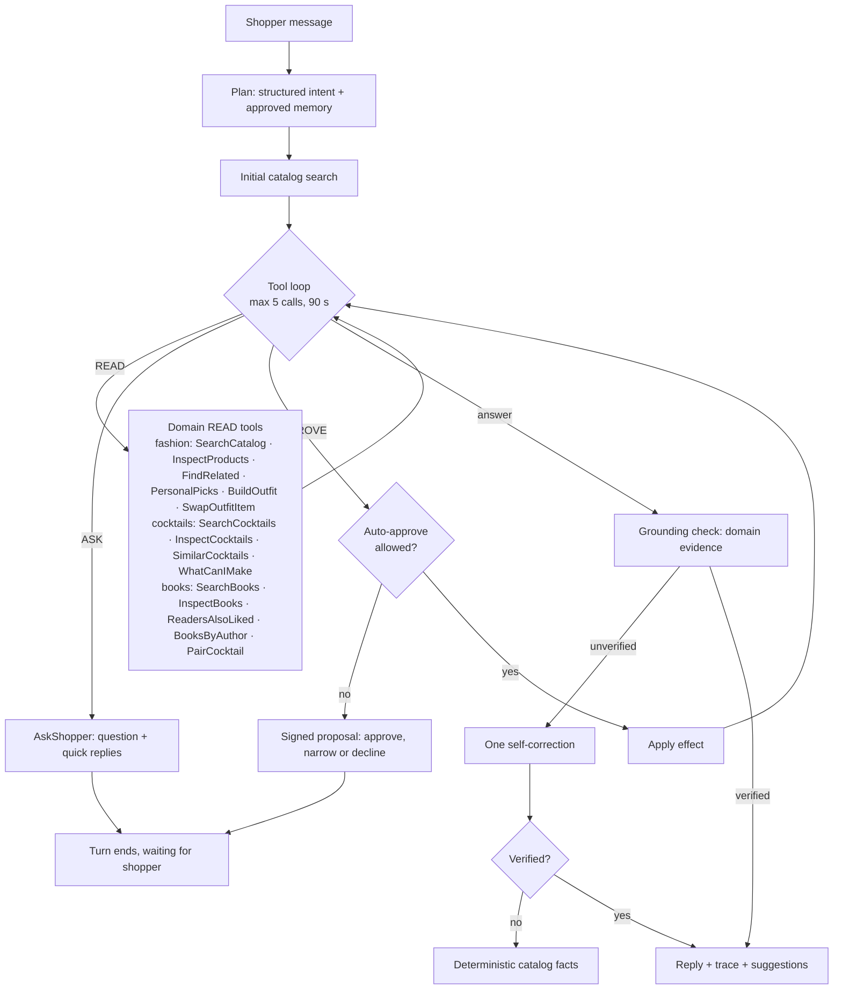

# Curio agent: architecture and review

This page describes how Curio's agent plans, acts, verifies and hands control back to
the shopper, in the fashion, cocktail and book domains. It also records the review of
the recommendation system and the earlier assistant that led to this design.

## One engine, three toolkits

The loop lives once, in `curio.engine` (`engine/agent.py`, `AgentEngine`). Each domain
plugs in a `Toolkit` (`engine/toolkit.py`): its tool schemas and policies, planning, how
READ tools run, how APPROVE effects are validated, the grounding check, the deterministic
fallback and the reply fields.

The code has three layers, and `tests/test_architecture.py` enforces their boundaries:

- `curio.engine`: the loop, the `Toolkit` protocol, policies and the shared `AskShopper`,
  signed proposals (`ActionSigner`, `narrow_args`), the generic grounding machinery (price and
  ID checks, name matching, `merge_reports`), the chat model factory and the wire models every
  turn shares. It imports no domain and not the app.
- `curio.domains.<name>`: a domain's catalog and recommenders beside its `agent/` package
  (toolkit, tools, prompts, grounding check and session schemas: its context fields, card IDs
  and approved effects). A domain imports the engine and itself; only `pairings` builds on
  `books` and `cocktails`.
- `curio.app`: settings, the domain registry, the API and the UI. `app/schemas.py` combines
  every domain's payloads into the one `/chat` wire format, and `app/assistants.py` binds
  each toolkit to the engine with it (`Schemas`).

[`examples/hello_domain`](../examples/hello_domain) is a complete small domain on the same
engine, without the app.

| | Fashion (`ShoppingAssistant`) | Cocktails (`CocktailAssistant`) | Books (`BookAssistant`) |
|---|---|---|---|
| Toolkit | `domains/fashion/agent/` | `domains/cocktails/agent/` | `domains/books/agent/`; PairCocktail from `domains/pairings/agent/` |
| Planning | Structured `SearchIntent` from the LLM, then an initial catalog search | The message is the query; no extra model call before the tool loop | As cocktails |
| Grounding | Euro amounts (including outfit totals) and product IDs | Drink IDs, catalog drink names and recipe amounts | Book IDs, catalog titles and Goodreads ratings; paired drinks' numbers, names and amounts |
| Reply items | `products` | `cocktails` | `books`; a pairing's drinks in `cocktails` and `pairing` |

The engine owns everything shared: the tool-call and time budgets, policy enforcement,
signed proposals and resume, clarifying questions, merging approved effects into the
turn, the self-correction step, the streamed trace and the error mapping. `POST /chat`
picks the assistant by `ChatRequest.domain` (default `fashion`) from the loaded domains in
the domain registry (`app.services.DOMAINS`, see the
[technical guide](technical-guide.md#domain-registry)). Every domain is optional: a request
for a domain the server does not serve gets 503 with how to prepare it, and a served domain
without an LLM gets 503 saying how to enable chat. Every assistant is built once at startup
from one shared `AgentKit` (the chat model and the approval signer), so a proposal is bound
to its tool's domain but verifies on any. A new domain's assistant is a `Toolkit` for the
same engine, built by its loader from that kit.

Books were the test of that claim. The book toolkit needed no change to the loop, budgets,
signing, resume, grounding flow, streaming or UI chat code. The book domain declares its own
session fields (`book_preferences`, `book_shortlist` on `BookContext`), card IDs and approved
effects (`BookEffect`, which names the context field each effect field updates); the app adds
them to its wire models and the book approval tools to `ApprovalTool`.

The book → drink pairing is the one cross-domain feature. The book toolkit registers
PairCocktail and exposes a `DrinkPairing` extension point; the pairings domain implements it
(`CocktailPairing`) with the pairer and `PairedDrinkCheck`, and the app plugs it in when both
books and cocktails are served. So `books` never imports `cocktails` or `pairings`.

## One turn

Every phase emits an `AgentStep` (kind, tool, summary, status, duration). The UI
streams them from `POST /chat/stream` as NDJSON, shows live progress, then keeps a
collapsed "How Curio worked" trace on each answer. A READ tool that works in stages returns
a generator instead of a `(result, step)` pair: the engine streams each step it yields as it
happens and records the returned step last. A `ToolError` raised midway keeps the steps
already streamed and ends with an error step. `BuildOutfit` uses this for one step per slot.

## Tools and policies

Each tool is a strict pydantic schema (`extra="forbid"`, bounded lists and lengths).
Invalid calls return a tool error to the model; nothing runs. The policy, not the
model, decides what a valid call may do.

### Fashion

| Tool | Policy | Backed by |
|---|---|---|
| SearchCatalog | read | CLIP text search; keeps budget, audience, type and colour filters |
| InspectProducts | read | Exact catalog rows for up to five IDs |
| FindRelated | read | Graph recommender (complement, alternative) or CLIP item-to-item (similar) |
| PersonalPicks | read | Learned ranker when deployed, collaborative filtering otherwise, with their reasons |
| BuildOutfit | read | `OutfitPlanner`: plans 3-4 slots for the occasion and fills each under one total budget; streams a step per slot |
| SwapOutfitItem | read | Replaces one slot of the current outfit ("other" or "cheaper", optional refining words) within the budget |
| AskShopper | ask | Ends the turn with a question and 2–4 quick replies |
| SaveToShortlist | approve | Validated product IDs; the shopper approves, narrows or declines |
| RememberPreferences | approve | Values mapped to catalog vocabulary; unknown values are a tool error |

`FindRelated` and `PersonalPicks` reach the recommendation system through
`RecommenderNavigator`. The agent sees ranked IDs plus the same evidence the browsing
pages show ("3 shoppers who bought … also bought this"), so explanations stay grounded.

#### Outfits: multi-step planning with human approval

"Build me a summer outfit for a wedding under €80" is one `BuildOutfit` call. The planner
(`domains/fashion/outfits.py`, described in the [technical guide](technical-guide.md#outfit-builder)) plans
slots from the occasion (a women's wedding: dress, shoes, bag, accessory), searches each
slot's candidates with CLIP restricted to its product types and the audience's sections,
checks that the cheapest pieces fit the budget, then fills the slots in order. Each slot may
spend what the later slots do not need at minimum, and prefers pieces bought together with,
or looking like, the ones already chosen. The trace shows the plan ("Planned 4 slots for
“summer wedding”: dress, shoes, bag, accessory · for women · budget €80.00"), each slot
("Filled shoes: Paloma · €12.99. Best match for “elegant heeled sandals”.") and the result
("Outfit ready: 4 pieces for €77.96 of a €80.00 budget."). A slot the budget cannot cover
is shown as "Could not fill …" with its cheapest price, never dropped silently.

The tool's audience is the one the shopper gave, else a wearer named in the occasion
("wedding outfit for my husband"), else the one their section filters or remembered
sections point to, else the section of the best match (the answer says so). A
remembered budget (`max_price`) caps every piece. The server keeps no outfit: the reply
carries `outfit` with its `state`, the UI sends that back as `TurnContext.outfit`, and the
toolkit re-reads every piece and price from the catalog. The session prompt lists the
current outfit, so "cheaper shoes" or "another top" become `SwapOutfitItem` calls, and
"Save outfit" becomes a `SaveToShortlist` proposal with every piece, which the shopper can
narrow in the approval card. The model is told to quote the tool's total and never add
prices up itself.

### Cocktails

| Tool | Policy | Backed by |
|---|---|---|
| SearchCocktails | read | `CocktailRecommender.search`: query, required ingredients, alcohol, category |
| InspectCocktails | read | Full recipes (ingredients with amounts, glass, method) for up to five drink IDs |
| SimilarCocktails | read | Ingredient-family overlap with one drink |
| WhatCanIMake | read | Pantry matching for 1–15 ingredients, up to three missing |
| AskShopper | ask | Shared with fashion |
| SaveCocktails | approve | 1–5 validated drink IDs for the cocktail shortlist |
| RememberTastes | approve | Alcohol-free, liked and avoided ingredients, mapped to catalog spelling |

Remembered tastes fill missing filters on every search: an alcohol-free taste sets
`non_alcoholic`, and avoided ingredients become exclusions. WhatCanIMake maps each pantry
word to catalog spelling first ("tonic" becomes "Tonic Water"); ambiguous or unknown words
pass through unchanged.

Safety rules are in the cocktail system prompt and in the toolkit: the agent labels alcohol
status, offers alcohol-free drinks to anyone underage, pregnant or driving, does not
encourage excessive drinking, and never claims allergen safety or health effects.
Ingredient filters only cover listed recipe ingredients. The deterministic fallback adds
"Please drink responsibly." when a listed drink contains alcohol, and the cocktail pages
show the same line.

### Books

| Tool | Policy | Backed by |
|---|---|---|
| SearchBooks | read | `BookRecommender.search`: query (including "like <title>"), genres, mood, minimum rating, maximum pages |
| InspectBooks | read | Full details (description, genres, shelves, rating, pages, year, series) for up to five book IDs |
| ReadersAlsoLiked | read | Item-item collaborative filtering from goodbooks-10k ratings; other authors only by default |
| BooksByAuthor | read | The author's books in the catalog, most rated first |
| PairCocktail | read | `BookCocktailPairer`: drinks for one book (ID or title) or the reading list and remembered tastes, with reasons; `alcohol_free`, `exclude_drink_ids` for another pairing |
| AskShopper | ask | Shared with fashion |
| SaveBooks | approve | 1–5 validated book IDs for the reading list |
| RememberReadingTastes | approve | Liked genres, avoided genres and avoided authors, mapped to catalog names |

Remembered tastes apply to every tool: avoided genres and authors are left out, and liked
genres rank higher (a 10 % boost, with the reason "A genre you like"). A genre the reader
asks for in the same call wins over a remembered avoidance of it. Genres and moods must
be catalog names; an unknown one is a tool error that lists the valid ones, so the model
can retry. The book that a "like <title>" search started from counts as evidence, so the
answer may name it. The prompt tells the model to quote ratings exactly, to say ratings are
Goodreads averages and not to reveal endings.

#### Cross-domain: pairing a drink with a book

PairCocktail is the agent's one cross-domain tool. "What should I drink with The Name of the
Wind?" is one call with the title; "pair a cocktail with my reading list" uses the reading
list, liked genres and avoided genres from the turn context. It reads the same deterministic
pairer as `POST /pairings/book-cocktail` ([technical guide](technical-guide.md#book--cocktail-pairing)),
so the agent cites the pairer's reasons rather than inventing its own. The tool is
registered with every book agent; when the server does not serve cocktails it returns a tool
error saying pairing is unavailable, and the session prompt says so.

Safety follows the cocktail rules: a children's or young-adult book is always alcohol-free,
whatever the model asks; the cocktail domain's remembered tastes (`TurnContext.cocktail_preferences`,
which the UI sends with book requests) apply, so an alcohol-free taste keeps every pairing
alcohol-free and avoided ingredients stay out; the prompt adds the cocktail safety rules
(alcohol status for each drink, no encouragement of excessive drinking, no health or allergen
claims), and the fallback ends with the pairer's note ("Please drink responsibly."). The
reply carries the drinks in `cocktails` and the explained `pairing`; its suggestions are
"Another pairing", "Make it alcohol-free" and readers-also-liked. For another pairing the
model sees the drinks earlier answers showed ("Drinks shown (an earlier pairing): drink #269
Old Fashioned") and passes them as `exclude_drink_ids`.

## Human in the loop

The API is stateless. The shortlist, remembered preferences, linked shopping history
and approval policy live on the client and are sent with each request (`TurnContext`).

1. When the agent calls an approval tool, the server validates the arguments against
   the catalog and returns `status="needs_approval"` with a `pending_action`.
2. The proposal is HMAC-SHA256 signed over its ID, tool, arguments, originating
   request, the proposing turn's search filters (`intent`) and issue time. It expires
   after 30 minutes. On resume the engine rebuilds the turn from those filters.
3. The client answers with `decision: {action, approved, edited_args}`. Edits may only
   remove values (a subset of product IDs, dropped preferences). A forged, modified,
   widened or expired proposal is rejected with HTTP 409.
4. On approval the server returns an `applied` effect for the client to store, merges it
   into the turn's context the way the UI does, and the agent continues the turn to
   confirm. Later searches in that turn use the approved change. An effect that touches
   no items (remembering preferences) leaves the shown cards in place. A resumed turn
   cannot pause for another proposal or question.

Shoppers can opt into auto-approval per tool in the session panel. Auto-approved
actions still run through the same validation and appear in the trace.

`AGENT_SIGNING_KEY` sets the signing key. Without it, a random per-process key is used,
so pending proposals expire on restart. Set it when running several API workers.

## Grounding guardrail

### Fashion

After drafting, every euro amount and product ID in the answer is checked against
products returned by tools this turn, products referenced in history and the shortlist.
Allowed amounts are evidence prices, differences between two evidence prices, numbers
the shopper typed and active budget filters. For an outfit built or swapped this turn, and
for the outfit the client sent, they also include its total, its budget, what is left, the
cheapest complete outfit, the shortfall and the cheapest price of a slot that did not fit;
a piece swapped out stays evidence. A wrong total ("€73.50" for a €75.96 outfit) is an
unverified claim like a wrong price, so it is rewritten or replaced. A whole-euro mention within €1 of a real
price ("about €35" for €34.99) is accepted. Negative amounts are always rejected.

An unverified draft gets one rewrite request listing the issues. If the rewrite still
fails, or tries to call tools, the reply falls back to a deterministic list of verified
catalog facts. The UI shows a verified, self-corrected or fallback badge.

The check covers prices and IDs only. It does not verify colours, materials or other
descriptive claims.

### Cocktails

`CocktailGroundingCheck` checks three things against drinks returned by tools this turn,
drinks in history and the cocktail shortlist:

- Drink IDs must have been returned.
- Catalog drink names, matched case-sensitively in catalog spelling, must have been
  returned or typed by the shopper. A name inside a longer glass or ingredient name
  ("Martini" in "Martini Glass") does not count, and names that are also ingredient names
  ("Limeade") are ignored.
- Ingredient amounts ("1 1/2 oz") must match an amount in an evidence recipe or one the
  shopper typed. Malformed measures with a zero denominator are skipped.

The same self-correction and fallback apply. Descriptive claims (taste, strength) are not
verified.

### Books

`BookGroundingCheck` checks, against books returned by tools this turn, books in history
and the reading list:

- Book IDs ("[id 192]", "book #192") must have been returned.
- Catalog titles, matched case-sensitively, must have been returned (or be the series of a
  returned book) or typed by the reader. Only titles unlikely to be ordinary words are
  checked: several words, or one word of at least six letters ("Twilight", not "It" or
  "Room"). A one-word title is checked only where the answer marks it as a title (bold,
  italic or quoted, next to its "[id N]", or followed by "by <author>"), so "Beloved by
  fans" or "Remember that" are ordinary words; the prompt asks for bold titles. A title that
  is also an author, genre or mood name ("Mystery") is ignored, and so is a title inside
  one ("George" in "George Orwell").
- Ratings ("★ 4.55", "rated 4.6", "4.5/5", "4.3 stars") must match an evidence book's
  Goodreads average at the precision written (4.6 may round 4.55; 4.55 must be exact) or
  a number the reader typed.

The fallback lists "Title by Author · ★ rating" for the shown books, then the drinks a
pairing returned (`Toolkit.fallback` receives the turn's extras). Plot, page counts and
years in prose are not verified.

Drinks in a book answer are checked by `PairedDrinkCheck` against the drinks PairCocktail
returned in the same turn only: earlier answers' drinks are context, never evidence, so the
model calls the tool again to talk about them.

- Drink numbers ("drink #12"; "[id 12]" means a book) must have been returned.
- Catalog drink names count only where the answer marks them as names (bold, italic, quoted
  or next to their "drink #N"), because in a book answer "Manhattan", "Brooklyn" or "San
  Francisco" are usually places. A drink name inside a longer evidence book title or author
  ("Casino" in "Casino Royale") is the book.
- Ingredient amounts must match a paired recipe, checked only in turns that paired drinks.
- Book titles accept the paired drinks' names ("Death in the Afternoon" is both) and titles
  the pairer's reasons cite (a lore line names The Long Goodbye).

An invented drink ("**Negroni** (drink #257)" when the pairing returned an Old Fashioned)
is an unverified claim like an invented rating: one rewrite, then the fallback.

## Budgets and failure handling

- At most five tool calls per turn, then a grounded fallback.
- A 90-second wall-clock budget, checked before every model call, including the
  self-correction call. When it is spent the trace shows a "Time budget" step and the
  answer falls back to catalog facts.
- Provider failures map to safe HTTP errors (429 retry, 502 otherwise). On the
  streaming endpoint they arrive as an `error` event; provider details stay in server logs.

## Feedback

Each completed answer has thumbs up/down. `POST /chat/feedback` stores the rating with
the question, answer, product IDs and tools used in a bounded in-memory buffer.
`GET /chat/feedback` summarises counts and the ten most recent negative ratings for review.
The buffer is not persisted.

## Review findings (November 2026)

### Recommendation system

The recommendation side is careful work. Every purchase-derived signal is trained
strictly before the holdout, baselines include the strong buy-again strategy, paired
customer intervals are reported, and frozen confirmation cohorts are protected from
reuse. Recommenders share one protocol, return deterministic tie-breaks and attach
human-readable evidence.

Observations, none changed in this iteration:

- `ContentBasedRecommender` returns raw popularity counts as scores when a shopper has
  no embedded purchases, while every other fallback scores 0. Scores are not comparable
  across fallbacks.
- `GraphRecommender._scores` iterates every product that shares an attribute with each
  purchase. High-degree attributes such as a common colour make this cost grow with
  catalog size; per-feature caps would bound latency.
- The learned ranker's improvement over buy-again is not established (the paired interval
  crosses zero), which the evaluation page already states.

### Earlier assistant

The previous assistant was a clean, bounded two-tool loop with validated read-only
actions. Gaps addressed here:

| Gap | Change |
|---|---|
| The agent could not use the recommendation system | FindRelated and PersonalPicks reuse graph, CLIP and ranker evidence |
| No visibility into what the agent did | Per-step trace, streamed live over NDJSON |
| Answers were not checked against tool results | Price/ID grounding check, one self-correction, deterministic fallback |
| No way to ask a clarifying question | AskShopper with quick replies |
| No actions on shopper state, so no human-in-the-loop surface | Approval-gated shortlist and memory with signed, narrow-only proposals |
| A 6–57 s request behind one spinner | Live step progress and a turn time budget |
| No quality signal from real use | Answer feedback endpoint |
| The UI crashed on empty 204 responses | `call_api` returns an empty result for responses without a body |

## Limits

- The shortlist, reading list and memory last for the browser session only, kept per domain.
- The grounding check verifies prices, IDs, drink names, amounts, book titles and ratings,
  not descriptive claims.
- Book titles that are a single short word ("It", "Dune") are not checked, so the agent
  could name such a book without evidence.
- A drink name the answer does not mark as a name (no bold, quotes or "drink #N") is read as
  prose and not checked. Pairing themes are hand-written rules over crowd shelves, not a
  taste model, and lore covers only a handful of authors.
- Cocktail ingredient filters and avoided ingredients are not allergen guarantees.
- Pantry words are mapped to catalog spelling only when the match is unique; "whiskey,
  lemon, sugar" does not yet find Whiskey Sour, whose recipe lists "Blended whiskey" and
  "Powdered sugar".
- Feedback stays in memory and resets when the API restarts.
- The live behaviour of a real LLM with the new tools has not been evaluated at scale;
  unit and UI tests use scripted models.
- Outfit coherence is a CLIP query per slot plus co-purchase and photo similarity; there is
  no colour-harmony or style model, so a dress and earrings can clash. Occasion templates
  are keyword-based and English-only, and the photo index has few men's and children's
  shoes. The outfit lives in the client session only.
