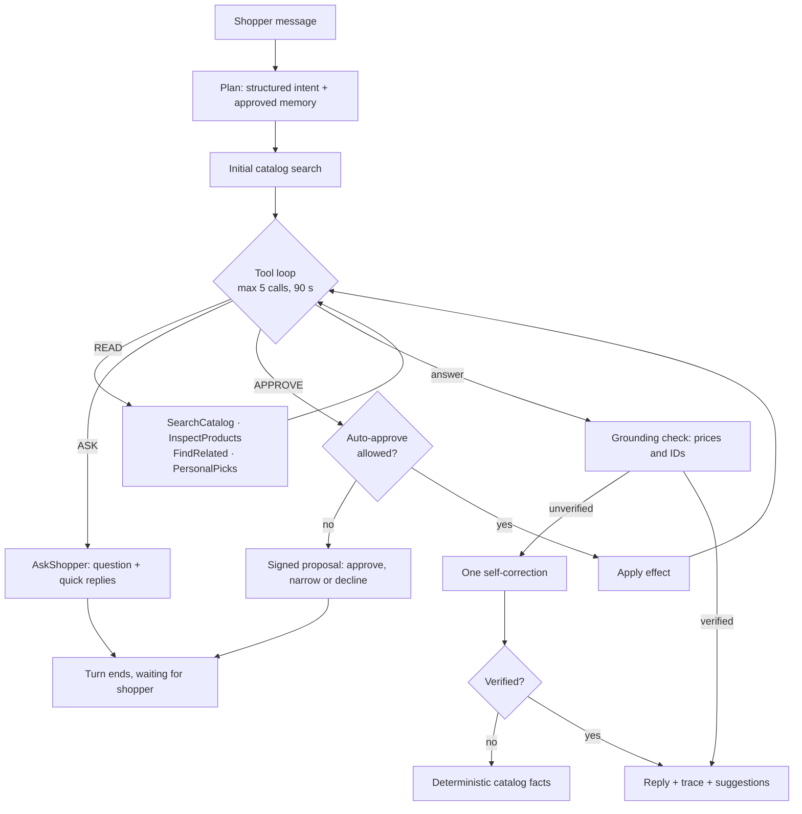

# Curio agent: architecture and review

This page describes how the shopping agent plans, acts, verifies and hands control
back to the shopper. It also records the review of the recommendation system and
the earlier assistant that led to this design.

## One turn

Every phase emits an `AgentStep` (kind, tool, summary, status, duration). The UI
streams them from `POST /chat/stream` as NDJSON, shows live progress, then keeps a
collapsed "How Curio worked" trace on each answer.

## Tools and policies

Each tool is a strict pydantic schema (`extra="forbid"`, bounded lists and lengths).
Invalid calls return a tool error to the model; nothing runs. The policy, not the
model, decides what a valid call may do.

| Tool | Policy | Backed by |
|---|---|---|
| SearchCatalog | read | CLIP text search; keeps budget, audience, type and colour filters |
| InspectProducts | read | Exact catalog rows for up to five IDs |
| FindRelated | read | Graph recommender (complement, alternative) or CLIP item-to-item (similar) |
| PersonalPicks | read | Learned ranker when deployed, collaborative filtering otherwise, with their reasons |
| AskShopper | ask | Ends the turn with a question and 2–4 quick replies |
| SaveToShortlist | approve | Validated product IDs; the shopper approves, narrows or declines |
| RememberPreferences | approve | Values mapped to catalog vocabulary; unknown values are a tool error |

`FindRelated` and `PersonalPicks` reach the recommendation system through
`RecommenderNavigator`. The agent sees ranked IDs plus the same evidence the browsing
pages show ("3 shoppers who bought … also bought this"), so explanations stay grounded.

## Human in the loop

The API is stateless. The shortlist, remembered preferences, linked shopping history
and approval policy live on the client and are sent with each request (`TurnContext`).

1. When the agent calls an approval tool, the server validates the arguments against
   the catalog and returns `status="needs_approval"` with a `pending_action`.
2. The proposal is HMAC-SHA256 signed over its ID, tool, arguments, originating
   request and issue time. It expires after 30 minutes.
3. The client answers with `decision: {action, approved, edited_args}`. Edits may only
   remove values (a subset of product IDs, dropped preferences). A forged, modified,
   widened or expired proposal is rejected with HTTP 409.
4. On approval the server returns an `applied` effect for the client to store, and the
   agent continues the turn to confirm. A resumed turn cannot pause for another
   proposal or question.

Shoppers can opt into auto-approval per tool in the session panel. Auto-approved
actions still run through the same validation and appear in the trace.

`AGENT_SIGNING_KEY` sets the signing key. Without it, a random per-process key is used,
so pending proposals expire on restart. Set it when running several API workers.

## Grounding guardrail

After drafting, every euro amount and product ID in the answer is checked against
products returned by tools this turn, products referenced in history and the shortlist.
Allowed amounts are evidence prices, differences between two evidence prices, numbers
the shopper typed and active budget filters. A whole-euro mention within €1 of a real
price ("about €35" for €34.99) is accepted. Negative amounts are always rejected.

An unverified draft gets one rewrite request listing the issues. If the rewrite still
fails, or tries to call tools, the reply falls back to a deterministic list of verified
catalog facts. The UI shows a verified, self-corrected or fallback badge.

The check covers prices and IDs only. It does not verify colours, materials or other
descriptive claims.

## Budgets and failure handling

- At most five tool calls per turn, then a grounded fallback.
- A 90-second wall-clock budget, checked before every model call.
- Provider failures map to safe HTTP errors (429 retry, 502 otherwise). On the
  streaming endpoint they arrive as an `error` event; provider details stay in server logs.

## Feedback

Each completed answer has thumbs up/down. `POST /chat/feedback` stores the rating with
the question, answer, product IDs and tools used in a bounded in-memory buffer.
`GET /chat/feedback` summarises counts and the ten most recent negative ratings for review.
The buffer is not persisted.

## Review findings (November 2026)

### Recommendation system

The recommendation side is careful work. Every purchase-derived signal is trained
strictly before the holdout, baselines include the strong buy-again strategy, paired
customer intervals are reported, and frozen confirmation cohorts are protected from
reuse. Recommenders share one protocol, return deterministic tie-breaks and attach
human-readable evidence.

Observations, none changed in this iteration:

- `ContentBasedRecommender` returns raw popularity counts as scores when a shopper has
  no embedded purchases, while every other fallback scores 0. Scores are not comparable
  across fallbacks.
- `GraphRecommender._scores` iterates every product that shares an attribute with each
  purchase. High-degree attributes such as a common colour make this cost grow with
  catalog size; per-feature caps would bound latency.
- The learned ranker's improvement over buy-again is not established (the paired interval
  crosses zero), which the evaluation page already states.

### Earlier assistant

The previous assistant was a clean, bounded two-tool loop with validated read-only
actions. Gaps addressed here:

| Gap | Change |
|---|---|
| The agent could not use the recommendation system | FindRelated and PersonalPicks reuse graph, CLIP and ranker evidence |
| No visibility into what the agent did | Per-step trace, streamed live over NDJSON |
| Answers were not checked against tool results | Price/ID grounding check, one self-correction, deterministic fallback |
| No way to ask a clarifying question | AskShopper with quick replies |
| No actions on shopper state, so no human-in-the-loop surface | Approval-gated shortlist and memory with signed, narrow-only proposals |
| A 6–57 s request behind one spinner | Live step progress and a turn time budget |
| No quality signal from real use | Answer feedback endpoint |
| The UI crashed on empty 204 responses | `call_api` returns an empty result for responses without a body |

## Limits

- The shortlist and memory last for the browser session only.
- The grounding check verifies prices and IDs, not descriptive claims.
- Feedback stays in memory and resets when the API restarts.
- The live behaviour of a real LLM with the new tools has not been evaluated at scale;
  unit and UI tests use scripted models.
