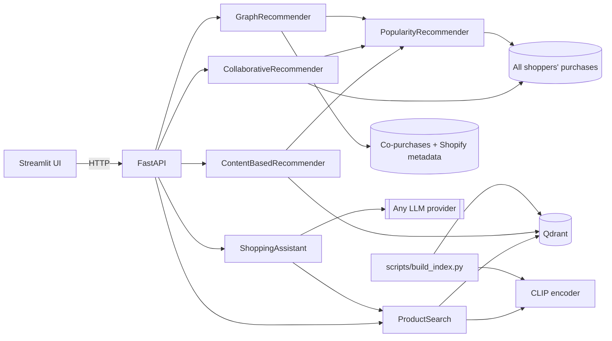

# Curio technical guide

[Back to the product overview](../README.md).

## Fashion engine


Recommendations use historical H&M transactions. Photo search has its own image index.

| Feature | How it works |
|---|---|
| Learned ranking | A past-trained linear relevance model combines repeat purchases, collaborative candidates, popularity and catalog affinities. Scores describe ranking, not purchase probability. |
| Text-to-image search | The query is embedded with CLIP's text encoder and compared with the CLIP image embeddings of every product in Qdrant. |
| Image search | An uploaded photo is embedded with CLIP's image encoder and compared the same way. Example photos show H&M garments outside the sampled catalog, so every match is a different product. |
| Visually similar products | A product's own image embedding is the query (CLIP item-to-item), shown next to the graph's co-purchase complements and alternatives. |
| Content-based recommendations | One *taste vector* per interest: for each of the three product groups a user buys most (e.g. dresses, leggings), the recency-weighted mean of those purchases' image embeddings, searched within that group and the sections it was bought from. Groups get slots by weight, so a dress buyer who also buys leggings sees both. |
| Collaborative recommendations | Item-to-item collaborative filtering over all ~480,000 shoppers in the 12-week window, not just the sample: a product scores by how many shoppers bought it together with the customer's purchases, recent purchases weighted more and best-sellers damped. Each result names the purchase behind it ("163 shoppers who bought Bradley trousers also bought this"). Its explanations expose the underlying co-purchase evidence. |
| Graph recommendations | Past purchases seed an in-memory graph of co-purchases, Shopify categories and attributes. Shared attributes are weighted by inverse degree; each result includes its evidence. |
| Knowledge graph | Explore a product's category, attributes and co-purchased neighbors, with complementary products and higher-priced alternatives. |
| Offline evaluation | Every strategy is trained on purchases before a cutoff and scored on the following week (MAP@12, catalog coverage); the Model quality page compares them. |
| Tool-using shopping agent | The LLM extracts constraints, retrieves matches, and can refine a visual search or inspect exact product IDs for details and comparisons. Follow-ups reload prior cards from the catalog. Up to four validated read-only tool calls per turn; budget and metadata filters survive query refinements. |

Users without usable purchase history get the products all shoppers bought most in the last
week of data, which also fill lists that come up short.

The Fashion page has ten example customers from the historical data, two per section
(Ladieswear, Divided, Menswear, Sport, Baby/Children). Each has a coherent
history (6-30 products, at least 80% from one section), ten collaborative recommendations
all backed by co-purchases (no best-seller filler) that stay in their sections and cover
their main product group, and a purchase with co-purchased complements for the graph. The checks only read the
recommenders' output; nothing is tuned for these customers. "Browse all customers" keeps
everyone else accessible, and offline evaluation scores all eligible customers.

## Data

The app uses the [H&M Personalized Fashion Recommendations](https://www.kaggle.com/competitions/h-and-m-personalized-fashion-recommendations)
dataset from Kaggle: 105k articles with photos and 31.8M real purchases from 2018 to 2020.
`scripts/prepare_data.py` keeps the last 12 weeks of transactions, samples 5,000 customers
with at least five purchases, and extracts the photos of the products they bought.
It also writes `co_purchases.parquet`, with links between catalog products learned from all
shoppers in that window, including shoppers outside the demo sample. Repeated purchases
of one item count once per basket; pairs need at least two shared baskets. It also writes
`shopper_purchases.parquet`: every shopper's purchases of catalog products (3.0M rows from
about 480,000 shoppers, under anonymous integer ids), which popularity and collaborative
filtering learn from. The 5,000 sampled customers alone made 2% of those purchases, far
too few to rank 14,300 products.

The dataset's prices are normalised. Multiplying them by 590 (a convention from the Kaggle
competition discussion) gives realistic euro price points such as €29.99, so the prices shown
are approximations. H&M licenses the data for non-commercial research use, so it is not part
of this repository.

New preparations also retain `product_code`, `department_name` and `index_name` in
products, and `price_normalized` (the original source units) and `sales_channel_id`
(1 store, 2 online) on both sampled and crowd events. `users.parquet.shopper_id`
provides the explicit mapping into that preparation's crowd events; **do not join
sampled `user_id` directly to crowd `shopper_id`**, or combine mappings from different
preparations. Original customer identifiers are not saved. Serving responses retain
their existing fields, and older prepared datasets remain supported.

Prepare experimental inputs separately from the running app:

```sh
uv run python -m scripts.prepare_data --archive data/raw/csvs --data-dir data/experiments/enriched
```

The same preparation accepts local Hugging Face Parquet shards arranged as
`{articles,customers,transactions}/*.parquet`, streaming transaction batches rather
than converting the full history to CSV:

```sh
uv run python -m scripts.prepare_data --archive data/raw/hf --data-dir data/experiments/enriched
```

Shards are read in sorted filename order. A root CSV and shards for the same table
are rejected as ambiguous; malformed shards fail preparation rather than being skipped.
Raw source files and prepared outputs remain local and ignored by Git.

This command retains the existing full-window sampling rule; it does not create a
new untouched evaluation set. New historical price features must use event prices
before each cutoff, rather than the displayed full-window product median. Existing
prepared files gain these fields only after regeneration.

### Shopify enrichment and graph behavior

The saved mapping in `taxonomy/hm_shopify_categories.json` assigns H&M product types to
Shopify's pinned `2026-05` taxonomy. Colour, pattern, gender and age attributes use explicit
field mappings. Ambiguous types and values stay unmapped. The classification script uses
conservative exact matches, then CLIP/word-overlap candidates and an LLM decision; its
results need review. Normal data preparation and graph recommendations make no LLM calls.
Older prepared catalogs without enrichment still load, using empty attributes and an
uncategorized category until the data is prepared again.

Graph scores sum co-purchase lift and shared-feature evidence across distinct past
purchases. A shared feature contributes `1 / (degree - 1)`, reducing the influence of
common attributes. Popularity fills short lists. Scores are ranking signals, not purchase
probabilities, and this baseline has not established a quality improvement.

The dataset has no basket ID: one customer on one day is a basket proxy. Complementary
suggestions require co-purchase evidence across different product groups. Higher-priced
alternatives require the same specific Shopify category, product type and section, with no
conflicting mapped gender/age attributes. Broad or unclassified categories return no
alternatives. Price does not establish quality or upsell value.

## Architecture



```
src/clothes_recommender/
├── config.py          # Settings from env / .env (pydantic-settings)
├── domain.py          # Product, User, Purchase, ProductFilter, Encoder protocol
├── catalog.py         # Product catalog + customer data access
├── embeddings.py      # CLIP encoder (lazy-loaded)
├── vector_store.py    # Qdrant wrapper: upsert, filtered search, vector lookup
├── search.py          # Text and image search
├── recommenders/      # content_based, collaborative, graph, popularity
├── chat/              # llm (provider-agnostic), intent, prompts, assistant
├── services.py        # Composition root
├── api.py             # FastAPI app
└── ui.py              # Streamlit client
scripts/prepare_data.py # Sample the H&M Kaggle archive (or its unzipped CSVs) into data/
scripts/fetch_photos.py # Download the sampled products' photos from the mirror
scripts/fetch_query_photos.py # Example image-search photos of garments outside the catalog
scripts/build_index.py # Embed product photos with CLIP, upsert into Qdrant
scripts/classify_product_types.py # Reviewable H&M-to-Shopify category decisions
scripts/evaluate.py # Chronological holdout evaluation; JSON results for the Model quality page
scripts/take_screenshots.py # Re-capture the README screenshots with Playwright
```

## Quick start

Requires [uv](https://docs.astral.sh/uv/) and Python 3.13.

```bash
uv sync --all-extras
cp .env.example .env                                   # optional: configure an LLM for the chat tab
```

Get the H&M data in one of two ways. The Kaggle archive needs a free account with the
[competition rules](https://www.kaggle.com/competitions/h-and-m-personalized-fashion-recommendations/rules)
accepted and an API token in `~/.kaggle/kaggle.json`; the download is about 30 GB.

```bash
uvx kaggle competitions download -c h-and-m-personalized-fashion-recommendations -p data/raw
uv run python -m scripts.prepare_data                  # photos are extracted from the zip
```

Without a Kaggle account, use the CSVs (3.7 GB) of the
[Hugging Face mirror](https://huggingface.co/datasets/einrafh/hnm-fashion-recommendations-data)
and fetch only the photos of the sampled products (about 35 minutes for the 14,300 products
of the default sample, 360 MB after downsizing):

```bash
M=https://huggingface.co/datasets/einrafh/hnm-fashion-recommendations-data/resolve/acde210b0090be673abdba5f989c48925c856f78/data/raw
mkdir -p data/raw && for f in articles customers transactions_train; do curl -L -o data/raw/$f.csv $M/$f.csv; done
uv run python -m scripts.prepare_data --archive data/raw
uv run python -m scripts.fetch_photos --data-dir data --workers 8
```

Then build the image index, fetch a few example photos for image search, and start the app:

```bash
uv run python -m scripts.build_index                   # all products: ~5 min at 50 img/s on 4 CPU cores
uv run python -m scripts.fetch_query_photos --articles data/raw/articles.csv
uv run python -m scripts.evaluate --qdrant-path .qdrant --output data/evaluation.json
uv run uvicorn clothes_recommender.api:create_app --factory --reload   # http://localhost:8000/docs
uv run streamlit run src/clothes_recommender/ui.py     # http://localhost:8501
```

The example photos show H&M garments that are not in the sampled catalog, so image search
always has to find a different product that looks alike. `scripts.evaluate` writes the
results that the Model quality page shows; without it, that tab explains how to create them.

`build_index --limit N` indexes a smaller subset spread across sections. Qdrant runs
embedded (stored in `.qdrant/`) unless `QDRANT_URL` is set, so no external service is needed.
Embedded Qdrant allows one process at a time: build the index and run the evaluation before
starting the API (or point everything at a Qdrant server).

### Docker

```bash
docker compose up --build
docker compose exec api python -m scripts.build_index --limit 3000
```

### LLM configuration

The assistant works with any LangChain chat provider, configured only through `.env`:

```bash
LLM_PROVIDER=openai                       # openai | anthropic | azure_openai | ...
LLM_MODEL=gpt-4.1-mini
LLM_API_KEY=sk-...
LLM_BASE_URL=                             # set for OpenAI-compatible gateways
```

Any OpenAI-compatible gateway (OmniRoute, OpenRouter, LiteLLM, Ollama, vLLM) works with
`LLM_PROVIDER=openai` plus `LLM_BASE_URL`. For a local OmniRoute gateway, set
`LLM_BASE_URL=http://127.0.0.1:20128/v1`, choose an available gateway model ID for
`LLM_MODEL`, and keep the gateway key in `.env`. The API uses this configuration
for both intent extraction and catalog-grounded replies. Without `LLM_MODEL`
every feature except chat still works.

## API

| Method | Path | Description |
|---|---|---|
| GET | `/health` | Index size and whether chat is enabled |
| GET | `/products/{id}` | Product details |
| GET | `/products/{id}/graph` | Bounded product neighborhood: nodes and edges |
| GET | `/products/{id}/related?kind=complement\|alternative` | Co-purchased complements or higher-priced alternatives |
| GET | `/products/{id}/similar` | Products whose photos look most alike (CLIP item-to-item) |
| GET | `/sections` | Catalog sections, for filtering text search |
| POST | `/search/text` | `{"query": "red floral dress", "top_k": 10, "section": "Ladieswear"}` (section optional) |
| POST | `/search/image` | Multipart image upload |
| GET | `/search/examples`, `/search/examples/{id}/image` | Example query photos of garments outside the catalog |
| GET | `/users`, `/users/{id}` | User ids; profile with purchase history |
| GET | `/demo/customers` | Up to ten descriptive customer examples and starting products |
| GET | `/users/{id}/recommendations?strategy=learned\|repeat\|collaborative\|graph\|content` | Personalised recommendations; learned, repeat, collaborative and graph hits include reasons |
| POST | `/chat` | `{"message": "...", "history": [...]}` |
| GET | `/evaluation` | Offline evaluation results saved by `scripts.evaluate --output` |

Interactive docs at `http://localhost:8000/docs`.

## Offline evaluation

Train the optional learned model before starting the API. Its default leaves the
last week out; explicit training dates make comparisons reproducible:

```bash
uv run python -m scripts.train_ranker --data-dir data --train-through 2020-09-15
uv run python -m scripts.evaluate --data-dir data --ranker data/ranker.json \
  --qdrant-path .qdrant --output data/evaluation.json
```

A fresh model is loaded at API startup. Without it, the existing strategies work
and `strategy=learned` returns 503. Evaluation rejects any artifact whose training
reaches the holdout cutoff. On the 819-customer final week, observed MAP@12 is
0.0302 versus 0.0248 for deterministic buy-again; hit rate is 13.9% versus 11.1%.
The paired bootstrap interval crosses zero, so this does not establish superiority
from that week alone. Full evidence and the three earlier validations are in the
[recommendation audit](recommendation-audit.md).
A [further BPR, sampling and training-scale iteration](recommendation-iteration2.md)
tested seven new designs. More supervision reached MAP .036754 on one development
week but regressed on the other; no design passed both weeks or was promoted.
A [ranking follow-up and customer-disjoint check](recommendation-ranking-followup.md)
raised observed scores again; the frozen challenger still failed its promotion gates.
The [complementary retrieval experiment](recommendation-retrieval.md) adds
family, recent-basket and latent channels: candidate reach improves on both development
weeks, but the ranking challenger remains unpromoted.
The [fixed-pool provenance experiment](recommendation-provenance.md) adds an
opt-in versioned feature contract; its mixed development results were not promoted.
See the [quality research and implementation direction](recommendation-research.md)
for the retrieval bottleneck, dataset comparison and next experiments.

The full holdout, including repeat purchases, is now the primary comparison.
`strategy=repeat` exposes the strong recent-purchases plus best-sellers baseline.
Evaluation reports customer hit rate and macro recall@12 beside MAP@12, and keeps
unrestricted popularity separate from new-item-only popularity. See the current
[recommendation audit](recommendation-audit.md) for reproduced validation and
MVP work; the earlier new-item benchmark below describes the previous branch state.
Use `--holdout-end YYYY-MM-DD` to reproduce earlier validation weeks.

```bash
uv run python -m scripts.evaluate --data-dir data
# Content-based recommendations need an explicitly chosen matching image index;
# --output saves the JSON that GET /evaluation and the Model quality page show:
uv run python -m scripts.evaluate --data-dir data --qdrant-path .qdrant --output data/evaluation.json
```

The last seven calendar days (2020-09-16 to 09-22) are held out. Popularity, collaborative
filtering and co-purchase links are rebuilt from every shopper's purchases before that
week; nothing from the holdout week reaches training. Results on the default sample (5,000
customers, seed 42; 819 of them bought in the holdout week, 794 something new):

| Strategy | MAP@12, new items | vs popularity | MAP@12, all purchases | Catalog coverage |
|---|---|---|---|---|
| Collaborative (item-to-item, all shoppers) | 0.0168 | 1.40x | 0.0160 | 24.9% |
| Popularity (all shoppers, last 7 days) | 0.0119 | 1.00x | 0.0113 | 0.1% |
| Knowledge graph | 0.0101 | 0.85x | 0.0097 | 18.4% |
| Content-based | 0.0054 | 0.45x | 0.0052 | 32.4% |

Recommenders never repeat a past purchase, so "new items" is the fair column. JSON output
also includes list fill. Users without both training and holdout purchases are excluded.

### What the recommendation audit found

An audit of the earlier system found the recommenders learning from the 5,000 sampled
customers only, 2% of the window's purchases. Each fix was measured on the holdout week:

| Change | Before | After |
|---|---|---|
| Collaborative: user-based on the sample -> item-to-item on all shoppers | 0.0088 | 0.0168 |
| Popularity: sample, 14 days -> all shoppers, 7 days | 0.0050 | 0.0119 |
| Graph evaluation: links from the sample -> all shoppers, as in production | 0.0077 | 0.0101 |
| Content-based: one averaged taste vector -> one per product group | 0.0046 | 0.0054 |

Settings were chosen on three earlier validation weeks (holdouts starting 08-26, 09-02 and
09-09) and the table above was measured once afterwards. The chosen collaborative settings
(popularity damping 0.3, a 7-day half-life on the customer's history) scored best on the
validation mean; 7 days of popularity beat 5 and 14. Two ideas were tested and dropped:

- **Padding photos to a square before CLIP**, so its center crop keeps a dress's neckline
  and hem, made content-based worse (0.0052 to 0.0032): the crop keeps fabric, print and
  colour at a higher resolution, which predicts purchases better.
- **Fusing strategies with reciprocal rank fusion.** The earlier hybrid (collaborative +
  content) was the best strategy against the weak user-based CF, but next to item-to-item
  CF fusion added nothing (+0.1% on validation) and fusing content hurt (-18%), so the
  hybrid was removed.

Re-recommending a customer's own recent purchases would score 0.0212 on all purchases,
because many H&M customers rebuy items. The recommenders exclude past purchases by design,
which costs that signal on the "all purchases" column.

The prepared sample and catalog can reflect the full observation window (the catalog is
the set of products the sample bought), so these are sample-level results, not a
population estimate or a competition leaderboard score. In evaluation, co-purchase lift
counts only baskets with catalog products. CLIP image vectors are fixed features, but index
provenance is not recorded.

The development workflow and remaining validation are recorded in
[engineering workflow](engineering-workflow.md).

## Development

```bash
uv run pytest                        # fast, offline unit tests (fake encoder, in-memory Qdrant, fake LLM)
uv run pytest -m integration        # tests that download the real CLIP model
uv run ruff check . && uv run ruff format --check .

# Re-capture README screenshots (API + UI running; uses the local Google Chrome)
uv run python -m scripts.take_screenshots --example 5 --skip-chat
```

### Release scope and compatibility

This is Curio's fashion-only portfolio release. The installable distribution is
`curio-recommendations`; the `clothes_recommender` import path remains stable for
existing scripts. Work on other recommendation domains is saved on
`next/curio-multidomain`, outside this release.

