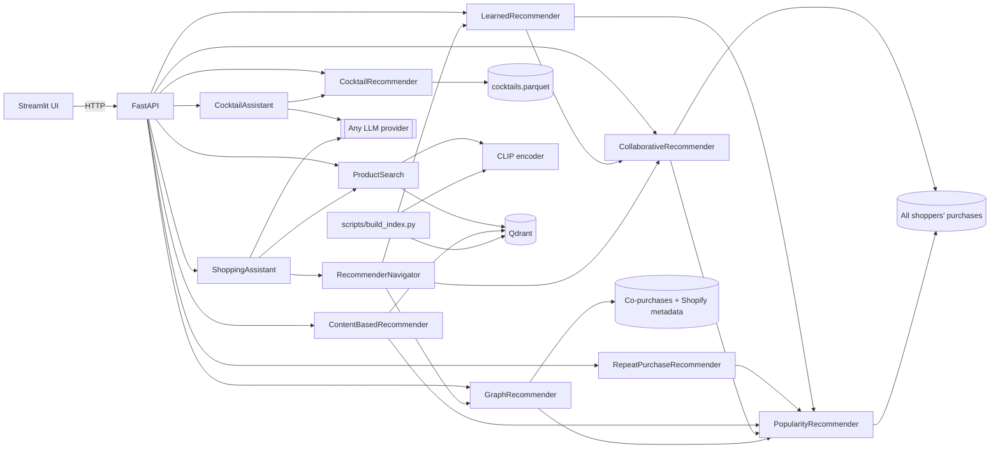

# Curio technical guide

[Back to the product overview](../README.md).

Curio has two domains, fashion and cocktails, behind one API, one Streamlit UI and
one agent engine. Fashion needs the prepared H&M data and image index; cocktails need only
`data/cocktails.parquet`. Every domain is optional at serving time: the API serves whichever
domains are prepared, so the [quick start](#quick-start) runs with cocktails alone.

## Fashion engine

Recommendations use historical H&M transactions. Photo search has its own image index.

| Feature | How it works |
|---|---|
| Learned ranking | A past-trained linear relevance model combines repeat purchases, collaborative candidates, popularity and catalog affinities. Scores describe ranking, not purchase probability. |
| Text-to-image search | The query is embedded with CLIP's text encoder and compared with the CLIP image embeddings of every product in Qdrant. |
| Image search | An uploaded photo is embedded with CLIP's image encoder and compared the same way. Example photos show H&M garments outside the sampled catalog, so every match is a different product. |
| Visually similar products | A product's own image embedding is the query (CLIP item-to-item), shown next to the graph's co-purchase complements and alternatives. |
| Content-based recommendations | One *taste vector* per interest: for each of the three product groups a user buys most (e.g. dresses, leggings), the recency-weighted mean of those purchases' image embeddings, searched within that group and the sections it was bought from. Groups get slots by weight, so a dress buyer who also buys leggings sees both. |
| Collaborative recommendations | Item-to-item collaborative filtering over all ~480,000 shoppers in the 12-week window, not just the sample: a product scores by how many shoppers bought it together with the customer's purchases, recent purchases weighted more and best-sellers damped. Each result names the purchase behind it ("163 shoppers who bought Bradley trousers also bought this"). Its explanations expose the underlying co-purchase evidence. |
| Graph recommendations | Past purchases seed an in-memory graph of co-purchases, Shopify categories and attributes. Shared attributes are weighted by inverse degree; each result includes its evidence. |
| Knowledge graph | Explore a product's category, attributes and co-purchased neighbors, with complementary products and higher-priced alternatives. |
| Offline evaluation | Every strategy is trained on purchases before a cutoff and scored on the following week (MAP@12, catalog coverage); the Model quality page compares them. |
| Tool-using shopping agent | The LLM plans a structured search, then uses policy-gated tools: catalog search, exact inspection, related pieces from the graph/CLIP index and personal picks from the ranker. It can ask a clarifying question, and proposes shortlist or memory changes for the shopper to approve. Answers are checked against tool evidence, with a streamed step trace. See [agent architecture](agent-architecture.md). |

Users without usable purchase history get the products all shoppers bought most in the last
week of data, which also fill lists that come up short.

The Fashion page has ten example customers from the historical data, two per section
(Ladieswear, Divided, Menswear, Sport, Baby/Children). Each has a coherent
history (6-30 products, at least 80% from one section), ten collaborative recommendations
all backed by co-purchases (no best-seller filler) that stay in their sections and cover
their main product group, and a purchase with co-purchased complements for the graph. The checks only read the
recommenders' output; nothing is tuned for these customers. "Browse all customers" keeps
everyone else accessible, and offline evaluation scores all eligible customers.

## Cocktail engine

The cocktail domain serves 425 recipes from `data/cocktails.parquet`, in memory, with no
model, index or network call at serving time. `CocktailRecommender`
(`cocktails/recommend.py`) is deterministic, and ties go to the lower drink ID.

| Feature | How it works |
|---|---|
| Search | TF-IDF cosine over name, category, glass and ingredient names, with a name boost, scaled by the share of query words a recipe uses. Plurals and spelling variants are normalised ("limes", "whisky" → "whiskey"); flavour words ("fresh", "creamy", "fruity", ...) stand for ingredient hints; "alcohol-free", "non-alcoholic" or "mocktail" set the alcohol filter. Required and excluded ingredients, alcohol and category are filters. Each hit has reasons ("Contains lime, mint"). |
| Similar drinks | IDF-weighted overlap of ingredient families ("Lime" ~ "Lime juice", "White rum" ~ "Light rum"). |
| What can I make? | Ranks recipes by fewest missing ingredients, then coverage. Matching ignores case and plurals and uses a small explicit alias table (`PANTRY_ALIASES`: a lime covers lime juice and peel, "rum" covers the common styles); a few staples (ice, water) count as available. Up to three missing ingredients can be allowed. |
| Cocktail agent | The shared agent engine with cocktail tools: SearchCocktails, InspectCocktails, SimilarCocktails, WhatCanIMake, SaveCocktails and RememberTastes. See [agent architecture](agent-architecture.md). |

Alcohol-free means TheCocktailDB's "Non alcoholic" label only. "Optional alcohol" recipes
list alcoholic ingredients, so every filter treats them as alcoholic; they are labelled
"Alcohol optional". Ingredient filters and avoided ingredients only see the listed recipe
ingredients and are not an allergen or dietary guarantee. The layout of the prepared file
and every interface are in the [multi-domain contract](multidomain-contract.md).

## Data

### H&M data

The app uses the [H&M Personalized Fashion Recommendations](https://www.kaggle.com/competitions/h-and-m-personalized-fashion-recommendations)
dataset from Kaggle: 105k articles with photos and 31.8M real purchases from 2018 to 2020.
`scripts/prepare_data.py` keeps the last 12 weeks of transactions, samples 5,000 customers
with at least five purchases, and extracts the photos of the products they bought.
It also writes `co_purchases.parquet`, with links between catalog products learned from all
shoppers in that window, including shoppers outside the demo sample. Repeated purchases
of one item count once per basket; pairs need at least two shared baskets. It also writes
`shopper_purchases.parquet`: every shopper's purchases of catalog products (3.0M rows from
about 480,000 shoppers, under anonymous integer ids), which popularity and collaborative
filtering learn from. The 5,000 sampled customers alone made 2% of those purchases, far
too few to rank 14,300 products.

The dataset's prices are normalised. Multiplying them by 590 (a convention from the Kaggle
competition discussion) gives realistic euro price points such as €29.99, so the prices shown
are approximations. H&M licenses the data for non-commercial research use, so it is not part
of this repository.

New preparations also retain `product_code`, `department_name` and `index_name` in
products, and `price_normalized` (the original source units) and `sales_channel_id`
(1 store, 2 online) on both sampled and crowd events. `users.parquet.shopper_id`
provides the explicit mapping into that preparation's crowd events; **do not join
sampled `user_id` directly to crowd `shopper_id`**, or combine mappings from different
preparations. Original customer identifiers are not saved. Serving responses retain
their existing fields, and older prepared datasets remain supported.

Prepare experimental inputs separately from the running app:

```sh
uv run python -m scripts.prepare_data --archive data/raw/csvs --data-dir data/experiments/enriched
```

The same preparation accepts local Hugging Face Parquet shards arranged as
`{articles,customers,transactions}/*.parquet`, streaming transaction batches rather
than converting the full history to CSV:

```sh
uv run python -m scripts.prepare_data --archive data/raw/hf --data-dir data/experiments/enriched
```

Shards are read in sorted filename order. A root CSV and shards for the same table
are rejected as ambiguous; malformed shards fail preparation rather than being skipped.
Raw source files and prepared outputs remain local and ignored by Git.

This command retains the existing full-window sampling rule; it does not create a
new untouched evaluation set. New historical price features must use event prices
before each cutoff, rather than the displayed full-window product median. Existing
prepared files gain these fields only after regeneration.

### Cocktail data

```sh
uv run python -m scripts.prepare_cocktails                 # default: pinned source, checksum-verified
uv run python -m scripts.prepare_cocktails --source path/to/final_cocktails.csv --sha256 <hex>
```

The source is `final_cocktails.csv` in [yo1am1/cocktail_advisor](https://github.com/yo1am1/cocktail_advisor),
pinned to commit `92e05ae` and checked against a SHA-256, so drink IDs stay stable. Its list
columns are parsed with `ast.literal_eval`. Malformed rows are skipped with a warning,
duplicate recipes are kept once, ingredient spellings are unified, and image links other
than `https://www.thecocktaildb.com/...` are dropped. The API reads the file at startup:
restart it after preparing.

**Terms.** The recipes and photos come from [TheCocktailDB](https://www.thecocktaildb.com/).
The cocktail_advisor code is Apache-2.0, but the recipe data and images remain subject to
TheCocktailDB's own terms; Curio does not relicense them, and this repository's MIT licence
covers the code only. Check TheCocktailDB's terms before commercial use. The file is not
committed; photos are loaded directly from thecocktaildb.com by the browser, and the UI
credits "Recipe data: TheCocktailDB".

### Shopify enrichment and graph behavior

The saved mapping in `taxonomy/hm_shopify_categories.json` assigns H&M product types to
Shopify's pinned `2026-05` taxonomy. Colour, pattern, gender and age attributes use explicit
field mappings. Ambiguous types and values stay unmapped. The classification script uses
conservative exact matches, then CLIP/word-overlap candidates and an LLM decision; its
results need review. Normal data preparation and graph recommendations make no LLM calls.
Older prepared catalogs without enrichment still load, using empty attributes and an
uncategorized category until the data is prepared again.

Graph scores sum co-purchase lift and shared-feature evidence across distinct past
purchases. A shared feature contributes `1 / (degree - 1)`, reducing the influence of
common attributes. Popularity fills short lists. Scores are ranking signals, not purchase
probabilities, and this baseline has not established a quality improvement.

The dataset has no basket ID: one customer on one day is a basket proxy. Complementary
suggestions require co-purchase evidence across different product groups. Higher-priced
alternatives require the same specific Shopify category, product type and section, with no
conflicting mapped gender/age attributes. Broad or unclassified categories return no
alternatives. Price does not establish quality or upsell value.

## Architecture



```
src/clothes_recommender/
├── config.py          # Settings from env / .env (pydantic-settings)
├── domain.py          # Product, User, Purchase, ProductFilter, Encoder protocol
├── catalog.py         # Product catalog + customer data access
├── embeddings.py      # CLIP encoder (lazy-loaded)
├── vector_store.py    # Qdrant wrapper: upsert, filtered search, vector lookup
├── search.py          # Text and image search
├── recommenders/      # learned, repeat, content_based, collaborative, graph, popularity
├── cocktails/         # domain (types), catalog, recommend (search, similar, pantry)
├── chat/              # engine (shared agent loop), llm, intent, prompts, schemas,
│                      # guardrails (grounding, signed proposals), tools + assistant
│                      # (fashion), cocktail_tools + cocktail_agent (cocktails),
│                      # navigator (recommender bridge)
├── services.py        # Composition root
├── api.py             # FastAPI app
└── ui.py              # Streamlit client
scripts/prepare_data.py # Sample the H&M Kaggle archive (or its unzipped CSVs) into data/
scripts/fetch_photos.py # Download the sampled products' photos from the mirror
scripts/fetch_query_photos.py # Example image-search photos of garments outside the catalog
scripts/build_index.py # Embed product photos with CLIP, upsert into Qdrant
scripts/classify_product_types.py # Reviewable H&M-to-Shopify category decisions
scripts/evaluate.py # Chronological holdout evaluation; JSON results for the Model quality page
scripts/prepare_cocktails.py # Download the pinned recipe CSV, write data/cocktails.parquet
scripts/take_screenshots.py # Development captures of every page with Playwright
```

### Domain registry

Each domain is one `DomainSpec` in `services.DOMAINS` (display order): its id, label, a
setup hint and a loader. `build_services` runs every loader; a loader returns `None` while
its data is missing (fashion: `products`, `users` and `purchases.parquet`; cocktails:
`cocktails.parquet`), so that domain is left out and the API still starts. Data that is
present but unusable fails startup for fashion (for example an index built with another
encoder) and only disables cocktails. A loaded domain is a runtime (`FashionServices`,
`CocktailServices`) with an `assistant`, `item_count()` and `close()`; `Services.domains`
maps ids to the loaded runtimes, and both domains share one chat model and one approval
signer (`AgentKit`).

From that registry, without per-domain code:

- `GET /health` and `GET /domains` list every registered domain with `enabled`,
  `chat_enabled`, `item_count` and a `hint` (how to prepare a missing domain, or how to enable
  chat for a served one).
- A domain's endpoints answer 503 with its setup hint when it is not served, through one
  FastAPI dependency per domain (`FashionDep`, `CocktailsDep`).
- `POST /chat` routes by `ChatRequest.domain` to that runtime's assistant.

The UI mirrors this with `DOMAIN_VIEWS` in `ui.py`: one `DomainView` per domain (switch
label, copy, session-state keys, grounding badges, approval tools, pages, session panel,
chat-request fields, footer). It reads availability from `/health`, registers only the
pages of served domains, opens on the first served domain, and shows a setup page when the
API serves none. A domain the server does not serve appears beside the switch as "… is not
available", with the server's hint.

`ENABLED_DOMAINS` (comma-separated ids, e.g. `cocktails`) limits loading to those domains
even when other data is present; an unknown id fails startup. Unset, every prepared domain
loads.

To add a domain (say, books): write its catalog and recommender, a runtime dataclass and a
loader in `services.py`, append a `DomainSpec` to `DOMAINS`, add its id to
`chat.schemas.Domain`, add its endpoints with a `BooksDep` dependency, and add a
`DomainView` with its pages to `DOMAIN_VIEWS`. Its agent is a `Toolkit` for the shared
engine ([agent architecture](agent-architecture.md)).

## Quick start

Two equivalent ways to run Curio with the cocktail domain, without the H&M download:

```bash
docker compose --profile demo up --build   # Docker
scripts/quickstart.sh                      # uv, no Docker
```

On the first run both download the pinned recipe file (about 400 KB, SHA-256 checked) and
then start the API (port 8000) and the UI (port 8501); later runs reuse the recipes. Expect
a few minutes for the first Docker build or `uv sync` (PyTorch is a dependency of the
fashion engine even though the demo never loads it), then seconds to start.

- **Docker** (`demo` profile): `demo-data` prepares the recipes into the `demo-data`
  volume (nothing is written to `./data`), `demo-api` serves them with
  `ENABLED_DOMAINS=cocktails` (it never loads CLIP or opens Qdrant), and `demo-ui` starts
  once the API is healthy. `docker compose --profile demo down -v` removes the volume.
- **`scripts/quickstart.sh`**: runs `uv sync --locked --extra ui --extra anthropic`, writes
  `data/cocktails.parquet` if it is missing, starts the API in the background, prints which
  domains and chat are available, then runs the UI; Ctrl+C stops both. `ENABLED_DOMAINS`
  (default `cocktails`), `API_PORT` and `UI_PORT` change what it serves and where. With
  fashion prepared, `ENABLED_DOMAINS=fashion,cocktails scripts/quickstart.sh` serves both.

Chat works when `LLM_*` is set in `.env` (see [LLM configuration](#llm-configuration));
both ways read it. Without it, the assistant says chat is unavailable and how to enable
it, and every other page works.

**Local LLM with Ollama (optional).** Add the `ollama` profile to the demo and point the
LLM settings in `.env` at it:

```bash
LLM_PROVIDER=openai
LLM_BASE_URL=http://ollama:11434/v1
LLM_API_KEY=ollama
LLM_MODEL=qwen2.5:3b          # any Ollama model with tool calling
```

```bash
docker compose --profile demo --profile ollama up --build
```

`ollama-pull` downloads `LLM_MODEL` into the `ollama-models` volume (about 2 GB for
`qwen2.5:3b`) and the API starts after it. Small local models follow the tool protocol
less reliably than hosted ones; the grounding check still replaces unverified answers with
catalog facts. For `scripts/quickstart.sh`, run Ollama yourself and use
`LLM_BASE_URL=http://localhost:11434/v1`.

## Fashion data

Requires [uv](https://docs.astral.sh/uv/) and Python 3.13.

```bash
uv sync --all-extras
cp .env.example .env                                   # optional: configure an LLM for the chat tab
uv run python -m scripts.prepare_cocktails             # optional: enables the cocktail domain
```

Get the H&M data in one of two ways. The Kaggle archive needs a free account with the
[competition rules](https://www.kaggle.com/competitions/h-and-m-personalized-fashion-recommendations/rules)
accepted and an API token in `~/.kaggle/kaggle.json`; the download is about 30 GB.

```bash
uvx kaggle competitions download -c h-and-m-personalized-fashion-recommendations -p data/raw
uv run python -m scripts.prepare_data                  # photos are extracted from the zip
```

Without a Kaggle account, use the CSVs (3.7 GB) of the
[Hugging Face mirror](https://huggingface.co/datasets/einrafh/hnm-fashion-recommendations-data)
and fetch only the photos of the sampled products (about 35 minutes for the 14,300 products
of the default sample, 360 MB after downsizing):

```bash
M=https://huggingface.co/datasets/einrafh/hnm-fashion-recommendations-data/resolve/acde210b0090be673abdba5f989c48925c856f78/data/raw
mkdir -p data/raw && for f in articles customers transactions_train; do curl -L -o data/raw/$f.csv $M/$f.csv; done
uv run python -m scripts.prepare_data --archive data/raw
uv run python -m scripts.fetch_photos --data-dir data --workers 8
```

Then build the image index, fetch a few example photos for image search, and start the app:

```bash
uv run python -m scripts.build_index                   # all products: ~5 min at 50 img/s on 4 CPU cores
uv run python -m scripts.fetch_query_photos --articles data/raw/articles.csv
uv run python -m scripts.evaluate --qdrant-path .qdrant --output data/evaluation.json
uv run uvicorn clothes_recommender.api:create_app --factory --reload   # http://localhost:8000/docs
uv run streamlit run src/clothes_recommender/ui.py     # http://localhost:8501
```

To enable the learned ranking shown in the screenshots, train its optional model
before starting the API. Without it, the feed defaults to buy-again recommendations:

```bash
uv run python -m scripts.train_ranker --data-dir data --train-through 2020-09-15
```

The example photos show H&M garments that are not in the sampled catalog, so image search
always has to find a different product that looks alike. `scripts.evaluate` writes the
results that the Model quality page shows; without it, that tab explains how to create them.

`build_index --limit N` indexes a smaller subset spread across sections. Qdrant runs
embedded (stored in `.qdrant/`) unless `QDRANT_URL` is set, so no external service is needed.
Embedded Qdrant allows one process at a time: build the index and run the evaluation before
starting the API (or point everything at a Qdrant server).

### Docker

The full stack (Qdrant server, API and UI over `./data`) is the `fashion` profile:

```bash
docker compose --profile fashion up --build
docker compose --profile fashion exec api python -m scripts.build_index --limit 3000
```

The image includes the `ui` and `anthropic` extras, so `LLM_PROVIDER=anthropic` works in
Docker; development tools are left out. The API mounts `./data` read-only, so prepare the
cocktail recipes with the one-off `prepare-cocktails` service, which mounts it writable,
then restart the API so it loads the file:

```bash
docker compose run --rm --user "$(id -u):$(id -g)" prepare-cocktails
docker compose --profile fashion restart api
```

`--user` makes the written file belong to you. Running
`uv run python -m scripts.prepare_cocktails` on the host and then
`docker compose --profile fashion restart api` works too. The CLIP model is downloaded once into the
`hf-cache` volume; the image creates that directory for its non-root user.

## LLM configuration

The assistant works with any LangChain chat provider, configured only through `.env`:

```bash
LLM_PROVIDER=openai                       # openai | anthropic | azure_openai | ...
LLM_MODEL=gpt-4.1-mini
LLM_API_KEY=sk-...
LLM_BASE_URL=                             # set for OpenAI-compatible gateways
```

Any OpenAI-compatible gateway (OmniRoute, OpenRouter, LiteLLM, Ollama, vLLM) works with
`LLM_PROVIDER=openai` plus `LLM_BASE_URL`. For a local OmniRoute gateway, set
`LLM_BASE_URL=http://127.0.0.1:20128/v1`, choose an available gateway model ID for
`LLM_MODEL`, and keep the gateway key in `.env`. The API uses this configuration
for both intent extraction and catalog-grounded replies. Without `LLM_MODEL`
every feature except chat still works. One configuration serves both the fashion and the
cocktail assistant. Set `AGENT_SIGNING_KEY` to a long random
string when running several API workers, so approval proposals verify on any worker.

## API

| Method | Path | Description |
|---|---|---|
| GET | `/health` | Index and catalog sizes, whether chat and ranking are enabled, `fashion_enabled`, `cocktails_enabled`, `cocktail_count`, `llm_configured`, and `domains` (as below) |
| GET | `/domains` | Every registered domain in display order: `id`, `label`, `enabled`, `chat_enabled`, `item_count`, `hint` |
| GET | `/products/{id}` | Product details |
| GET | `/products/{id}/graph` | Bounded product neighborhood: nodes and edges |
| GET | `/products/{id}/related?kind=complement\|alternative` | Co-purchased complements or higher-priced alternatives |
| GET | `/products/{id}/similar` | Products whose photos look most alike (CLIP item-to-item) |
| GET | `/sections` | Catalog sections, for filtering text search |
| POST | `/search/text` | `{"query": "red floral dress", "top_k": 10, "section": "Ladieswear"}` (section optional) |
| POST | `/search/image` | Multipart image upload |
| GET | `/search/examples`, `/search/examples/{id}/image` | Example query photos of garments outside the catalog |
| GET | `/users`, `/users/{id}` | User ids; profile with purchase history |
| GET | `/demo/customers` | Up to ten descriptive customer examples and starting products |
| GET | `/users/{id}/recommendations?strategy=learned\|repeat\|collaborative\|graph\|content` | Personalised recommendations; learned, repeat, collaborative and graph hits include reasons |
| GET | `/cocktails/ingredients`, `/cocktails/categories` | Distinct ingredient names (catalog spelling) and categories |
| POST | `/cocktails/search` | `{"query": "fresh lime and mint", "ingredients": [], "exclude_ingredients": [], "alcohol": "any\|alcoholic\|non_alcoholic", "category": null, "top_k": 10}` |
| POST | `/cocktails/pantry` | `{"ingredients": ["Gin", "Lime"], "alcohol": "any", "max_missing": 2, "top_k": 10}`: drinks you can make, with what is missing |
| GET | `/cocktails/{id}` | Full recipe (404 for an unknown ID) |
| GET | `/cocktails/{id}/similar?top_k=5&alcohol=any` | Drinks sharing the most distinctive ingredients |
| POST | `/chat` | One agent turn: `{"domain": "fashion\|cocktails", "message", "history", "preferences", "shopper_id", "shortlist", "cocktail_preferences", "cocktail_shortlist", "auto_approve"}`, or `{"decision": {...}}` to answer a pending proposal. `domain` defaults to `fashion` |
| POST | `/chat/stream` | The same turn as NDJSON: `step` events, then `reply` (or `error`) |
| POST, GET | `/chat/feedback` | Rate an answer; summary of ratings and recent negative feedback |
| GET | `/evaluation` | Offline evaluation results saved by `scripts.evaluate --output` |

Every `/cocktails` endpoint returns 503 until `scripts.prepare_cocktails` has been run, and
every fashion endpoint (`/products`, `/sections`, `/search`, `/users`, `/demo/customers`,
`/evaluation`) returns 503 with how to prepare the H&M data when fashion is not served.
`/chat` returns 503 when the requested domain is not served or has no assistant (no LLM);
the detail says which. The flat `chat_enabled`, `ranking_enabled` and catalog counts in
`/health` describe fashion and read `false`/`0` without it. The API title and
version shown at `http://localhost:8000/docs` come from the installed package metadata.

## Offline evaluation

Train the optional learned model before starting the API. Its default leaves the
last week out; explicit training dates make comparisons reproducible:

```bash
uv run python -m scripts.train_ranker --data-dir data --train-through 2020-09-15
uv run python -m scripts.evaluate --data-dir data --ranker data/ranker.json \
  --qdrant-path .qdrant --output data/evaluation.json
```

A fresh model is loaded at API startup. Without it, the existing strategies work
and `strategy=learned` returns 503. Evaluation rejects any artifact whose training
reaches the holdout cutoff. On the 819-customer final week, observed MAP@12 is
0.0302 versus 0.0248 for deterministic buy-again; hit rate is 13.9% versus 11.1%.
The paired bootstrap interval crosses zero, so this does not establish superiority
from that week alone. Full evidence and the three earlier validations are in the
[recommendation audit](recommendation-audit.md).
A [further BPR, sampling and training-scale iteration](recommendation-iteration2.md)
tested seven new designs. More supervision reached MAP .036754 on one development
week but regressed on the other; no design passed both weeks or was promoted.
A [ranking follow-up and customer-disjoint check](recommendation-ranking-followup.md)
raised observed scores again; the frozen challenger still failed its promotion gates.
The [complementary retrieval experiment](recommendation-retrieval.md) adds
family, recent-basket and latent channels: candidate reach improves on both development
weeks, but the ranking challenger remains unpromoted.
The [fixed-pool provenance experiment](recommendation-provenance.md) adds an
opt-in versioned feature contract; its mixed development results were not promoted.
See the [quality research and implementation direction](recommendation-research.md)
for the retrieval bottleneck, dataset comparison and next experiments.

The full holdout, including repeat purchases, is now the primary comparison.
`strategy=repeat` exposes the strong recent-purchases plus best-sellers baseline.
Evaluation reports customer hit rate and macro recall@12 beside MAP@12, and keeps
unrestricted popularity separate from new-item-only popularity. See the current
[recommendation audit](recommendation-audit.md) for reproduced validation and
MVP work; the earlier new-item benchmark below describes the previous branch state.
Use `--holdout-end YYYY-MM-DD` to reproduce earlier validation weeks.

```bash
uv run python -m scripts.evaluate --data-dir data
# Content-based recommendations need an explicitly chosen matching image index;
# --output saves the JSON that GET /evaluation and the Model quality page show:
uv run python -m scripts.evaluate --data-dir data --qdrant-path .qdrant --output data/evaluation.json
```

### Historical discovery benchmark

The following results describe the earlier system, before repeat-aware ranking.
For the current learned model and buy-again comparison, see the beginning of this
section and the [recommendation audit](recommendation-audit.md).

The last seven calendar days (2020-09-16 to 09-22) are held out. Popularity, collaborative
filtering and co-purchase links are rebuilt from every shopper's purchases before that
week; nothing from the holdout week reaches training. Results on the default sample (5,000
customers, seed 42; 819 of them bought in the holdout week, 794 something new):

| Strategy | MAP@12, new items | vs popularity | MAP@12, all purchases | Catalog coverage |
|---|---|---|---|---|
| Collaborative (item-to-item, all shoppers) | 0.0168 | 1.40x | 0.0160 | 24.9% |
| Popularity (all shoppers, last 7 days) | 0.0119 | 1.00x | 0.0113 | 0.1% |
| Knowledge graph | 0.0101 | 0.85x | 0.0097 | 18.4% |
| Content-based | 0.0054 | 0.45x | 0.0052 | 32.4% |

These discovery methods excluded past purchases, so new-item MAP was their primary
comparison. JSON output also included list fill. Users without both training and
holdout purchases were excluded.

### What the recommendation audit found

An audit of the earlier system found the recommenders learning from the 5,000 sampled
customers only, 2% of the window's purchases. Each fix was measured on the holdout week:

| Change | Before | After |
|---|---|---|
| Collaborative: user-based on the sample -> item-to-item on all shoppers | 0.0088 | 0.0168 |
| Popularity: sample, 14 days -> all shoppers, 7 days | 0.0050 | 0.0119 |
| Graph evaluation: links from the sample -> all shoppers, as in production | 0.0077 | 0.0101 |
| Content-based: one averaged taste vector -> one per product group | 0.0046 | 0.0054 |

Settings were chosen on three earlier validation weeks (holdouts starting 08-26, 09-02 and
09-09) and the table above was measured once afterwards. The chosen collaborative settings
(popularity damping 0.3, a 7-day half-life on the customer's history) scored best on the
validation mean; 7 days of popularity beat 5 and 14. Two ideas were tested and dropped:

- **Padding photos to a square before CLIP**, so its center crop keeps a dress's neckline
  and hem, made content-based worse (0.0052 to 0.0032): the crop keeps fabric, print and
  colour at a higher resolution, which predicts purchases better.
- **Fusing strategies with reciprocal rank fusion.** The earlier hybrid (collaborative +
  content) was the best strategy against the weak user-based CF, but next to item-to-item
  CF fusion added nothing (+0.1% on validation) and fusing content hurt (-18%), so the
  hybrid was removed.

Re-recommending a customer's own recent purchases would score 0.0212 on all purchases,
because many H&M customers rebuy items. Those earlier recommenders excluded past
purchases and lost that signal on the "all purchases" column. The current repeat
baseline and learned ranker can recommend past purchases.

The prepared sample and catalog can reflect the full observation window (the catalog is
the set of products the sample bought), so these are sample-level results, not a
population estimate or a competition leaderboard score. In evaluation, co-purchase lift
counts only baskets with catalog products. CLIP image vectors are fixed features, but index
provenance is not recorded.

The development workflow and remaining validation are recorded in
[engineering workflow](engineering-workflow.md).

## Development

```bash
uv run pytest                        # fast, offline unit tests (fake encoder, in-memory Qdrant, fake LLM)
uv run pytest -m integration        # tests that download the real CLIP model
uv run pytest -m e2e tests/e2e      # browser end-to-end run over prepared data (below)
uv run ruff check . && uv run ruff format --check .

# Development captures of every page (API + UI running; uses the local Google Chrome)
uv run python -m scripts.take_screenshots --example 5 --skip-chat --out data/screenshots
```

`take_screenshots` writes development captures (`mvp-*`, `text-search`, `cocktails-*`, ...)
and checks layout invariants on the way. The curated README images
(`docs/screenshots/curio-*.jpg`) come from `scripts.capture_readme`, which drives the
running stack through the same flows; its docstring lists the commands. The current images
use the H&M sample prepared from the Hugging Face mirror (3,586 photographed products) and
the real recipe catalog; chat replies come from the scripted stub, as the README says.

### End-to-end tests

`tests/e2e` starts the real API (real catalog, CLIP index, recommenders and ranker), the
real Streamlit UI and Chromium, then clicks through every page in both domains: the feed
and its strategies, description and photo search, the product dialog hand-off to the
assistant, product connections, model quality, the agent trace, self-correction,
approve / narrow / decline, clarifying questions, memory, personal picks, the cocktail
chat, recipe search, "What can I make?" and phone layouts. API scenarios check CLIP
retrieval quality, image search finding the photographed product, every strategy's
evidence, signed approvals (including cross-domain replay) and the cocktail endpoints.

The chat model is `tests/e2e/llm_stub.py`, a scripted OpenAI-compatible server: the app
reaches it through `LLM_PROVIDER=openai` and `LLM_BASE_URL`, so the real provider path runs
over HTTP while replies stay deterministic and need no key. It does not measure the
quality of a real model's answers.

`test_quickstart_e2e.py` starts a second API and UI the way the quick start does: a data
folder with only `cocktails.parquet`, no image index, no LLM and no `.env`. It checks that
`/health` and `/domains` report fashion as not prepared, that fashion endpoints answer 503,
and that the UI opens on cocktails, says how to enable chat and has no fashion pages. It
opens no Qdrant index, so it runs beside the full-data API.

Prepare the data as in [Fashion data](#fashion-data) (`prepare_data`, `fetch_photos`, `build_index`,
`fetch_query_photos`, `train_ranker`, `evaluate`, `prepare_cocktails`), stop any API that
holds the embedded Qdrant index, then run `uv run pytest -m e2e tests/e2e`. Screenshots of
each step go to `e2e-artifacts/` (override with `E2E_ARTIFACTS`); `E2E_DATA_DIR`,
`E2E_QDRANT_PATH` and `E2E_CHROMIUM` point at other data or browsers. The default
`uv run pytest` run excludes these tests.

CI (`.github/workflows/ci.yml`) runs `uv sync --locked`, Ruff, `scripts.prepare_cocktails`
(so the probes on the real recipe catalog run instead of skipping), the offline test suite,
a startup check of the real API with only the recipes (the runner has no H&M data: `/health`
must report cocktails served and fashion not, `/products/1` must be 503 and recipe search
200) and `docker compose config` for every profile. It needs no secrets.

The offline suite covers fashion-less serving in `tests/test_optional_domains.py` (real
`Settings` over a temporary data folder; CLIP and Qdrant fail the test if touched) and the
UI's cocktails-only, no-domain and legacy-API cases in `tests/test_ui_cocktails.py`.

### Release scope and compatibility

Version 1.0.0 covers fashion and cocktails; see the [changelog](../CHANGELOG.md). The
installable distribution is `curio-recommendations`; the `clothes_recommender` import path
remains stable for existing scripts. `ChatRequest.domain` defaults to `fashion`, so fashion
clients written for 0.2.0 keep working. Unreleased changes: `/health` and `/domains` only
gain fields; the UI still reads an older API's `/health`. In Docker the full stack now
starts with `docker compose --profile fashion up` (plain `docker compose up` selects no
service), and Python code that read fields from `Services` reads them from
`services.fashion` / `services.cocktails`.
