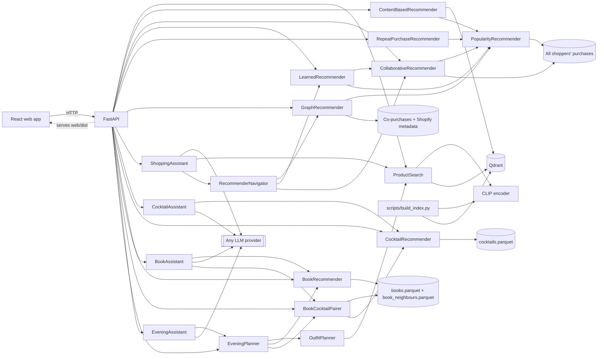

# Curio technical guide

[Back to the product overview](../README.md).

Curio has three domains, fashion, cocktails and books, behind one API, one React web app
(served by that API) and one agent engine. Fashion needs the prepared H&M data and image index; cocktails need
only `data/cocktails.parquet`; books need `data/books.parquet` and
`data/book_neighbours.parquet`. Every domain is optional at serving time: the API serves
whichever domains are prepared, so the [quick start](#quick-start) runs with cocktails alone.

## Fashion engine

Recommendations use historical H&M transactions. Photo search has its own image index.

| Feature | How it works |
|---|---|
| Learned ranking | A past-trained linear relevance model combines repeat purchases, collaborative candidates, popularity and catalog affinities. Scores describe ranking, not purchase probability. |
| Text-to-image search | The query is embedded with CLIP's text encoder and compared with the CLIP image embeddings of every product in Qdrant. |
| Image search | An uploaded photo is embedded with CLIP's image encoder and compared the same way. Example photos show H&M garments outside the sampled catalog, so every match is a different product. |
| Visually similar products | A product's own image embedding is the query (CLIP item-to-item), shown next to the graph's co-purchase complements and alternatives. |
| Content-based recommendations | One *taste vector* per interest: for each of the three product groups a user buys most (e.g. dresses, leggings), the recency-weighted mean of those purchases' image embeddings, searched within that group and the sections it was bought from. Groups get slots by weight, so a dress buyer who also buys leggings sees both. |
| Collaborative recommendations | Item-to-item collaborative filtering over all ~480,000 shoppers in the 12-week window, not just the sample: a product scores by how many shoppers bought it together with the customer's purchases, recent purchases weighted more and best-sellers damped. Each result names the purchase behind it ("163 shoppers who bought Bradley trousers also bought this"). Its explanations expose the underlying co-purchase evidence. |
| Graph recommendations | Past purchases seed an in-memory graph of co-purchases, Shopify categories and attributes. Shared attributes are weighted by inverse degree; each result includes its evidence. |
| Knowledge graph | Explore a product's category, attributes and co-purchased neighbors, with complementary products and higher-priced alternatives. |
| Offline evaluation | Every strategy is trained on purchases before a cutoff and scored on the following week (MAP@12, catalog coverage); the Model quality page compares them. |
| Tool-using shopping agent | The LLM plans a structured search, then uses policy-gated tools: catalog search, exact inspection, related pieces from the graph/CLIP index, personal picks from the ranker and the outfit builder. It can ask a clarifying question, and proposes shortlist or memory changes for the shopper to approve. Answers are checked against tool evidence, with a streamed step trace. See [agent architecture](agent-architecture.md). |
| Outfit builder | `outfits.OutfitPlanner` turns an occasion ("summer wedding"), a total budget and an audience into 3-4 slots from a per-occasion template, then fills each with a CLIP text search restricted to the slot's product types and the audience's sections. The budget is allocated cheapest-feasible, later pieces prefer co-purchased or visually coherent ones, and slots the budget cannot cover are reported. See [Outfit builder](#outfit-builder). |

Users without usable purchase history get the products all shoppers bought most in the last
week of data, which also fill lists that come up short.

The Fashion page has ten example customers from the historical data, two per section
(Ladieswear, Divided, Menswear, Sport, Baby/Children). Each has a coherent
history (6-30 products, at least 80% from one section), ten collaborative recommendations
all backed by co-purchases (no best-seller filler) that stay in their sections and cover
their main product group, and a purchase with co-purchased complements for the graph. The checks only read the
recommenders' output; nothing is tuned for these customers. "Browse all customers" keeps
everyone else accessible, and offline evaluation scores all eligible customers.

**Display names.** H&M names carry merchandising codes and capitals ("PQ BOSTON SILK
SKIRT", "Flirty Mysan ring pk.", "Nora dress(1)", "Maxi tansitional boot").
`fashion/names.display_name` drops the codes and stock notes ("new", "old", "(1)", "pk", "RW",
"TRS", "PQ", "TD", "Pid"), spells packs out ("2PK" → "2-pack"), fixes "tansitional",
title-cases shouty names and collapses spaces; it changes 2,062 of the 8,054 distinct names.
`Product.display_name` carries it in every API response, and the UI and the agents' text use
it, while `name` stays the raw catalog name in the data and IDs. Grounding accepts either.

**Data behind the screenshots.** The fashion images use 5,000 historical customers and a
photo index covering 14,280 of the 14,300 catalog products (the mirror lacks 20 photos),
prepared from the public Hugging Face mirror of the H&M data. A product without a photo
shows a placeholder. Prices are approximate historical values; there is no live stock or
checkout. The holdout results for the learned ranker, and their uncertainty, are under
[Offline evaluation](#offline-evaluation).

### Outfit builder

`src/curio/domains/fashion/outfits.py` holds the planner, used by the agent's `BuildOutfit` and
`SwapOutfitItem` tools and by `POST /outfits` and `POST /outfits/swap`.

1. **Plan.** The occasion text picks a template by keyword (wedding, office, party, beach,
   sport, otherwise casual) and a season (summer, winter, autumn, spring). Each template
   lists, per audience, 3-4 slots with a CLIP query, the allowed H&M product types and a
   budget weight: a women's wedding is dress, heeled sandals, bag and earrings; a men's
   wedding is shirt, suit trousers, blazer and smart shoes. Winter and autumn swap the last
   slot for a coat or jacket (winter shoes become boots). Named slots replace the template
   and are filled in a fixed order (dress, top, bottom, outerwear, shoes, bag, accessory).
   Without an audience, a wearer named in the occasion decides it ("for my husband", "for
   her", "kids' party"; a companion such as "dinner with my wife" does not count), else the
   section of the best garment match for the occasion, and a note says so.
2. **Candidates.** Each slot runs two filtered CLIP searches: the 24 best matches under the
   whole budget and the 12 best under the slot's fair share (budget × weight / total
   weight), so a tight budget still has relevant, affordable options. Filters are the
   slot's product types plus the audience's sections (women: Ladieswear, Divided; men:
   Menswear; kids: Baby/Children; sportswear also Sport); if the types find nothing, the
   slot's other types are tried, except those that do not suit the occasion
   (`OFF_OCCASION`: no flip flops, gym bags or caps for a wedding, the office or a party
   or dinner; no heels for sport). A remembered per-piece price limit caps every search.
   Products that are not worn (laundry bags, phone cases) are skipped.
3. **Feasibility.** The cheapest candidate of each slot is known before anything is chosen.
   Slots are kept in order while their minimums fit; a slot that would exceed the budget
   is reported ("The budget cannot cover the bag: the cheapest match costs €5.99, more than
   is left after the cheapest dress and shoes.") with the cheapest complete outfit.
4. **Allocation.** Slots are filled in order. A slot may spend what is left after
   reserving the minimums of the slots still to fill, so the outfit always fits when any
   outfit does; spending beyond the slot's fair share of what is left costs a small score
   penalty. All money is handled in cents.
5. **Coherence.** Score = CLIP relevance + 0.08 × the mean photo similarity to the pieces
   already chosen + (0.02 + 0.03 × co-purchase strength) when real shoppers bought it with
   one of them − the over-share penalty. Ties break on price, then product ID, so equal
   input gives the same outfit. Each slot carries its reason: "Bought together with the
   Manson slim trs TVP J in 4 baskets.", "Its photo matches the look of the Lennox." or
   "Best match for “elegant heeled sandals”." ("within what is left of the budget" when a
   better match was priced out). A piece of another type than the query names says so:
   "Closest accessory to “leather belt”: a bracelet, not a belt.", or, from the fallback
   types, "Not the kind “elegant heeled sandals” asks for (sandals or heels): none is
   available within the budget, so this is the closest shoe instead."
6. **Swap.** `swap(state, slot, mode, refine)` re-reads the client's outfit from the
   catalog, searches that slot again with `refine` added to its query, excludes the
   current piece and every piece swapped out before (`state.skipped`), and keeps the total
   within the budget; `cheaper` also requires a lower price. When nothing qualifies the
   outfit comes back unchanged.

The client holds the outfit as `OutfitState` (occasion, budget, audience, slot → product ID,
skipped IDs, and each piece's reason and the notes for display) and sends it back as
`TurnContext.outfit`; prices always come from the catalog. After a swap the unchanged pieces
keep their reasons and the outfit its notes. Those strings come from the client, so they are
bounded (300 characters, four notes), marked `carried`, and only shown again: they are never
sent to the model and are not grounding evidence.
On the real sample a plan takes about 0.6-1 s with CLIP on CPU. Results on the real data
look like outfits: a women's summer wedding under €80 is River Wrap Dress €29.99, Paloma
heels €12.99, Hedi top handle bag €24.99 and Flirty Friday hoop earrings €9.99, bought together
with the bag (€77.96); a men's
is a white linen shirt, slim suit trousers and the slim blazer bought with them, plus
loafers (€73.96). The photo index covers 14,280 of the 14,300 products, but the sample has few men's (26)
and children's (46) shoes, so those slots have less choice and may fall back to another
shoe type.

## Cocktail engine

The cocktail domain serves 425 recipes from `data/cocktails.parquet`, in memory, with no
model, index or network call at serving time. `CocktailRecommender`
(`domains/cocktails/recommend.py`) is deterministic, and ties go to the lower drink ID.

| Feature | How it works |
|---|---|
| Search | TF-IDF cosine over name, category, glass and ingredient names, with a name boost, scaled by the share of query words a recipe uses. Plurals and spelling variants are normalised ("limes", "whisky" → "whiskey"); flavour words ("fresh", "creamy", "fruity", ...) stand for ingredient hints; "alcohol-free", "non-alcoholic" or "mocktail" set the alcohol filter. Required and excluded ingredients, alcohol and category are filters. Each hit has reasons ("Contains lime, mint"). |
| Similar drinks | IDF-weighted overlap of ingredient families ("Lime" ~ "Lime juice", "White rum" ~ "Light rum"). |
| What can I make? | Ranks recipes that miss only mixers or garnish first and those missing their base spirit (`SPIRIT_WORDS`: gin, rum, vodka, whiskey…) last, then by fewest missing ingredients, then coverage. Matching ignores case and plurals and uses a small explicit alias table (`PANTRY_ALIASES`: a lime covers lime juice and peel, "rum" covers the common styles); a few staples (ice, water) count as available. Up to three missing ingredients can be allowed. |
| Crude names | Drinks whose names are crude, sexual or a slur (`CRUDE_NAMES`: "After sex", "Orgasm", "Zipperhead"…) are left out of search, similar drinks and "What can I make?", unless the search names the drink; pairings never offer them. |
| Shots | Shot-style drinks (`is_shot`: the "Shot" category, and shots, slammers or flaming drinks by name, such as Jello shots) are left out of "What can I make?" and of search, unless the request asks for shots (`asks_for_shots`: shot, shooter, slammer), filters on the Shot category or names the drink. The cocktail agent's WhatCanIMake includes them when the shopper's message asks for shots; pairings never offer them. |
| Cocktail agent | The shared agent engine with cocktail tools: SearchCocktails, InspectCocktails, SimilarCocktails, WhatCanIMake, SaveCocktails and RememberTastes. See [agent architecture](agent-architecture.md). |

Alcohol-free means TheCocktailDB's "Non alcoholic" label only. "Optional alcohol" recipes
list alcoholic ingredients, so every filter treats them as alcoholic; they are labelled
"Alcohol optional". Ingredient filters and avoided ingredients only see the listed recipe
ingredients and are not an allergen or dietary guarantee. The layout of the prepared file
and every interface are in the [multi-domain contract](multidomain-contract.md).

## Book engine

The book domain serves the 10,000 most-rated Goodreads books of
[goodbooks-10k](https://github.com/zygmuntz/goodbooks-10k), in memory, with numpy and scipy
only: no model, index or network call at serving time. `BookRecommender`
(`domains/books/recommend.py`) is deterministic, and ties go to the lower book ID (goodbooks-10k
numbers books by popularity). It loads in about 2 seconds.

| Feature | How it works |
|---|---|
| Search | TF-IDF cosine over title (×3), series, authors, genres (×2), reader shelves and the description (×0.3), scaled by the share of query words a book uses, then by a quality prior (Bayesian-average rating and log popularity) that scales it by 0.65 to 1, so it orders near-ties without overriding relevance. Genre names ("sci-fi", "ya", "classics") become genre filters, the first mood word ("cosy", "dark", "funny") the mood filter, "short" a 250-page limit, and "by <author>" an author filter when the name is in the catalog. Only the topic counts: words about the person or occasion ("gift", "mom", "loves", "long flight") are dropped when anything else describes the book, bare one- or two-digit numbers always are, and a title counts only when it matches two query words or the query names the whole title ("dune", "catch 22"). A reader's age ("for a 10 year old") becomes the Children's genre up to 12 and Young adult up to 17; "world war 2" (or "wwii", "second world war") matches the shelves readers file that war under. Each author appears at most twice and each series once, with its earliest book the search found ("fantasy" shows Harry Potter and the Sorcerer's Stone, not all seven), unless the query names the series or the author. |
| "Like <title>" | "fantasy like The Name of the Wind" seeds the search with that book: candidates are what its readers also liked (75 %) blended with shelf similarity (25 %), its own series is left out, and the other words still have to match. The same author and series limits apply. |
| Readers also liked | Item-item collaborative filtering precomputed by `prepare_books` from ~6 M ratings: "liked" is 4 or 5 stars, and the score is an asymmetric cosine `c / (n_i^0.35 · n_j^0.65)` (c readers liked both; n readers liked each), which damps blockbusters every reader liked, shrunk by `c / (c + 10)`; pairs with fewer than 5 shared readers are dropped and each book keeps its 50 best. Books with few links are topped up by shelf similarity. Reasons name the shared readers ("960 readers who liked The Name of the Wind also liked this") and the link (same series, author or shelves). |
| Because you liked… | The neighbour scores of several liked books, summed; the seeds and their series are left out and each author appears at most twice. |
| More by this author | The author's books, most rated first, with their series position. |
| Browse by genre and mood | 30 genres mapped from reader shelves (`domains/books/taxonomy.py`), and nine moods (Cosy, Dark, Funny, Romantic, Thought-provoking, Adventurous, Emotional, Epic, Short reads) defined by shelves and, for short reads, a 200-page limit. Books rank by how high the mood's shelf sits among their shelves, times the quality prior. |
| Content safety | Curio is a public demo, so results nobody asked for never carry sexual or abuse-centred shelves: `taxonomy.EXCLUDED_SHELVES` (erotica, erotic romance, BDSM, smut, steamy, dark romance, abuse, child abuse, rape…, from the real tag vocabulary) is `BookQuery.exclude_tags` by default and the default of `similar` and `because`, applied before `top_k`. A series where at least 40 % of the books carry such a shelf is kept out as a whole (Fifty Shades Darker is shelved only as romance). A query that asks for the group ("steamy", "erotica", "abuse"), names the whole title, seeds "like <title>" with such a book or names its author lifts it, and so does a seed book that carries it ("readers also liked" Bared to You). |
| Book agent | The shared agent engine with book tools: SearchBooks, InspectBooks, ReadersAlsoLiked, BooksByAuthor, SaveBooks and RememberReadingTastes. See [agent architecture](agent-architecture.md). |

Ratings are Goodreads averages over all Goodreads readers; the neighbour links come from the
~53,000 goodbooks-10k readers. Genres and moods come from reader shelves, so they are
crowd labels, not editorial ones. A length filter leaves out the ~9 % of books without a
page count. Probes on the real data, run with `prepare_books` output:

- "fantasy like The Name of the Wind": The Way of Kings, The Final Empire, The Lies of Locke
  Lamora, The Blade Itself, The Warded Man, Assassin's Apprentice, The Black Prism, The Eye
  of the World; never The Wise Man's Fear (same series), at most two Sanderson books and
  only the first book of each series.
- "a gift for my mom who loves gardening": The Botany of Desire, The Dirty Life, The
  Signature of All Things (books shelved as gardening, botany or farming); "something for
  a 10 year old who loves dragons": My Father's Dragon, The Paper Bag Princess, The Fire
  Within, How to Train Your Dragon, Dragon Rider (children's books shelved as dragons);
  "best books about world war 2": The Longest Day, A Bridge Too Far, The Fall of Berlin
  1945, City of Thieves, The Nightingale (WWII shelves).
- "short classic novels": The Great Gatsby, Persuasion, Animal Farm, A Little Princess, A
  Study in Scarlet, Alice's Adventures in Wonderland, Of Mice and Men, Fahrenheit 451, all
  Classics of at most 250 pages.
- "cosy mystery", "funny fantasy" and "sci-fi" return cozy mysteries, Pratchett and Douglas
  Adams, and Ender's Game, The Martian and 1984.

## Book → cocktail pairing

`domains/pairings/` pairs a book, or a reader's taste, with drinks from the recipe catalog. It is
deterministic and offline: no model, no download, about a second to build at startup.

| Step | How it works |
|---|---|
| Profile | A book's signals point to flavour themes (`domains/pairings/themes.py`): each genre by rank (1.0, 0.8, 0.6, 0.5), each reader shelf by rank (0.5 fading to about 0.13) and title (0.6) or description (0.4) words such as a setting (Paris, Caribbean, Tuscany, Moscow) or an era (Jazz Age, Victorian), capped per theme. Broad themes weigh less (Classics ×0.6, literary ×0.7, historical ×0.75, adventure ×0.8). Shares below 10 % are dropped and at most four themes kept. Reader taste sums each reading-list book's shares, plus one book's worth per liked genre. |
| Avoided genres | Their genre labels and their shelves (`books.taxonomy.GENRES`) are dropped, and a theme whose main genre is avoided (Horror for "Horror and gothic") is switched off, so an avoided genre never drives a pairing. |
| Score | Each theme scores every recipe with the cocktail search index (`CocktailRecommender.term_scores`: TF-IDF cosine of weighted words), counted only when the recipe's ingredients or name use those words, plus a bonus for its signature drinks (most typical first) and glasses. A recipe's score is the profile-weighted sum, plus a bonus for a documented literary drink of the book's author (`LORE`: the Vesper for Ian Fleming, gin rickeys and mint juleps for F. Scott Fitzgerald, the Hemingway daiquiri and Death in the Afternoon, Chandler's gimlet, and for 1984 alone Orwell's Victory Gin as a pink gin, whose larger bonus makes it lead). |
| Choose | The pool is the recipes scoring at least 30 % of the best, at most four sets' worth. Sets are drawn greedily: a pick sharing a base spirit (×0.7), a theme (×0.75), a name word or most ingredient families (×0.5) with an earlier pick of its set ranks lower. `seed` picks set `seed mod sets`, so "Another pairing" is deterministic; the agent passes the drinks already shown instead. |
| Explain | The main reason cites the book and recipe evidence: "The Big Sleep (Mystery · shelved as noir) → a bitter, spirit-forward whiskey drink: Old Fashioned (Bourbon, Angostura Bitters)", or "Your reading list leans Mystery and noir (4 of 6 books) → …". Lore leads when it chose the drink. A second theme the recipe also pours, and why it is alcohol-free, follow (at most three reasons). |
| Responsible drinking | A book whose genres or reader shelves say children's or young adult, `alcohol_free`, or an alcohol-free `cocktail_preferences` keep only recipes marked "Non alcoholic" (alcohol-free styles then describe what is poured: "a drawing-room cup of tea", not gin). Shots, drinks named as slammers or flaming, overproof spirits and crude names are never offered; avoided ingredients are left out with search's broad matching. Pairings make no health or allergen claims. |

When no allowed recipe fits (an alcohol-free profile that avoids milk, say), the result is
empty rather than a drink without a reason. `tests/domains/pairings/test_pairing_real_data.py`
checks the golden cases on the real data; the E2E suite writes the top three pairings of 14
famous books to `e2e-artifacts/pairings.json`.

## Plan my evening

`domains/evening/` composes the other domains into one evening: an outfit, a book and a drink
paired with that book, under one theme. It is deterministic and offline (no model); the
outfit needs fashion's CLIP photo index, the rest runs on the book and recipe files alone.

| Step | How it works |
|---|---|
| Theme | The occasion (or a `mood` that names one) maps to one of eight themes in `domains/evening/themes.py` by the words it uses, matched as whole words: cosy ("rainy", "Sunday", "night in", "winter"…), romantic ("date night", "first date", "anniversary", "for two"…; never "dinner" or "love" alone), glamorous ("party", "New Year's Eve", "gala"…), summery ("summer", "garden", "picnic"…), mysterious ("murder mystery", "noir", "halloween"…), thoughtful ("book club", "reading group"…), adventurous ("camping", "trip"…) and playful ("game night", "friends"…). The theme with most matching words wins (ties in table order); with none the evening is cosy and says so. Negated mentions ("not a date", "no kids") do not count. Words that only decide the drink (a driver and where the car goes, a pregnancy, "sober", "alcohol-free", "mocktails": `themes.drink_words_removed`) are removed before themes and guards are read, so they never choose or change the theme: "Date night, but I'm driving us home" is romantic with an alcohol-free drink, not a cosy night in because of "home", and "without alcohol" never negates the theme word after it. An occasion with kids, with family (parents, a baby shower) or for work (business, a client) is never romantic or glamorous, whatever its other words or the mood say: its other words decide, else playful for kids and thoughtful for family and work (`themes.GUARDS`). The theme's evidence reads after its label: "Cosy: you mentioned rainy and Sunday", "Thoughtful: a work occasion (you mentioned business)". |
| Outfit | The theme's outfit occasion (its words choose the template's style and season; a season in the occasion wins), slots and a query per slot ("chunky knit sweater", "soft knit cardigan") go to `OutfitPlanner` through `OutfitRequest.queries`, with menswear queries for men. The budget caps the whole outfit, a remembered per-piece limit every piece. Without an audience the look is womenswear (the plan's note says so): fashion's best-match probe tends to pick children's pieces for homely occasions. The evening asks for variety (`OutfitRequest.variety`, seeded from the occasion text): a slot avoids its cheapest tenth of candidates unless the budget leaves nothing else, and a small deterministic jitter per occasion reorders near-ties, so evenings do not converge on the same few pieces. Over 17 real occasions this took the distinct pieces from 30 to 47 of 62 and the pieces at €5 or less from 14 to 5. |
| Book | The theme's book searches (`BookSearch`: genres, a mood, a query, a minimum rating; mainstream first, so a romantic evening starts with Romance and Classics at ★4.0+) run through `BookRecommender.search`, then a last "well-rated" search, so every theme finds a book. The evening then ranks the hits itself: books with at least 100,000 Goodreads ratings first (25,000, then any, when no candidate reaches that), then the searches in order, books that stand alone or open their series, liked genres, and the quality prior (rating × log popularity): a date night reads Pride and Prejudice, then Persuasion, then Rebecca. A search with words keeps its 12 most relevant hits, a genre or mood browse its 40 best. The excluded shelves of the book domain (erotica, abuse…) never come through, children's books are left out except for an evening with kids (which reads one first), remembered avoided genres and authors too (an avoided genre skips the searches that ask for it); swapped-out books never return. |
| Drink | `BookCocktailPairer` pairs the chosen book (top five, alcohol-free when asked, written in the occasion, remembered, or for a children's or young-adult book; avoided ingredients left out). Among its drinks the first whose ingredients, name or glass use the theme's drink words ("honey", "cinnamon", "hot" for cosy; "champagne", "strawberry" for romantic) suits the evening best, else the pairer's first. When no drink pairs, the next book (up to three) is tried, and the plan notes it; the drink never comes from anywhere but the pairer. |
| Explain | Each part has its reason (the outfit's look and total against the budget, the book's theme fit, genre and Goodreads rating, the pairer's reasons plus the drink's fit with the evening), and one "why it works" line cites each part's evidence: "Rainy Sunday in → cosy: Osman crew sweater (€24.99) + 2 more, €58.97 in all · The Name of the Wind (fantasy, ★4.55) · Honey Bee (Honey; pairs with fantasy and magic)". |

A budget ("under €100", "up to €99.50", "max €1,500", "a €80 budget") or "alcohol-free"
written in the occasion counts as if given; an amount of €0 or over €5,000 is no budget, and
the plan says so in a note instead of failing ("Planned without a budget: €6,000 is not one
Curio can plan with…"). Prices are euros and nothing is converted: a budget in dollars or
pounds ("$150", "£80", "150 USD", "80 GBP", "90 dollars", "60 pounds") is used as a euro budget
of the same number, and the plan's first note says so: "Prices are in euros; I used 150 as a €
budget. You gave it in US dollars, and Curio does not convert currencies."
(`domains/fashion/currency.py`). In chat, PlanEvening adds the same note when the shopper's
message wrote the budget in another currency and the model passed the number, so the tool
result and the card both carry it. In chat, any invalid value an evening tool meets becomes a tool message the model
can correct, never a failed turn. The
drink is alcohol-free when the occasion asks for it ("alcohol-free", "sober", "mocktails",
not when negated: "alcohol-free is boring"), mentions family, or gives a safety reason: a
pregnancy ("pregnant", "expecting", "baby shower"), a driver ("designated driver",
"driving") or kids. `alcohol_free` left out follows these words; an explicit `false`
overrides them except a safety reason, and the plan then notes "The drink stays
alcohol-free: you mentioned kids." Every
part is optional: without fashion the outfit is listed in `missing` ("The outfit needs the
fashion catalogue…"), without cocktails the drink, without books the book and the drink, and a
photo search that fails only drops the outfit. A plan is never an error.

Swaps are stateless like outfits. The client holds `EveningState` (occasion, theme, budget,
audience, alcohol-free, the outfit's `OutfitState`, the book and drink IDs and the parts
swapped out) and sends it back; `EveningPlanner.restore` re-reads every product and book and
re-pairs the drink (the outfit's state also carries its empty slots, their order and the
minimum, display-only, so a partial outfit stays partial after any swap, and the evening's
`status` is "partial" whenever its outfit is), keeping the client's drink only when the pairer still pairs it with the
book under the current rules (a forged or no-longer-allowed drink is replaced). "Another book"
skips the old one and re-pairs a drink for the new one; "another drink" skips the drink;
"alcohol-free" re-pairs with alcohol-free recipes; an outfit piece is swapped by
`OutfitPlanner.swap` with the theme's query for the slot. `tests/domains/evening/` covers the
planner over small catalogs, and the E2E suite writes real plans for fifteen occasions to
`e2e-artifacts/evening-plans.json`.

## Data

### H&M data

The app uses the [H&M Personalized Fashion Recommendations](https://www.kaggle.com/competitions/h-and-m-personalized-fashion-recommendations)
dataset from Kaggle: 105k articles with photos and 31.8M real purchases from 2018 to 2020.
`scripts/prepare_data.py` keeps the last 12 weeks of transactions, samples 5,000 customers
with at least five purchases, and extracts the photos of the products they bought.
It also writes `co_purchases.parquet`, with links between catalog products learned from all
shoppers in that window, including shoppers outside the demo sample. Repeated purchases
of one item count once per basket; pairs need at least two shared baskets. It also writes
`shopper_purchases.parquet`: every shopper's purchases of catalog products (3.0M rows from
about 480,000 shoppers, under anonymous integer ids), which popularity and collaborative
filtering learn from. The 5,000 sampled customers alone made 2% of those purchases, far
too few to rank 14,300 products.

The dataset's prices are normalised. Multiplying them by 590 (a convention from the Kaggle
competition discussion) gives realistic euro price points such as €29.99, so the prices shown
are approximations. H&M licenses the data for non-commercial research use, so it is not part
of this repository.

New preparations also retain `product_code`, `department_name` and `index_name` in
products, and `price_normalized` (the original source units) and `sales_channel_id`
(1 store, 2 online) on both sampled and crowd events. `users.parquet.shopper_id`
provides the explicit mapping into that preparation's crowd events; **do not join
sampled `user_id` directly to crowd `shopper_id`**, or combine mappings from different
preparations. Original customer identifiers are not saved. Serving responses retain
their existing fields, and older prepared datasets remain supported.

Prepare experimental inputs separately from the running app:

```sh
uv run python -m scripts.prepare_data --archive data/raw/csvs --data-dir data/experiments/enriched
```

The same preparation accepts local Hugging Face Parquet shards arranged as
`{articles,customers,transactions}/*.parquet`, streaming transaction batches rather
than converting the full history to CSV:

```sh
uv run python -m scripts.prepare_data --archive data/raw/hf --data-dir data/experiments/enriched
```

Shards are read in sorted filename order. A root CSV and shards for the same table
are rejected as ambiguous; malformed shards fail preparation rather than being skipped.
Raw source files and prepared outputs remain local and ignored by Git.

This command retains the existing full-window sampling rule; it does not create a
new untouched evaluation set. New historical price features must use event prices
before each cutoff, rather than the displayed full-window product median. Existing
prepared files gain these fields only after regeneration.

### Cocktail data

```sh
uv run python -m scripts.prepare_cocktails                 # default: pinned source, checksum-verified
uv run python -m scripts.prepare_cocktails --source path/to/final_cocktails.csv --sha256 <hex>
```

The source is `final_cocktails.csv` in [yo1am1/cocktail_advisor](https://github.com/yo1am1/cocktail_advisor),
pinned to commit `92e05ae` and checked against a SHA-256, so drink IDs stay stable. Its list
columns are parsed with `ast.literal_eval`. Malformed rows are skipped with a warning,
duplicate recipes are kept once, ingredient spellings are unified, and image links other
than `https://www.thecocktaildb.com/...` are dropped. The API reads the file at startup:
restart it after preparing.

**Terms.** The recipes and photos come from [TheCocktailDB](https://www.thecocktaildb.com/).
The cocktail_advisor code is Apache-2.0, but the recipe data and images remain subject to
TheCocktailDB's own terms; Curio does not relicense them, and this repository's Apache-2.0 licence
covers the code only. Check TheCocktailDB's terms before commercial use. The file is not
committed; photos are loaded directly from thecocktaildb.com by the browser, and the UI
credits "Recipe data: TheCocktailDB".

### Book data

```sh
uv run python -m scripts.prepare_books                     # default: pinned source, checksum-verified
uv run python -m scripts.prepare_books --no-details        # skip page counts and descriptions
uv run python -m scripts.prepare_books --source path/to/goodbooks-10k   # a local checkout
```

The source is [zygmuntz/goodbooks-10k](https://github.com/zygmuntz/goodbooks-10k) pinned to
commit `6dd165b`: `books.csv`, `ratings.csv` (5,976,479 ratings), `book_tags.csv`,
`tags.csv` and `books_xml/books_xml.zip` (page counts and descriptions). Each file is
checked against its SHA-256 at that commit, also for a local `--source`; `--no-verify`
skips the check for another version. It takes about 40 seconds with a ~150 MB download
(25 seconds from a local copy) and about 1 GB of RAM at its peak, and writes two files
of about 9 MB together:

- `books.parquet`: one row per book. Titles lose the "(Series, #1)" suffix, which becomes
  `series` and `series_position`; authors are split; reader shelves are cleaned of
  bookkeeping ("to-read", "owned", "kindle", "read-in-2015"); genres come from shelf shares;
  descriptions are plain text without the Goodreads librarian notes some start with ("There is
  an alternate cover edition for this ASIN here and here.", 160 books; the catalog loader
  strips them from files prepared earlier too), cut at 600 characters; only https covers on
  `images.gr-assets.com` are kept (a third of the books have Goodreads' "no photo"
  placeholder, which is dropped). `isbn` is a checked ISBN-13 for 9,277 books, converted
  from the ISBN-10 column after restoring its lost leading zeros; the ISBN-13 column is a
  float rounded to 12 digits, so it is not used. For a book without a Goodreads cover the
  UI shows Open Library's (`covers.openlibrary.org/b/isbn/<isbn>-M.jpg?default=false`,
  credited "Some covers: Open Library"): it asks Open Library first with a cached HEAD
  request, shows the placeholder on a 404, and stops asking for a minute after a network
  error. 3,211 of the 3,332 books without a Goodreads cover have an ISBN; The Lies of Locke
  Lamora and all 40 sampled coverless books have an Open Library cover. Open Library
  rate-limits cover lookups by ISBN (about 100 per 5 minutes per IP), so a busy server may
  show placeholders for a while. A `books.parquet` prepared before this column loads
  without ISBNs and simply shows placeholders; prepare again to add them. The XML archive is read member by member with a size cap,
  and documents with a DOCTYPE are skipped.
- `book_neighbours.parquet`: the 50 strongest readers-also-liked links per book
  (499,419 rows), so the 72 MB ratings file is not needed to serve.

The layout is in the [multi-domain contract](multidomain-contract.md#books). Files are
written atomically; restart the API after preparing.

**Terms.** goodbooks-10k is published by Zygmunt Zając under the
[Creative Commons Attribution-ShareAlike 4.0](https://creativecommons.org/licenses/by-sa/4.0/)
licence (its `LICENSE` file). Its metadata, shelves and ratings were collected from
Goodreads, so Goodreads' own terms may also apply to that content; Curio does not
relicense it, and the Apache-2.0 licence covers this repository's code only. Covers stay on
Goodreads' (or Open Library's) servers and are loaded by the browser; they and the book
descriptions are the publishers' and Goodreads' material, not covered by CC BY-SA. The
prepared files stay on your machine. The only copies in this repository are the README
images `curio-pairing.webp`, `curio-evening.webp` and `curio-overview.webp`, which show
covers and a description excerpt for illustration only; they are not licensed by this
repository. If you share them, they are adaptations of goodbooks-10k: credit it and share
them under CC BY-SA 4.0. The UI credits "Book data: goodbooks-10k from Goodreads (CC BY-SA
4.0)" and links each book to its Goodreads page.

### Shopify enrichment and graph behavior

The saved mapping in `taxonomy/hm_shopify_categories.json` assigns H&M product types to
Shopify's pinned `2026-05` taxonomy. Colour, pattern, gender and age attributes use explicit
field mappings. Ambiguous types and values stay unmapped. The classification script uses
conservative exact matches, then CLIP/word-overlap candidates and an LLM decision; its
results need review. Normal data preparation and graph recommendations make no LLM calls.
Older prepared catalogs without enrichment still load, using empty attributes and an
uncategorized category until the data is prepared again.

Graph scores sum co-purchase lift and shared-feature evidence across distinct past
purchases. A shared feature contributes `1 / (degree - 1)`, reducing the influence of
common attributes. Popularity fills short lists. Scores are ranking signals, not purchase
probabilities, and this baseline has not established a quality improvement.

The dataset has no basket ID: one customer on one day is a basket proxy. Complementary
suggestions require co-purchase evidence across different product groups. Higher-priced
alternatives require the same specific Shopify category, product type and section, with no
conflicting mapped gender/age attributes. Broad or unclassified categories return no
alternatives. Price does not establish quality or upsell value.

## Architecture



```
src/curio/
├── engine/               # Domain-independent: imports no domain and not the app
│   ├── agent.py          # AgentEngine: plan, bounded tool loop, approvals, verify, fallback
│   ├── toolkit.py        # The Toolkit protocol, BaseToolkit, Turn, ToolError
│   ├── tools.py          # Policy (READ / ASK / APPROVE) and the shared AskShopper tool
│   ├── schemas.py        # AgentStep, Intent, PendingAction, AppliedEffect, AssistantReply…
│   ├── signing.py        # ActionSigner (HMAC proposals), narrow_args
│   ├── grounding.py      # Facts bound to items, names, labels, GroundingReport counts
│   ├── llm.py            # Chat model factory for any LangChain provider
│   └── data.py           # DataFileMissingError, shared by every catalog loader
├── domains/              # Each imports the engine and itself only (pairings: + books,
│   │                     # cocktails; evening: + fashion, books, cocktails, pairings)
│   ├── fashion/          # models, catalog, embeddings, vector_store, search, outfits,
│   │   │                 # navigator (recommender bridge), recommenders/
│   │   └── agent/        # toolkit, tools, intent, prompts, grounding, schemas
│   ├── cocktails/        # models, catalog, recommend (search, similar, pantry), agent/
│   ├── books/            # models, catalog, taxonomy, recommend, agent/
│   ├── pairings/         # models, themes, pairer; agent/ (PairCocktail, PairedDrinkCheck)
│   └── evening/          # themes, models, planner (Plan my evening); agent/ (PlanEvening…)
└── app/                  # Composition: settings, wire format, assistants, API
    ├── config.py         # Settings from env / .env (pydantic-settings)
    ├── schemas.py        # The /chat wire models: the engine's plus every domain's payloads
    ├── assistants.py     # ShoppingAssistant, CocktailAssistant, BookAssistant, EveningAssistant
    ├── services.py       # Composition root and domain registry
    ├── demo.py           # Demo customers
    ├── api.py            # FastAPI app
    └── web.py            # Serves the built React app (web/dist) beside the API routes
web/                      # The React app (Vite, React 19, TypeScript); see "Web app" below
examples/hello_domain/    # A complete teas domain on the engine (teas.py, its catalog teas.csv)
scripts/prepare_data.py # Sample the H&M Kaggle archive (or its unzipped CSVs) into data/
scripts/fetch_photos.py # Download the sampled products' photos from the mirror
scripts/fetch_query_photos.py # Example image-search photos of garments outside the catalog
scripts/build_index.py # Embed product photos with CLIP, upsert into Qdrant
scripts/classify_product_types.py # Reviewable H&M-to-Shopify category decisions
scripts/evaluate.py # Chronological holdout evaluation; JSON results for the Model quality page
scripts/prepare_cocktails.py # Download the pinned recipe CSV, write data/cocktails.parquet
scripts/prepare_books.py # Download pinned goodbooks-10k, write books + book_neighbours.parquet
scripts/export_openapi.py # Write the API's OpenAPI schema (web/openapi.json) without a server
```

### Domain registry

Each domain is one `DomainSpec` in `app.services.DOMAINS` (display order): its id, label, a
setup hint and a loader. `build_services` runs every loader; a loader returns `None` while
its data is missing (fashion: `products`, `users` and `purchases.parquet`; cocktails:
`cocktails.parquet`; books: `books.parquet` and `book_neighbours.parquet`), so that domain
is left out and the API still starts. Data that is present but unusable fails startup for
fashion (for example an index built with another encoder) and only disables cocktails or
books. A loaded domain is a runtime (`FashionServices`, `CocktailServices`,
`BookServices`) with an `assistant`, `item_count()` and `close()`; `Services.domains` maps
ids to the loaded runtimes, and every domain shares one chat model and one approval signer
(`AgentKit`).

From that registry, without per-domain code:

- `GET /health` and `GET /domains` list every registered domain with `enabled`,
  `chat_enabled`, `item_count` and a `hint` (how to prepare a missing domain, or how to enable
  chat for a served one).
- A domain's endpoints answer 503 with its setup hint when it is not served, through one
  FastAPI dependency per domain (`FashionDep`, `CocktailsDep`, `BooksDep`).
- `POST /chat` routes by `ChatRequest.domain` to that runtime's assistant.

The web app mirrors this with its registry (`web/src/domains/registry.ts`): one `DomainView`
per domain (switch label, copy, grounding badges, approval tools, credit line) and its pages
(`DOMAIN_PAGES`). It reads availability from `/domains`, routes only to the pages of served
domains (a deep link to another domain's page lands on the landing page), opens on Plan my
evening when the API serves the evening (choosing Evening in the switch lands there too, not
on its chat), else on the first served domain's main page, and shows a setup page when the
API serves none. A domain the server does not serve stays in the switch, disabled, with
"… is not available" and the server's hint.

`ENABLED_DOMAINS` (comma-separated ids, e.g. `cocktails`) limits loading to those domains
even when other data is present; an unknown id fails startup. Unset, every prepared domain
loads.

Books were added this way, which is the recipe for the next domain: its catalog and
recommender (`domains/books/`), a runtime dataclass and a loader in `app/services.py`, a
`DomainSpec` appended to `DOMAINS`, its id in `app.schemas.Domain`, its endpoints behind a `BooksDep`
dependency, and a `DomainView` with its pages in the web app's registry. Its agent is a `BaseToolkit` for
the shared engine ([agent architecture](agent-architecture.md)). The shared parts needed
only data-driven additions: the domain's approval tools in `ApprovalTool`, its context
fields on `TurnContext` (`book_preferences`, `book_shortlist`), its effect kinds on
`AppliedEffect` (serialized with their own fields only), whose `remembers` and `adds` say
which context fields an approved effect updates. The engine loop, budgets, signing,
grounding flow and chat code did not change. [Extending Curio](extending.md#8-registering-the-domain-in-the-app)
lists every file a new domain touches.

A **composed domain** has no data of its own: its `DomainSpec` has `compose` instead of
`load`, and `build_services` builds it from the loaded domains after linking. `evening` is the
first: `compose_evening` returns an `EveningServices` (the `EveningPlanner` over the served
book recommender, pairer, recipes and, when fashion is served, its `OutfitPlanner`, plus the
`EveningAssistant`) whenever books and cocktails are served and their pairer built. Its
`missing` callable names what an unserved evening lacks ("Plan my evening needs the book
catalog and the cocktail recipes: The book catalog is not prepared: …"), which `/domains` and
the 503 of `/evening/*` and evening chat report; a served evening without fashion reports
`item_count` 2 (the parts it plans) and the hint "The outfit needs the fashion catalogue…".
`ENABLED_DOMAINS` limits only the data domains: the quick start (`cocktails,books`) serves
the evening too, without the outfit. Naming a composed domain enables what it builds on
(`DomainSpec.builds_on`): `ENABLED_DOMAINS=evening` loads books, cocktails and fashion, each
only when its data is prepared, and the log says so.

Cross-domain features link loaded domains after loading: `link_domains` builds the
`BookCocktailPairer` when books and cocktails are both served, stores it on `BookServices`
(`services.pairing`) and enables the book agent's PairCocktail tool. A pairer that fails to
build leaves both domains serving as before; `/pairings/book-cocktail` answers 503 with the
setup hint of whichever domain is missing, and the web app shows its pairing controls only
when `/domains` reports both domains.

## Web app

`web/` is Curio's UI: a React single-page app over the API, which serves its build on the
same port. It has the shell and domain switch, Plan my evening, chat for every domain, the
item dialogs, the fashion feed (For you), Discover (description and photo search), Product
connections, Model quality, recipe search, "What can I make?", book search, "Because you
liked…", browse by mood, the reading list's cocktail and the Compare dialogs.

- **Stack:** Vite, React 19 and TypeScript (strict), React Router, TanStack Query, the
  `motion` package for animation, `react-markdown` for answers and lucide icons. Styling
  is hand-written CSS modules over design tokens (`src/styles/tokens.css`); dark mode follows
  `prefers-color-scheme`. Fonts (Source
  Serif 4, Source Sans 3) are bundled, so the app makes no third-party requests except
  recipe photos, Goodreads covers and Open Library covers.
- **Layout:** `src/api` (fetch client, the NDJSON stream reader, query hooks, types
  generated into `schema.d.ts`), `src/state` (the client-held session and its
  `TurnContext`, chat transcripts, approval narrowing, effects), `src/domains` (the
  registry: copy, badges, step labels, credits), `src/components` (shell, chat, evening,
  cards, dialogs, session panel) and `src/ui` (buttons, toggles, dialog, toasts, photos).
- **Routes:** each domain opens on its main page, with its pages and its chat in the
  sub-navigation (`DOMAIN_PAGES` in `src/domains/registry.ts`):

  | Domain | Pages |
  |---|---|
  | Fashion | `/fashion` (For you), `/fashion/discover`, `/fashion/connections`, `/fashion/quality` (Model quality, linked from For you, not in the navigation) |
  | Cocktails | `/drinks` (recipe search), `/drinks/pantry` ("What can I make?") |
  | Books | `/reading` (search), `/reading/because`, `/reading/moods` |
  | Evening | `/evening` (Plan my evening, where a visit lands when the evening is served) |

  Chat is `/ask/<domain>`. Page paths never sit under an API path (`/books/…`,
  `/cocktails/…`, `/products/…`, `/search/…`, `/users/…`, `/evaluation`…), which the API
  answers itself; that is why cocktails live under `/drinks` and books under `/reading`.
- **Browse pages:** filters become request bodies in `src/domains/requests.ts` (remembered
  reading tastes boost liked genres and leave out avoided genres and authors;
  remembered cocktail tastes leave out avoided ingredients and make "Any" mean
  alcohol-free). Inputs are kept for the browser tab (`curio.page.*` in `sessionStorage`).
  Photo search uploads the file (or an example photo) as multipart form data
  (`postForm`). The filter controls are a hand-written accessible combobox
  (`src/ui/Combobox.tsx`, the WAI-ARIA list-autocomplete pattern) and styled native
  selects; the product connections graph and the Model quality chart are hand-drawn SVG
  (`ConnectionsGraph.tsx`, a radial layout from `graph.ts`), so no chart or graph library
  is bundled. The saved list's count in the sub-navigation opens the session panel, with
  Compare for pieces and drinks.
- **Session:** the shortlist, reading list, saved drinks, memory, outfit and evening
  state, the approval toggles and the linked shopper live in `localStorage`
  (`curio.session.v1`) and go back with every chat request as its `TurnContext`. Transcripts and the planner's current plan are kept for the
  browser tab (`sessionStorage`).

```bash
cd web
npm ci
npm run dev        # http://localhost:5173, proxying the API at CURIO_API_URL (default :8000)
npm run lint && npm run typecheck && npm test && npm run build
```

The dev server proxies every request except page navigations (GET with `Accept:
text/html`), the same rule the API uses in production; `CURIO_API_URL` points it at
another API and `CURIO_WEB_PORT` changes its port.

**Production.** After `npm run build`, the API serves `web/dist` itself: `/assets/*` with
long-lived caching, top-level files such as `favicon.svg`, and `index.html` for any GET
that accepts `text/html` and matches no API route, so a deep link like `/ask/books` opens
the app. API paths stay where they are (no `/api` prefix), and their 404s and 405s are
unchanged. It is automatic when `WEB_DIST` (default `web/dist`, relative to where the API
starts) holds a build, checked per request; `SERVE_WEB=false` turns it off. Open
`http://localhost:8000/`.

**API types.** `npm run gen:api` regenerates `src/api/schema.d.ts` from `web/openapi.json`
with openapi-typescript; `npm run openapi:export` rewrites that file from the code
(`uv run python -m scripts.export_openapi`, no server or data needed), and `npm run
gen:api:live` reads a running API's `/openapi.json` instead. `tests/app/test_web.py` fails
when the committed schema no longer matches the API, so regenerate both after an API
change. TypeScript is 6.0, the newest release typescript-eslint supports.

## Quick start

Two equivalent ways to run Curio with cocktails, books and Plan my evening (without the
outfit), without the H&M download:

```bash
docker compose --profile demo up --build   # Docker
scripts/quickstart.sh                      # uv, no Docker
```

The first run prepares goodbooks-10k besides the recipes (about 150 MB to download, under a
minute and about 1 GB of RAM; ~9 MB on disk), so the one-command demo has book pairings and
Plan my evening. Opt out with `DEMO_BOOKS=0 docker compose --profile demo up --build` or
`CURIO_BOOKS=0 scripts/quickstart.sh` for cocktails only. Both ways serve books whenever they
are prepared.

On the first run both download the pinned recipe file (about 400 KB, SHA-256 checked) and
then start one server on port 8000: the API, which also serves the web app. Open
http://localhost:8000; later runs reuse the recipes. Expect
a few minutes for the first Docker build or `uv sync` (PyTorch is a dependency of the
fashion engine even though the demo never loads it), then seconds to start.

- **Docker** (`demo` profile): `demo-data` prepares the recipes into the `demo-data`
  volume (nothing is written to `./data`), plus the books unless `DEMO_BOOKS=0`; `demo-api`
  serves them and the web app (built into the image) with `ENABLED_DOMAINS=cocktails,books`
  (it never loads CLIP or opens Qdrant) on port 8000, with a health check on `/health`.
  `docker compose --profile demo down -v` removes the volume.
- **`scripts/quickstart.sh`**: runs `uv sync --locked --extra anthropic`, writes
  `data/cocktails.parquet` if it is missing (and the book files unless `CURIO_BOOKS=0`),
  builds the web app with `npm ci && npm run build` when `web/dist` is missing or older than
  its sources and npm (Node 22) is installed (`CURIO_WEB_BUILD=0` skips it; without npm a
  build made before is served, and with none the script says how to get one), starts the
  server, prints which domains and chat are available and the URL; Ctrl+C stops it.
  `ENABLED_DOMAINS` (default `cocktails,books`; a domain that is not prepared is skipped)
  and `CURIO_PORT` (8000) change what it serves and where. With fashion prepared,
  `ENABLED_DOMAINS=fashion,cocktails,books scripts/quickstart.sh` serves all three. The
  server listens on 127.0.0.1 only: it holds the chat, which spends the configured LLM key.
  `CURIO_HOST=0.0.0.0` opens it to the network on purpose (the script warns).
  `tests/test_quickstart_script.py` runs a copy of the script with a recording `uv` and
  `npm` to check the binding and when the web app is built.

Chat works when `LLM_*` is set in `.env` (see [LLM configuration](#llm-configuration));
both ways read it. Without it, the assistant says chat is unavailable and how to enable
it, and every other page works.

**Local LLM with Ollama (optional).** Add the `ollama` profile to the demo and point the
LLM settings in `.env` at it:

```bash
LLM_PROVIDER=openai
LLM_BASE_URL=http://ollama:11434/v1
LLM_API_KEY=ollama
LLM_MODEL=qwen2.5:3b          # any Ollama model with tool calling
```

```bash
docker compose --profile demo --profile ollama up --build
```

`ollama-pull` downloads `LLM_MODEL` into the `ollama-models` volume (about 2 GB for
`qwen2.5:3b`) and the API starts after it. Small local models follow the tool protocol
less reliably than hosted ones; the grounding check still replaces unverified answers with
catalog facts. For `scripts/quickstart.sh`, run Ollama yourself and use
`LLM_BASE_URL=http://localhost:11434/v1`.

## Fashion data

Requires [uv](https://docs.astral.sh/uv/) and Python 3.13.

```bash
uv sync --all-extras
cp .env.example .env                                   # optional: configure an LLM for chat
uv run python -m scripts.prepare_cocktails             # optional: enables the cocktail domain
```

Get the H&M data in one of two ways. The Kaggle archive needs a free account with the
[competition rules](https://www.kaggle.com/competitions/h-and-m-personalized-fashion-recommendations/rules)
accepted and an API token in `~/.kaggle/kaggle.json`; the download is about 30 GB.

```bash
uvx kaggle competitions download -c h-and-m-personalized-fashion-recommendations -p data/raw
uv run python -m scripts.prepare_data                  # photos are extracted from the zip
```

Without a Kaggle account, use the CSVs (3.7 GB) of the
[Hugging Face mirror](https://huggingface.co/datasets/einrafh/hnm-fashion-recommendations-data)
and fetch only the photos of the sampled products (about 35 minutes for the 14,300 products
of the default sample, 360 MB after downsizing):

```bash
M=https://huggingface.co/datasets/einrafh/hnm-fashion-recommendations-data/resolve/acde210b0090be673abdba5f989c48925c856f78/data/raw
mkdir -p data/raw && for f in articles customers transactions_train; do curl -L -o data/raw/$f.csv $M/$f.csv; done
uv run python -m scripts.prepare_data --archive data/raw
uv run python -m scripts.fetch_photos --data-dir data --workers 8
```

Then build the image index, fetch a few example photos for image search, and start the app:

```bash
uv run python -m scripts.build_index                   # all products: ~5 min at 50 img/s on 4 CPU cores
uv run python -m scripts.fetch_query_photos --articles data/raw/articles.csv
uv run python -m scripts.evaluate --qdrant-path .qdrant --output data/evaluation.json
(cd web && npm ci && npm run build)                    # the web app, served by the API
uv run uvicorn curio.app.api:create_app --factory --reload   # http://localhost:8000
```

To enable the learned ranking shown in the screenshots, train its optional model
before starting the API. Without it, the feed defaults to buy-again recommendations:

```bash
uv run python -m scripts.train_ranker --data-dir data --train-through 2020-09-15
```

The example photos show H&M garments that are not in the sampled catalog, so image search
always has to find a different product that looks alike. `scripts.evaluate` writes the
results that the Model quality page shows; without it, that page explains how to create them.

`build_index --limit N` indexes a smaller subset spread across sections. Qdrant runs
embedded (stored in `.qdrant/`) unless `QDRANT_URL` is set, so no external service is needed.
Embedded Qdrant allows one process at a time: build the index and run the evaluation before
starting the API (or point everything at a Qdrant server).

### Docker

The full stack (a Qdrant server, and the API serving the web app over `./data` on port 8000)
is the `fashion` profile:

```bash
docker compose --profile fashion up --build
docker compose --profile fashion exec api python -m scripts.build_index --limit 3000
```

The image is built in two stages: a `node:22` stage runs `npm ci && npm run build` in `web/`,
and the Python image copies `web/dist` from it, so one container serves the API and the app
on one port. It includes the `anthropic` extra, so `LLM_PROVIDER=anthropic` works in Docker;
development tools are left out. The API mounts `./data` read-only, so prepare the
cocktail recipes with the one-off `prepare-cocktails` service, which mounts it writable,
then restart the API so it loads the file:

```bash
docker compose run --rm --user "$(id -u):$(id -g)" prepare-cocktails
docker compose --profile fashion restart api
```

`--user` makes the written file belong to you. `prepare-books` does the same for the book
catalog (`docker compose run --rm --user "$(id -u):$(id -g)" prepare-books`). Running
`uv run python -m scripts.prepare_cocktails` on the host and then
`docker compose --profile fashion restart api` works too. The CLIP model is downloaded once into the
`hf-cache` volume; the image creates that directory for its non-root user.

## LLM configuration

The assistant works with any LangChain chat provider, configured only through `.env`:

```bash
LLM_PROVIDER=openai                       # openai | anthropic | azure_openai | ...
LLM_MODEL=gpt-4.1-mini
LLM_API_KEY=sk-...
LLM_BASE_URL=                             # set for OpenAI-compatible gateways
```

Any OpenAI-compatible gateway (OmniRoute, OpenRouter, LiteLLM, Ollama, vLLM) works with
`LLM_PROVIDER=openai` plus `LLM_BASE_URL`. For a local OmniRoute gateway, set
`LLM_BASE_URL=http://127.0.0.1:20128/v1`, choose an available gateway model ID for
`LLM_MODEL`, and keep the gateway key in `.env`. The API uses this configuration
for both intent extraction and catalog-grounded replies. Without `LLM_MODEL`
every feature except chat still works. One configuration serves the fashion, cocktail and
book assistants. Set `AGENT_SIGNING_KEY` to at least 32 random bytes when running several
API workers (`WEB_CONCURRENCY`), so approval proposals verify on any worker; the API refuses
to start without it then, and refuses a shorter key at any time.
`AGENT_TURN_DEADLINE_SECONDS` (default 90) is the wall-clock budget of one agent turn and
`LLM_TIMEOUT_SECONDS` (default 60) the timeout of one model call. Keep the defaults in
production; the [agent evaluation](agent-eval.md) raises both for a relayed model that can
take minutes per request.

## API

| Method | Path | Description |
|---|---|---|
| GET | `/health` | Index and catalog sizes, whether chat and ranking are enabled, `fashion_enabled`, `cocktails_enabled`, `cocktail_count`, `books_enabled`, `book_count`, `llm_configured`, and `domains` (as below) |
| GET | `/domains` | Every registered domain in display order: `id`, `label`, `enabled`, `chat_enabled`, `item_count`, `hint` |
| GET | `/products/{id}` | Product details |
| GET | `/products/{id}/graph` | Bounded product neighborhood: nodes and edges |
| GET | `/products/{id}/related?kind=complement\|alternative` | Co-purchased complements or higher-priced alternatives |
| GET | `/products/{id}/similar` | Products whose photos look most alike (CLIP item-to-item), from any section; the agent's FindRelated keeps them in the product's audience |
| GET | `/sections` | Catalog sections, for filtering text search |
| POST | `/outfits` | `{"occasion": "summer wedding", "budget": 80, "audience": "women\|men\|kids", "slots": ["dress", "shoes"], "max_item_price": null}` (all but `occasion` optional): a planned outfit with per-slot pieces, reasons and gaps, `total`, `status` (`complete`, `partial`, `empty`), `notes`, `minimum` and the `state` to send back |
| POST | `/outfits/swap` | `{"outfit": <state>, "slot": "shoes", "mode": "other\|cheaper", "refine": "in black"}`: the outfit with that slot replaced within the budget (unchanged when nothing qualifies); 422 for a slot the outfit does not have |
| POST | `/search/text` | `{"query": "red floral dress", "top_k": 10, "section": "Ladieswear"}` (section optional) |
| POST | `/search/image` | Multipart image upload |
| GET | `/search/examples`, `/search/examples/{id}/image` | Example query photos of garments outside the catalog |
| GET | `/users`, `/users/{id}` | Sampled shopper ids; a shopper's id and purchase history (products and dates; no age). These are real, pseudonymous H&M shoppers: see [data and licences](data-and-licences.md) |
| GET | `/demo/customers` | Up to ten descriptive customer examples and starting products |
| GET | `/users/{id}/recommendations?strategy=learned\|repeat\|collaborative\|graph\|content` | Personalised recommendations; learned, repeat, collaborative and graph hits include reasons |
| GET | `/cocktails/ingredients`, `/cocktails/categories` | Distinct ingredient names (catalog spelling) and categories |
| POST | `/cocktails/search` | `{"query": "fresh lime and mint", "ingredients": [], "exclude_ingredients": [], "alcohol": "any\|alcoholic\|non_alcoholic", "category": null, "top_k": 10}` |
| POST | `/cocktails/pantry` | `{"ingredients": ["Gin", "Lime"], "alcohol": "any", "max_missing": 2, "top_k": 10}`: drinks you can make, with what is missing |
| GET | `/cocktails/{id}` | Full recipe (404 for an unknown ID) |
| GET | `/cocktails/{id}/similar?top_k=5&alcohol=any` | Drinks sharing the most distinctive ingredients |
| GET | `/books/genres`, `/books/moods` | Genres in use (most common first) and the browse moods |
| GET | `/books/index` | Every book's `book_id`, `title` and first `author`, most rated first (for pickers) |
| POST | `/books/search` | `{"query": "fantasy like The Name of the Wind", "genres": [], "mood": null, "author": null, "min_rating": null, "max_pages": null, "exclude_genres": [], "exclude_authors": [], "boost_genres": [], "top_k": 10}`; an empty query with filters browses |
| POST | `/books/because` | `{"liked": [192, 2], "exclude_genres": [], "exclude_authors": [], "top_k": 10}`: what readers of those books also liked |
| GET | `/books/{id}` | Book details (404 for an unknown ID) |
| GET | `/books/{id}/similar?top_k=5&other_authors_only=false` | Readers who liked this book also liked |
| GET | `/books/{id}/by-author?top_k=5` | More by its first author |
| POST | `/pairings/book-cocktail` | `{"book_id": 5}` or `{"book_ids": [1160, 1598], "liked_genres": [], "avoided_genres": []}`, plus `alcohol_free`, `cocktail_preferences`, `exclude_drink_ids`, `seed` (0-10,000) and `top_k` (1-5): drinks for a book or a reader's taste with `profile` (themes, summary, alcohol-free reason), `pairings` (cocktail, theme, 1-3 reasons), `sets` and `note`. 404 for an unknown book, 422 for nothing known to pair |
| POST | `/evening/plan` | `{"occasion": "rainy Sunday in", "budget": 100, "audience": "women\|men", "mood": null, "alcohol_free": false, "book_preferences": {}, "cocktail_preferences": {}, "max_item_price": null}` (all but `occasion` optional; occasion 2-200 characters, budget up to €5,000, mood up to 40 characters, unknown fields 422): `theme` (id, label, icon, feeling, evidence), `outfit` (the `Outfit` and its reason), `book` (book, reason), `drink` (cocktail, reasons, `pairs_with`, `evening_fit`, `alcohol_free_reason`, `note`), `why`, `missing` (part, reason), `notes`, `status` (`complete`, `partial`, `empty`) and the `state` to send back |
| POST | `/evening/swap` | `{"evening": <state>, "part": "outfit\|book\|drink", "slot": "shoes", "mode": "other\|cheaper\|alcohol_free", "refine": "", "tastes": {...}}`: the plan with that part changed and `change` saying what changed; 422 for a swap the plan cannot make (a cheaper book, an alcohol-free outfit, a slot the outfit lacks) or an out-of-bounds state |
| POST | `/chat` | One agent turn: `{"domain": "fashion\|cocktails\|books\|evening", "message", "history", "preferences", "shopper_id", "shortlist", "outfit", "cocktail_preferences", "cocktail_shortlist", "book_preferences", "book_shortlist", "evening", "auto_approve"}`, or `{"decision": {...}}` to answer a pending proposal. `domain` defaults to `fashion`; a fashion reply carries `outfit` when the turn built or changed one, an evening reply `evening` (the plan) |
| POST | `/chat/stream` | The same turn as NDJSON: `step` events, then `reply` (or `error`) |
| POST | `/chat/feedback` | Rate an answer (204); the rating and tool names go to the server log, the texts are not kept |
| GET | `/evaluation` | Offline evaluation results saved by `scripts.evaluate --output` |

Every `/cocktails` endpoint returns 503 until `scripts.prepare_cocktails` has been run,
every `/books` endpoint until `scripts.prepare_books` has, `/pairings/book-cocktail` and
`/evening/*` until both have (with the missing domain's hint), and
every fashion endpoint (`/products`, `/sections`, `/search`, `/outfits`, `/users`,
`/demo/customers`, `/evaluation`) returns 503 with how to prepare the H&M data when fashion is not served.
`/chat` returns 503 when the requested domain is not served or has no assistant (no LLM);
the detail says which. The flat `chat_enabled`, `ranking_enabled` and catalog counts in
`/health` describe fashion and read `false`/`0` without it. The API title and
version in `/openapi.json` (and at `/docs` with `API_DOCS=true`) come from the installed
package metadata.

### HTTP limits and security settings

The API has no login. These settings bound what an anonymous client can do; all are read
from the environment or `.env` (see `.env.example`), and SECURITY.md says what they do not
cover.

| Setting | Default | Effect |
|---|---|---|
| `CURIO_HOST`, `CURIO_PORT` | `127.0.0.1`, `8000` | Where `scripts/quickstart.sh` listens and where Docker Compose publishes the port. Qdrant is never published. |
| `ALLOWED_HOSTS` | `localhost,127.0.0.1` | Host names (the `Host` header, without the port) the API answers; others get 400. Stops DNS rebinding. Add the names browsers use when serving a network; `*` turns the check off. |
| `MAX_CONCURRENT_TURNS` | `8` (1-32) | Agent turns at once per process. Over it, `/chat` and `/chat/stream` answer 503 with `Retry-After: 5`, so search and `/health` keep their worker threads. |
| `MAX_BODY_BYTES` | 1 MiB | Largest request body; 413 beyond it, before the body is read in full. `POST /search/image` allows 10 MB, also enforced while the upload streams in. |
| `API_DOCS` | off | Swagger UI at `/docs`, with swagger-ui-dist pinned by SRI hash. `/redoc` is not served; `/openapi.json` always is. |
| `AGENT_SIGNING_KEY` | random per process | Approval-signing key, at least 32 bytes. Required when `WEB_CONCURRENCY` is above 1. |
| `WEB_CONCURRENCY` | `1` | API worker processes (uvicorn reads it for `--workers`). Above 1 with chat on, the API refuses to start without `AGENT_SIGNING_KEY` and warns that each worker keeps its own record of answered proposals. |

Every response carries a Content-Security-Policy (scripts, styles, fonts and requests from
the app's origin; images also from TheCocktailDB, Goodreads, Open Library and archive.org;
`frame-ancestors 'none'`), `X-Content-Type-Options: nosniff`,
`Referrer-Policy: strict-origin-when-cross-origin` and `X-Frame-Options: DENY`. Uploaded
images are decoded only as PNG or JPEG. Agent-step summaries, which quote the shopper, are
logged at DEBUG only.

## Offline evaluation

Train the optional learned model before starting the API. Its default leaves the
last week out; explicit training dates make comparisons reproducible:

```bash
uv run python -m scripts.train_ranker --data-dir data --train-through 2020-09-15
uv run python -m scripts.evaluate --data-dir data --ranker data/ranker.json \
  --qdrant-path .qdrant --output data/evaluation.json
```

A fresh model is loaded at API startup. Without it, the existing strategies work
and `strategy=learned` returns 503. Evaluation rejects any artifact whose training
reaches the holdout cutoff. On the 819-customer final week, observed MAP@12 is
0.0302 versus 0.0248 for deterministic buy-again; hit rate is 13.9% versus 11.1%.
The paired bootstrap interval crosses zero, so this does not establish superiority
from that week alone. Full evidence and the three earlier validations are in the
[recommendation audit](research/fashion/recommendation-audit.md).
A [further BPR, sampling and training-scale iteration](research/fashion/recommendation-iteration2.md)
tested seven new designs. More supervision reached MAP .036754 on one development
week but regressed on the other; no design passed both weeks or was promoted.
A [ranking follow-up and customer-disjoint check](research/fashion/recommendation-ranking-followup.md)
raised observed scores again; the frozen challenger still failed its promotion gates.
The [complementary retrieval experiment](research/fashion/recommendation-retrieval.md) adds
family, recent-basket and latent channels: candidate reach improves on both development
weeks, but the ranking challenger remains unpromoted.
The [fixed-pool provenance experiment](research/fashion/recommendation-provenance.md) adds an
opt-in versioned feature contract; its mixed development results were not promoted.
See the [quality research and implementation direction](research/fashion/recommendation-research.md)
for the retrieval bottleneck, dataset comparison and next experiments.

The full holdout, including repeat purchases, is now the primary comparison.
`strategy=repeat` exposes the strong recent-purchases plus best-sellers baseline.
Evaluation reports customer hit rate and macro recall@12 beside MAP@12, and keeps
unrestricted popularity separate from new-item-only popularity. See the current
[recommendation audit](research/fashion/recommendation-audit.md) for reproduced validation and
MVP work; the earlier new-item benchmark below describes the previous branch state.
Use `--holdout-end YYYY-MM-DD` to reproduce earlier validation weeks.

```bash
uv run python -m scripts.evaluate --data-dir data
# Content-based recommendations need an explicitly chosen matching image index;
# --output saves the JSON that GET /evaluation and the Model quality page show:
uv run python -m scripts.evaluate --data-dir data --qdrant-path .qdrant --output data/evaluation.json
```

### Historical discovery benchmark

The following results describe the earlier system, before repeat-aware ranking.
For the current learned model and buy-again comparison, see the beginning of this
section and the [recommendation audit](research/fashion/recommendation-audit.md).

The last seven calendar days (2020-09-16 to 09-22) are held out. Popularity, collaborative
filtering and co-purchase links are rebuilt from every shopper's purchases before that
week; nothing from the holdout week reaches training. Results on the default sample (5,000
customers, seed 42; 819 of them bought in the holdout week, 794 something new):

| Strategy | MAP@12, new items | vs popularity | MAP@12, all purchases | Catalog coverage |
|---|---|---|---|---|
| Collaborative (item-to-item, all shoppers) | 0.0168 | 1.40x | 0.0160 | 24.9% |
| Popularity (all shoppers, last 7 days) | 0.0119 | 1.00x | 0.0113 | 0.1% |
| Knowledge graph | 0.0101 | 0.85x | 0.0097 | 18.4% |
| Content-based | 0.0054 | 0.45x | 0.0052 | 32.4% |

These discovery methods excluded past purchases, so new-item MAP was their primary
comparison. JSON output also included list fill. Users without both training and
holdout purchases were excluded.

### What the recommendation audit found

An audit of the earlier system found the recommenders learning from the 5,000 sampled
customers only, 2% of the window's purchases. Each fix was measured on the holdout week:

| Change | Before | After |
|---|---|---|
| Collaborative: user-based on the sample -> item-to-item on all shoppers | 0.0088 | 0.0168 |
| Popularity: sample, 14 days -> all shoppers, 7 days | 0.0050 | 0.0119 |
| Graph evaluation: links from the sample -> all shoppers, as in production | 0.0077 | 0.0101 |
| Content-based: one averaged taste vector -> one per product group | 0.0046 | 0.0054 |

Settings were chosen on three earlier validation weeks (holdouts starting 08-26, 09-02 and
09-09) and the table above was measured once afterwards. The chosen collaborative settings
(popularity damping 0.3, a 7-day half-life on the customer's history) scored best on the
validation mean; 7 days of popularity beat 5 and 14. Two ideas were tested and dropped:

- **Padding photos to a square before CLIP**, so its center crop keeps a dress's neckline
  and hem, made content-based worse (0.0052 to 0.0032): the crop keeps fabric, print and
  colour at a higher resolution, which predicts purchases better.
- **Fusing strategies with reciprocal rank fusion.** The earlier hybrid (collaborative +
  content) was the best strategy against the weak user-based CF, but next to item-to-item
  CF fusion added nothing (+0.1% on validation) and fusing content hurt (-18%), so the
  hybrid was removed.

Re-recommending a customer's own recent purchases would score 0.0212 on all purchases,
because many H&M customers rebuy items. Those earlier recommenders excluded past
purchases and lost that signal on the "all purchases" column. The current repeat
baseline and learned ranker can recommend past purchases.

The prepared sample and catalog can reflect the full observation window (the catalog is
the set of products the sample bought), so these are sample-level results, not a
population estimate or a competition leaderboard score. In evaluation, co-purchase lift
counts only baskets with catalog products. CLIP image vectors are fixed features, but index
provenance is not recorded.

How the project was built and reviewed is summarised in
[how it was built](how-it-was-built.md).

## Development

```bash
uv run pytest                        # fast, offline unit tests (fake encoder, in-memory Qdrant, fake LLM)
uv run pytest -m integration        # tests that download the real CLIP model
uv run pytest -m e2e tests/e2e      # browser end-to-end run over prepared data (below)
uv run python -m evals.run_eval     # agent evaluation with a real model (docs/agent-eval.md)
uv run ruff check . && uv run ruff format --check .
```

The README images (`docs/screenshots/curio-*.webp`, with rounded transparent corners from
`scripts.readme_images`) come from `scripts.capture_readme`, which drives a running stack;
its docstring lists the commands. They use the H&M sample prepared from the Hugging Face
mirror (14,280 of 14,300 products photographed), goodbooks-10k and the real recipe catalog;
chat replies come from the scripted stub, as the README says. The overview animation
(`docs/screenshots/curio-overview.webp`) comes from `scripts.record_overview` against the
same stack: it warms the models, records a captioned tour with Chrome's screencast and
builds an animated WebP with the same rounded corners with ffmpeg (about 40 s): Plan my
evening, the agent's step trace and grounding check, the approval drawer, the Gatsby pairing
and dark mode. Both open the API's URL (`--url`, default http://127.0.0.1:8000), which serves
the built app.

### End-to-end tests

`tests/e2e` starts the real API (real catalogs, recommenders and, with the H&M data, the
CLIP index and ranker), which serves the built React app (`web/dist`, built with `npm run build` first when it is missing
and `web/node_modules` exists; the browser tests skip otherwise), and drives it in Chromium.
Each test file covers one area in the browser and through the API:

- `test_web_e2e.py`: a visit lands on Plan my evening; a rainy Sunday in with a swapped book
  and a save with one part unticked; a fashion turn with its live step trace and verified
  grounding; a narrowed shortlist approval (the decision's `edited_args`); a drink paired in
  the book dialog (alcohol-free, the recipe and back) and in book chat; the fashion feed with
  every strategy and its evidence, Model quality, description and photo search (a multipart
  upload), the connections graph, recipe search with filters, a pantry match, book search,
  the reading list's cocktail, "Because you liked…", browse by mood, both Compare dialogs,
  deep links after a reload and every page at 390 px without sideways scrolling.
- `test_fashion_e2e.py`: the product dialog's hand-off to the assistant, self-correction of
  an invented price, a narrowed approval, a clarifying question, a remembered budget applied
  to the next search, a declined proposal and personal picks from a linked shopping history.
- `test_cocktails_e2e.py`: the cocktail chat (a pantry question, a saved drink, an
  alcohol-free taste remembered and applied, conversations kept per domain) and the recipe
  dialog.
- `test_books_e2e.py`: the book probes on the real catalog ("fantasy like The Name of the
  Wind", "short classic novels", author and series caps); in the browser the Books pages
  (search seeded by a title, the book dialog, "Because you liked…", browse by mood), the book
  agent (grounded search, self-correction of an invented rating, reading-list approval,
  remembered tastes in the trace, a clarifying question) and the page at 390 px. It skips
  when the book files are not prepared.
- `test_outfit_e2e.py`: outfits for six occasions on the real index, each a real outfit (one
  piece of the slot's kind per slot, at least three product groups, no repeated type, the
  audience's sections, the total within the budget), a €8 wedding budget that names the slot
  that does not fit, swaps that never exceed the budget or bring a piece back, and the agent
  streaming a step per slot with a verified total; in the browser the "Outfit for an
  occasion" starter, the outfit card, "Cheaper" shoes and "Save outfit" narrowed to three
  pieces in the approval drawer.
- `test_pairing_e2e.py`: 14 famous books paired on the real catalogs (their top three drinks
  go to `pairings.json`): a noir mystery gets a whiskey-forward drink, children's books only
  alcohol-free drinks, The Great Gatsby a Jazz Age gin or Champagne drink, reader taste with
  avoided genres, and the agent's PairCocktail turn and an invented drink caught; in the
  browser a drink in the book dialog (another pairing, alcohol-free, the recipe and back), the
  reading-list cocktail card, the chat starter and the dialog at phone width.
- `test_evening_e2e.py`: fifteen occasions planned on the real catalogs and written to
  `evening-plans.json` (complete exactly when the outfit is, within budget, alcohol-free when
  asked or for kids, family and a baby shower, never romantic for family, kids or work, a
  well-known book and a drink paired with it) and swaps on the real data; in the browser the
  landing and the brand, "rainy Sunday in" and "book club, alcohol-free" on the planner page,
  "date night under €100" in evening chat (a cheaper piece, a SaveEvening approval with six
  parts), an invented drink caught by grounding and the page at 390 px. A third API, the
  quick-start demo with books (no fashion, no LLM), plans the book and the drink and says the
  outfit needs the fashion catalogue.
- `test_api_e2e.py`: CLIP retrieval quality, image search finding the photographed product,
  every strategy's evidence, signed approvals (including cross-domain replay) and the
  cocktail endpoints.

Screenshots are `web-*.png`, named by area.

The chat model is `tests/e2e/llm_stub.py`, a scripted OpenAI-compatible server: the app
reaches it through `LLM_PROVIDER=openai` and `LLM_BASE_URL`, so the real provider path runs
over HTTP while replies stay deterministic and need no key. It does not measure the
quality of a real model's answers.

`test_quickstart_e2e.py` starts a second API the way the quick start does: a data folder
with only `cocktails.parquet`, no image index, no LLM and no `.env`, serving the built app.
It checks that `/health` and `/domains` report fashion as not prepared, that fashion
endpoints answer 503, and that the app lands on the cocktail pages, shows fashion as
unavailable with its hint, says how to enable chat and sends fashion deep links back to the
landing. It opens no Qdrant index, so it runs beside the full-data API.

The suite adapts to the data it finds. With the cocktails and the books prepared (no H&M
download), the API serves cocktails, books and Plan my evening (without the outfit), and
every test runs except the ones marked `@pytest.mark.fashion`, which skip with "Needs the H&M
data and its image index": 39 of the 85 run that way. With the H&M sample, its photos and
the Qdrant index as well, the API serves every domain and all 85 run.

Prepare the data as in [Fashion data](#fashion-data) (`prepare_data`, `fetch_photos`, `build_index`,
`fetch_query_photos`, `train_ranker`, `evaluate`, `prepare_cocktails`, `prepare_books`),
stop any API that
holds the embedded Qdrant index, then run `uv run pytest -m e2e tests/e2e`. Screenshots of
each step go to `e2e-artifacts/` (override with `E2E_ARTIFACTS`); `E2E_DATA_DIR`,
`E2E_QDRANT_PATH` and `E2E_CHROMIUM` point at other data or browsers, `E2E_PORTS` (for
example `8100-8199`) limits the ports the servers use, and `E2E_REQUIRE_DATA=1` turns missing
cocktail or book files into an error instead of skipped tests. The default `uv run pytest`
run excludes these tests.

A second CI job, `web`, runs `npm ci`, lint (ESLint and Prettier), the type check, the
Vitest suite and the production build of `web/` on Node 22. A third, `e2e-demo`, prepares
the recipes and goodbooks-10k (its source files are cached per pinned commit with
`actions/cache` and checked by SHA-256 on every use), runs the 15 golden pairing checks on
that real data, builds the app, installs Chromium and runs `tests/e2e` with
`E2E_REQUIRE_DATA=1`: the 39 tests that need no H&M data run, the 46 marked `fashion` skip.
The fashion tests run locally on the prepared H&M data.

CI (`.github/workflows/ci.yml`) runs `uv sync --locked`, Ruff, `scripts.prepare_cocktails`
(so the probes on the real recipe catalog run instead of skipping), the offline test suite,
a startup check of the real API with only the recipes (the runner has no H&M data: `/health`
must report cocktails served and fashion not, `/products/1` must be 503 and recipe search
200) and `docker compose config` for every profile. It needs no secrets.

The offline suite covers fashion-less serving in `tests/app/test_optional_domains.py` (real
`Settings` over a temporary data folder; CLIP and Qdrant fail the test if touched); the web
app's own behaviour (the stream reader, step trace, approvals, cards, session, filters,
pantry, Compare and the graph) is covered by its Vitest suites in `web/src`. Books
have their own offline tests over a ten-book fixture (`tests/conftest.py`): the catalog,
taxonomy and recommender in `tests/domains/books/`, `scripts.prepare_books` over a miniature
goodbooks-10k checkout in `tests/test_prepare_books.py`, the agent and its grounding in
`tests/agents/test_book_agent.py`, and loading and endpoints in `tests/app/test_books_api.py`.
Only CI's `e2e-demo` job downloads goodbooks-10k. The outfit builder is
covered by planner tests over a 13-product fixture (`tests/domains/fashion/test_outfits.py`: plans, budget
allocation, infeasible budgets, co-purchase and visual preference, swaps), agent tests with
a scripted model (`tests/agents/test_outfit_agent.py`) and API tests in `tests/app/test_api.py`.

### Releases

Releases are cut from `main` by changing the version, never by pushing tags by hand. Set
`version` in `pyproject.toml` and `CITATION.cff`, run `uv lock`, and rename
`## [Unreleased]` in the changelog to `## [X.Y.Z] - YYYY-MM-DD` (plus the compare links at
the bottom). When CI passes on that `main` commit, the Release workflow
(`.github/workflows/release.yml`) first checks that the changelog has that section, then
builds the image, smoke-tests it (`.github/scripts/smoke-image.sh`: the container must turn
healthy and serve `/health` and the app) and pushes `ghcr.io/yo1am1/curio:X.Y.Z` (and
`:latest` when it is the highest released version). Only once the image is on ghcr.io does
it tag the commit `vX.Y.Z` and publish the GitHub release whose notes are that changelog
section, so a failed build leaves no release behind. An image or release that already exists
is kept, so re-runs are safe and a later run finishes what an earlier one left undone.
Actions are pinned by commit SHA, and Dependabot (`.github/dependabot.yml`) proposes grouped
weekly updates for `uv.lock`, the web app and those GitHub Actions pins, and monthly ones for
the Docker base images.

### Release scope and compatibility

Version 1.0.0 covers fashion and cocktails; see the [changelog](../CHANGELOG.md). The
installable distribution is `curio-recommendations`; the `curio` import path
remains stable for existing scripts. `ChatRequest.domain` defaults to `fashion`, so fashion
clients written for 0.2.0 keep working. Changes in 1.1.0: `/health` and `/domains` only
gain fields; the UI still reads an older API's `/health`. In Docker the full stack now
starts with `docker compose --profile fashion up` (plain `docker compose up` selects no
service), and Python code that read fields from `Services` reads them from
`services.fashion` / `services.cocktails` / `services.books`. The book domain adds fields
only: `/health` gains `books_enabled` and `book_count`, `/domains` a third entry,
`ChatRequest` the `books` domain with `book_preferences` and `book_shortlist`, and
`TurnContext.auto_approve` accepts up to six tools. A client that lists `/domains` and only
knows fashion and cocktails ignores the new entry. The outfit builder adds fields only:
`TurnContext.outfit` (optional) and `AssistantReply.outfit` (null unless the turn built or
changed an outfit), plus the `/outfits` endpoints. Version 3.0.0 replaces the Streamlit UI
with the React app the API serves: the API is unchanged, but the `ui` extra, port 8501 and
`streamlit run …` are gone, Docker runs one service per stack on port 8000, and
`scripts/quickstart.sh` takes `CURIO_HOST` and `CURIO_PORT` instead of `UI_HOST`, `UI_PORT`
and `API_PORT`.
